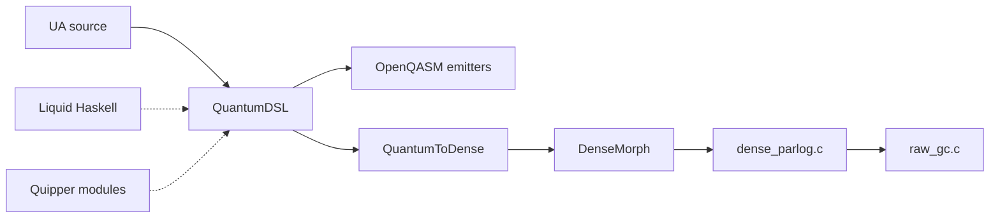
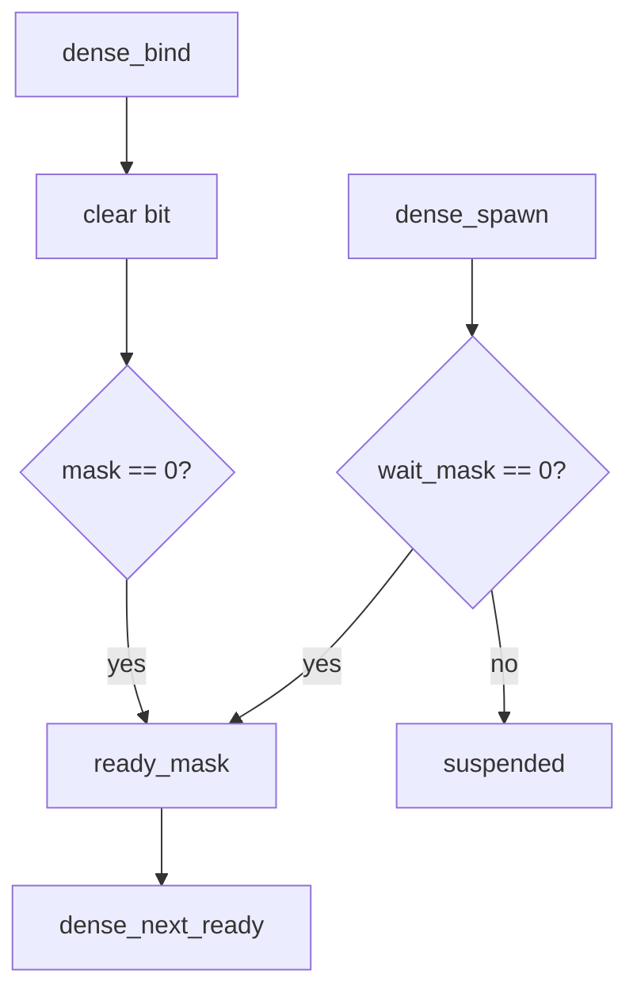

# Ahmad's Plumbline

**Technical abstract.**  
Ahmads-Plumbline assembles a dense committed-choice parallel-logic runtime, a symbolic quantum-circuit DSL with OpenQASM 3.0 emitters, and distance-3/5 quantum error-correction circuit templates. The logic runtime is a fixed-size arena of 64-bit tagged words with bit-mask suspension and ready queues (`cbits/dense_parlog.c`). A separate raw mark-sweep heap (`cbits/raw_gc.{h,c}`) provides an independent term representation. Liquid Haskell modules encode two refinement properties: a simplified concurrence for a Bell state produced by CNOT, and a Landauer work-budget identity. Quipper modules construct a two-qubit CNOT Bell pair and a simplified coherent-demon cycle. ATS modules supply indexed affine and linear stacks. The repository does not contain a machine-checked proof of fault tolerance or a production PARLOG engine; it contains the data structures, circuit emitters, and refinement annotations described below.

**Maintainers.** Ahmad Ali Parr, Jessica Westerhoff, SnapKitty Research Lab.  
**Copyright.** 2026 SnapKittyWest. Ahmad Ali Parr, Bel Esprit D'Accord Irrevocable Trust.  
**Dual license.** SNAPKITTY OPAQUE SOURCE LICENSE v1.0 **or** GNU Affero General Public License v3.0. See [LICENSE](LICENSE).

## Contents

1. [System Purpose and Computational Model](#2-system-purpose-and-computational-model)
2. [Mathematical Foundations](#3-mathematical-foundations)
3. [Architecture and System Boundaries](#4-architecture-and-system-boundaries)
4. [Repository Directory Tree](#5-repository-directory-tree)
5. [Complete File Inventory and Topic Index](#6-complete-file-inventory-and-topic-index)
6. [Parallel Logic Programming and PARLOG Semantics](#7-parallel-logic-programming-and-parlog-semantics)
7. [Curry, Haskell, and Foreign-Function Integration](#8-curry-haskell-and-foreign-function-integration)
8. [ATS Affine and Linear Resource Model](#9-ats-affine-and-linear-resource-model)
9. [Dense Runtime and Memory Management](#10-dense-runtime-and-memory-management)
10. [Boyer–Moore Search Implementation](#11-boyermoore-search-implementation)
11. [Quantum DSL and Circuit Representation](#12-quantum-dsl-and-circuit-representation)
12. [Quantum Error Correction Circuits](#13-quantum-error-correction-circuits)
13. [Quipper Circuit Construction](#14-quipper-circuit-construction)
14. [Scala and Qiskit Transpilation](#15-scala-and-qiskit-transpilation)
15. [LiquidHaskell Refinement Proofs](#16-liquidhaskell-refinement-proofs)
16. [Theorem and Lemma Reference](#17-theorem-and-lemma-reference)
17. [Lisp Reactive Computation](#18-lisp-reactive-computation)
18. [SGML, DTD, and Structured Representations](#19-sgml-dtd-and-structured-representations)
19. [UA Source Module](#20-ua-source-module)
20. [Compiler and Data Transformation Pipeline](#21-compiler-and-data-transformation-pipeline)
21. [Function and Core Block Reference](#22-function-and-core-block-reference)
22. [Module Dependency Tables](#23-module-dependency-tables)
23. [Runtime and Memory Invariants](#24-runtime-and-memory-invariants)
24. [Algorithmic Complexity and Resource Bounds](#25-algorithmic-complexity-and-resource-bounds)
25. [Build System and Dependencies](#26-build-system-and-dependencies)
26. [Installation and Reproducible Development Environment](#27-installation-and-reproducible-development-environment)
27. [Program Invocation and Usage](#28-program-invocation-and-usage)
28. [Verification and Testing Procedures](#29-verification-and-testing-procedures)
29. [Cross-Language Contract Matrix](#30-cross-language-contract-matrix)
30. [Architecture Diagrams](#31-architecture-diagrams)
31. [Mathematical Notation Reference](#32-mathematical-notation-reference)
32. [License](#33-license)
33. [Source Navigation Index](#34-source-navigation-index)

---

## 2. System Purpose and Computational Model

The repository combines three computational models.

1. **Committed-choice AND-parallel logic (PARLOG-style subset).**  
   Goals carry input-mode masks. A goal suspends when an input argument is an unbound logic variable. Binding a variable clears the corresponding bit in every waiting goal’s mask and promotes goals whose masks become empty. The implemented subset uses a 64-slot goal array and 64-bit masks (`MAX_GOALS = 64` in `cbits/dense_parlog.c`).

2. **Symbolic quantum circuits.**  
   `src/QuantumDSL.hs` defines an AST of gates and lowers four blocks of the UA source (`src/UA/uiee.ua`) into named circuits. Emitters produce OpenQASM 3.0, including Steane and Surface-17 wrappers.

3. **Refinement-typed arithmetic.**  
   Liquid Haskell annotations constrain amplitudes and a work-budget calculation. These are refinement predicates, not full equational proofs.

The dense runtime and the quantum emitters are independent. `src/QuantumToDense.hs` provides a one-way lowering of `QGate` nodes into dense goal slots.

---

## 3. Mathematical Foundations

**Dense term representation.**  
A `DWord` is a 64-bit word with a 3-bit tag in the low bits:

$$
w = (v \ll 3) \lor t,\qquad t \in \{0,1,2\}
$$

corresponding to `D_INT`, `D_VAR`, `D_UNBOUND`. Payload extraction is an arithmetic right shift by 3.

**Suspension mask.**  
For a goal $g$ and variable index $v < 64$,

$$
v \in \texttt{wait\_mask}(g) \iff \text{the input-mode argument at } v \text{ is unbound}.
$$

Binding variable $v$ executes

$$
\texttt{wait\_mask}(g) \leftarrow \texttt{wait\_mask}(g) \land \lnot(1 \ll v)
$$

for every waiting goal, then promotes $g$ if the mask becomes zero.

**Simplified concurrence (UA `CalcDeg`).**  
For amplitudes $a_{00}, a_{01}, a_{10}, a_{11}$,

$$
C = 2 \bigl| a_{00} a_{11} - a_{01} a_{10} \bigr|.
$$

`Liquid.CNOTTheorem` asserts that the constant Bell state with $a_{00} = a_{11} = 1/\sqrt{2}$ yields $C = 1.0$.

**Landauer work budget.**  
With $k_B T \ln 2$ the Landauer energy, the arithmetic in `Liquid.WorkBudget.coherentDemonWorkPerBit` yields

$$
W_{\text{net incl prep}} = -2\, k_B T \ln 2
$$

under the sign conventions of that module.

**QEC resource counts (source-derived).**

| Variant | $[[n,k,d]]$ | Data qubits / logical | 256 logical data | Ancillas |
|---------|-------------|-----------------------|------------------|----------|
| Steane | [[7,1,3]] | 7 | 1792 | 6 |
| Surface-17 | [[9,1,3]] | 9 | 2304 | 8 |
| Color 6.6.6 $d=3$ | [[7,1,3]] | 7 | 1792 | (flag) |
| Color 4.8.8 $d=5$ | [[17,1,5]] | 17 | 4352 | (flag) |

Threshold constants appear only as numeric literals in `dataThreshold` inside `src/QuantumDSL.hs`.

---

## 4. Architecture and System Boundaries


```text
UA source (uiee.ua)
        |
        v
QuantumDSL.hs  --> OpenQASM 3.0 emitters --> qasm/*.qasm
        |
        v
QuantumToDense.hs --> DenseMorph.hs --> dense_parlog.c (arena + masks)
                                         |
                                         +-- dense_steane_decode
                                         +-- (independent) raw_gc.c
Liquid Haskell --> refinement predicates (no runtime link)
Quipper modules --> circuit sketches (external Quipper dependency)
Scala QiskitTranspiler.scala --> pure-Scala QASM header processor
```

### Dense ready-mask wave

Rule: at time $t$, slot $i$ is marked if bit $((i+t)\bmod 16)$ is set; character density follows a sine envelope.

```text
  dense ready-mask  (16 slots, sine envelope)
  t\i 0123456789012345
 0  *........%%%#+:.
 1  ........#%%#+-.
 2  .......#%%%*=: .
 3  ......*%%%*=: ..
 4  .....*%%%#+-....
 5  ....+#%%#*-.....
 6  ...+#%%%*=:.....
 7  ..=*%%%#+-......
 8  .-+#%%#+-.......
 9  -+#%%%*=........
10  =*%%%#+........%
11  *#%%#+........%%
12  #%%%*........%%%
13  %%%*........#%%#
  ready bits travel left-to-right; density ~ sin
  rule: bit((i+t) mod 16) and sine envelope
```

---

## 5. Repository Directory Tree

```text
ahmads-plumbline/
├── LICENSE
├── LICENSE-AGPL-3.0.txt
├── README.md
├── ahmads-plumbline.cabal
├── cabal.project
├── app/Main.hs
├── ats/
│   ├── affine_stack.dats
│   ├── linear_proofs.dats
│   └── linear_proofs.sats
├── cbits/
│   ├── boyer_moore.c
│   ├── dense_parlog.c
│   ├── raw_gc.c
│   └── raw_gc.h
├── docs/svg/
│   ├── qubit-entanglement.svg
│   └── wormhole-geometry.svg
├── nix/flake.nix
├── qasm/
│   ├── manifold_colorcode_qec.qasm
│   ├── manifold_steane_qec.qasm
│   └── manifold_surface17_qec.qasm
├── scala/QiskitTranspiler.scala
└── src/
    ├── AhmadsPlumbline/DemonHole.hs
    ├── DenseFFI.curry
    ├── DenseMorph.hs
    ├── DenseParlog.curry
    ├── External_DenseFFI.hs
    ├── Franz/
    │   ├── proof-popped.txt
    │   └── qa5-reactive.lisp
    ├── LinearSGML.hs
    ├── Liquid/
    │   ├── CNOTTheorem.hs
    │   └── WorkBudget.hs
    ├── Main.hs
    ├── Parlog/parlog.dtd
    ├── QuantumDSL.hs
    ├── QuantumToDense.hs
    ├── Quipper/
    │   ├── CNOTEntangle.hs
    │   └── DemonCycle.hs
    └── UA/uiee.ua
```

---

## 6. Complete File Inventory and Topic Index

| File path | Language / format | Mathematical topic | Primary symbols | Core responsibility | Related modules |
|-----------|-------------------|--------------------|-----------------|---------------------|-----------------|
| `LICENSE` | text | licensing | — | Dual license text | — |
| `LICENSE-AGPL-3.0.txt` | text | licensing | — | AGPLv3 text | — |
| `README.md` | Markdown | navigation | — | This document | — |
| `ahmads-plumbline.cabal` | Cabal | build | library, executable | Package definition | `nix/flake.nix` |
| `app/Main.hs` | Haskell | entry point | `main` | Cabal executable entry | library |
| `ats/affine_stack.dats` | ATS | affine length | `aff_stack`, `aff_push` | Indexed affine stack | `ats/linear_proofs.*` |
| `ats/linear_proofs.dats` | ATS | linear resources | `lin_stack`, `lin_goal` | Linear stack, arena, goal | `linear_proofs.sats` |
| `ats/linear_proofs.sats` | ATS | interface | declarations | Static signatures | `linear_proofs.dats` |
| `cabal.project` | Cabal | project | — | Project configuration | cabal file |
| `cbits/boyer_moore.c` | C | string search | `bm_search_raw` | Boyer–Moore on raw bytes | `LinearSGML.hs` |
| `cbits/dense_parlog.c` | C | dense scheduling | `dense_bind`, `dense_next_ready` | Arena, masks, Steane decoder | `DenseMorph.hs` |
| `cbits/raw_gc.c` | C | mark-sweep | `gc_alloc`, `gc_collect` | Independent term heap | `raw_gc.h` |
| `cbits/raw_gc.h` | C header | interface | `Term`, accessors | Term type and contracts | `raw_gc.c` |
| `nix/flake.nix` | Nix | reproducibility | `callCabal2nix` | Dev shell and package | cabal file |
| `qasm/manifold_colorcode_qec.qasm` | OpenQASM 3.0 | color codes | `rx_color488`, flagged plaquette | Gate library | `QuantumDSL.hs` |
| `qasm/manifold_steane_qec.qasm` | OpenQASM 3.0 | Steane [[7,1,3]] | `steane_encode`, `rx_logical` | 1792-qubit manifold | `QuantumDSL.hs` |
| `qasm/manifold_surface17_qec.qasm` | OpenQASM 3.0 | Surface-17 | `rx_surface17`, `surface17_qec` | 2304-qubit manifold | `QuantumDSL.hs` |
| `scala/QiskitTranspiler.scala` | Scala | QASM processing | `transpile` | Pure-Scala header processor | — |
| `src/AhmadsPlumbline/DemonHole.hs` | Haskell/Quipper | wormhole transfer | `ahmad_plumbline_udh` | Demon’s Hole U_DH circuit | Quipper |
| `src/DenseFFI.curry` | Curry | FFI | external decls | Curry external declarations | `External_DenseFFI.hs` |
| `src/DenseMorph.hs` | Haskell | lowering | `morphGoalsDense` | Linear morph into dense slots | `dense_parlog.c` |
| `src/DenseParlog.curry` | Curry | logic | dense words | Curry dense-word sketch | — |
| `src/External_DenseFFI.hs` | Haskell | KiCS2 glue | `external_d_C_*` | External wrappers | `DenseFFI.curry` |
| `src/Franz/proof-popped.txt` | text | proof trace | — | Recorded QA5 output | `qa5-reactive.lisp` |
| `src/Franz/qa5-reactive.lisp` | Lisp | reactive resolution | — | Franz Lisp sketch | — |
| `src/LinearSGML.hs` | Haskell | linear buffers | `LinBuf`, `bmScanLinear` | LinearTypes Boyer–Moore wrapper | `boyer_moore.c` |
| `src/Liquid/CNOTTheorem.hs` | Liquid Haskell | concurrence | `theorem_cnot_entangle` | Bell-state refinement | `UA/uiee.ua` |
| `src/Liquid/WorkBudget.hs` | Liquid Haskell | work budget | `netIsNegativeTwo` | Landauer identity refinement | — |
| `src/Main.hs` | Haskell | orchestration | `main` | Library-level demo | — |
| `src/Parlog/parlog.dtd` | DTD | grammar | `program`, `clause` | PARLOG document structure | — |
| `src/QuantumDSL.hs` | Haskell | quantum AST | `QGate`, `toOpenQASM3` | DSL, lowerer, emitters | `qasm/` |
| `src/QuantumToDense.hs` | Haskell | lowering | `gatesToGoals` | QGate → dense goals | `DenseMorph.hs` |
| `src/Quipper/CNOTEntangle.hs` | Haskell/Quipper | CNOT | `bellFromPlus` | Bell-pair circuit | — |
| `src/Quipper/DemonCycle.hs` | Haskell/Quipper | cycle | `demonCycle` | Coherent-demon sketch | — |
| `src/UA/uiee.ua` | UA | source | `CalcDeg`, `CNOT` | UA pipeline and QASM/Q# blocks | `QuantumDSL.hs` |

---

## 7. Parallel Logic Programming and PARLOG Semantics

**Implemented subset** (`cbits/dense_parlog.c`).

- Fixed arena of `MAX_TERMS = 65536` tagged words.
- Fixed array of `MAX_GOALS = 64` `GoalSlot`s.
- Two bit masks: `active_mask` and `ready_mask`.
- `dense_spawn` computes the initial wait mask by dereferencing input-mode arguments and setting bits for unbound variables whose indices are $< 64$.
- `dense_bind` clears one variable bit across all waiting goals and promotes those whose masks become zero.
- `dense_next_ready` returns the lowest set bit of `ready_mask` in $O(1)$ via `__builtin_ctzll`.

**Not implemented.**  
OR-parallel search, full unification with occurs-check, trail, committed-choice clause selection, and general message passing are absent.

**Operational step (bind).**  
Given variable index $v < 64$ and value index $u$:

1. Store `D_VAR` pointing to $u$ at `term_arena[v]`.
2. Let $W = \texttt{active\_mask} \land \lnot\texttt{ready\_mask}$.
3. For each set bit $g$ in $W$: clear bit $v$ in `goals[g].wait_mask`; if the result is zero, set bit $g$ in `ready_mask`.

---

## 8. Curry, Haskell, and Foreign-Function Integration

| Origin | Destination | Symbol | Representation | Ownership |
|--------|-------------|--------|----------------|-----------|
| Haskell `DenseMorph` | C `dense_parlog.c` | `dense_alloc_var`, `dense_spawn`, `dense_bind`, `dense_next_ready` | `Word32` indices | C static arena |
| Curry `DenseFFI` | Haskell `External_DenseFFI` | `cDenseAllocVar`, … | KiCS2 `C_IO` wrappers | Same C arena |
| Haskell `LinearSGML` | C `boyer_moore.c` | `bm_search_raw` | raw pointers | Linear via `LinBuf` |

---

## 9. ATS Affine and Linear Resource Model

`ats/affine_stack.dats` defines an indexed dataviewtype `aff_stack(n)` with `aff_push`, `aff_pop`, and `aff_drop`.  
`ats/linear_proofs.dats` defines strict linear variants:

- `lin_stack(n)` — length-indexed linear stack.
- `lin_arena(cap)` — linear arena index.
- `lin_goal(ready: bool)` — linear goal slot.
- `theorem_push_pop` — encodes that push-then-pop restores length.
- `linear_pipeline` — consumes every linear value exactly once.

These files are not linked into the Cabal build. `nix/flake.nix` lists `ats2` for optional compilation with `patscc`.

---

## 10. Dense Runtime and Memory Management

**Dense arena** (`cbits/dense_parlog.c`).  
Static arrays; no dynamic allocation. Indices are plain `uint32_t`. Dereference follows `D_VAR` chains.

**Raw GC** (`cbits/raw_gc.{h,c}`).  
`Term` is a tagged union (`TAG_INT`, `TAG_VAR`, `TAG_CONS`) with a mark bit and an allocation-list pointer. `gc_alloc` allocates and links; `gc_collect` performs a mark-sweep from the root stack. Field accessors avoid Haskell `Storable` offset arithmetic.

The two heaps are independent.

---

## 11. Boyer–Moore Search Implementation

`cbits/boyer_moore.c` implements `bm_search_raw` over raw `uint8_t` buffers using bad-character and good-suffix tables.  
`src/LinearSGML.hs` wraps the call in a `LinBuf` linear type so that the buffers are consumed exactly once under GHC `LinearTypes`.

---

## 12. Quantum DSL and Circuit Representation

`src/QuantumDSL.hs` defines:

- `Expr` — numeric, variable, and arithmetic nodes.
- `QGate` — `QInit`, `QH`, `QRX`/`QRY`/`QRZ`, `QCNOT`, `QCond`, `QMeas`, `QReset`, `QLoop`, `QWhile`.
- `QCircuit` — name, qubit count, gate list.
- `lowerToCircuits` — partitions a UA source string into four sections and emits four concrete circuits:
  - `Pipeline_Entangle_Collapse` (2 qubits)
  - `Fibonacci_Cantor_Phase_Oracle` (4 qubits)
  - `QASM_Manifold_256` (256 qubits)
  - `QSharp_ManifoldGreedyStep` (256 qubits)
- `toOpenQASM3` / `unrollGate` — emit valid OpenQASM 3.0.
- Steane and Surface-17 emitters.
- `QECVariant`, `checkThreshold`, and `emitVariantGate`.

---

## 13. Quantum Error Correction Circuits


### Steane [[7,1,3]] (`qasm/manifold_steane_qec.qasm`)

- **Registers.** `qubit[1792] q` (256 logical × 7), `qubit[6] anc` (reusable), `bit[6] syn`, `input float[64] theta`.
- **Encoding.** `steane_encode` applies H on data[0,1,3] then nine CNOTs to prepare $|0\rangle_L$ on each 7-qubit block.
- **Logical RX.** `rx_logical(angle)` implements the weight-3 operator $X_L = X_0 X_1 X_2$ by conjugating an RX on data[0].
- **Logical CNOT.** `cx_logical` is transversal: seven parallel physical CNOTs.
- **Syndrome extraction.** `steane_qec` measures three Z-stabilizers (detect X errors) and three X-stabilizers (detect Z errors). The 3-bit syndromes are packed into `err_x` and `err_z` (1-based indices 1..7). A single X or Z correction is applied if the syndrome is nonzero.
- **Schedule.** All 256 blocks are encoded, then each logical qubit receives `rx_logical(theta * (i+1))`, a transversal CNOT from the previous logical qubit (when $i>0$), and a QEC round.
- **Decoder.** `cbits/dense_parlog.c` supplies `dense_steane_decode` which maps a 6-bit syndrome to packed `(err_x << 32) | err_z` in $O(1)$.

### Surface-17 (`qasm/manifold_surface17_qec.qasm`)

- **Registers.** `qubit[2304] q` (256 × 9), `qubit[8] anc`, `bit[8] syn`.
- **Logical operators.** Weight-3 $X_L = X_0 X_3 X_6$. Transversal CNOT across the 3×3 patch.
- **Syndrome.** Four Z-plaquettes and four X-plaquettes. Recovery is a hard-coded lookup for weight-1 errors.
- **Schedule.** Initialize all patches, then apply `rx_surface17`, transversal CNOT, and `surface17_qec` per logical qubit.

### Color codes (`qasm/manifold_colorcode_qec.qasm`)

- **6.6.6 [[7,1,3]].** Transversal H, S, CNOT. Flagged weight-4 plaquette measurement to catch hook errors.
- **4.8.8 [[17,1,5]].** `rx_color488` is transversal H, a weight-5 $Z_L$ parity gadget on the boundary {0,1,2,3,4}, then transversal H. Transversal CNOT across 17 data qubits.
- These are gate libraries; no full 256-logical unrolled circuit is emitted.

These files are circuit templates. They do not contain noise simulation or a verified fault-tolerance proof.

---

## 14. Quipper Circuit Construction

`src/Quipper/CNOTEntangle.hs`  
`bellFromPlus` prepares $|+\rangle|0\rangle$ and applies CNOT.  
`measureBell` measures both qubits.

`src/Quipper/DemonCycle.hs`  
`prepareCoherent` applies Hadamard to an $n$-qubit register.  
`demonCycle` composes preparation and a controlled-NOT sequence into a battery register.

Both modules require the external `quipper` package declared in the Cabal file.

---

## 15. Scala and Qiskit Transpilation

`scala/QiskitTranspiler.scala` is a pure-Scala program. It:

- Parses the first `qubit[N]` declaration.
- Counts lines that look like `h`, `rx`, `ry`, `rz`, `cx`, or `measure`.
- Optionally substitutes the token `theta` by a numeric literal.
- Writes a cleaned OpenQASM 3.0 file with a comment recording the requested topology and optimization level.

It does not perform basis rewriting, layout, or routing.

---

## 16. LiquidHaskell Refinement Proofs

**`Liquid.CNOTTheorem`**

| Field | Content |
|-------|---------|
| Property | `theorem_cnot_entangle` |
| Path | `src/Liquid/CNOTTheorem.hs` |
| Statement | `calcDeg bellPlus == 1.0` |
| Assumptions | Constant amplitudes $1/\sqrt{2}, 0, 0, 1/\sqrt{2}$ |
| Conclusion | Boolean refinement `v == True` |
| Method | Direct equality on `Double` |
| Status | Annotation present; Liquid Haskell run not recorded |

**`Liquid.WorkBudget`**

| Field | Content |
|-------|---------|
| Property | `netIsNegativeTwo` |
| Path | `src/Liquid/WorkBudget.hs` |
| Statement | `netInclPrep b == -2.0 * landauerLimit b` |
| Method | Direct equality after the arithmetic in `coherentDemonWorkPerBit` |
| Status | Annotation present; no recorded Liquid Haskell check |

Both files request `--reflection` and `--ple`. No proof transcript is stored.

---

## 17. Theorem and Lemma Reference

Only the two Liquid annotations above exist as named properties. No other lemmas, Hoare triples, or proof terms appear in the source.

---

## 18. Lisp Reactive Computation

`src/Franz/qa5-reactive.lisp` is a short Franz Lisp sketch of a reactive resolution engine.  
`src/Franz/proof-popped.txt` is the recorded text output of a Socrates-mortality query; it is not source code.

---

## 19. SGML, DTD, and Structured Representations

`src/Parlog/parlog.dtd` defines the element content models for a PARLOG program: `program` → `mode*` `clause+`, `clause` → `head` optional `guard` `body`, and `arg` direction attributes `in|out`.  
`src/LinearSGML.hs` provides linear buffer types used with the Boyer–Moore scanner; it does not implement a full SGML parser.

---

## 20. UA Source Module

`src/UA/uiee.ua` contains:

- A 4-element initial state and the CNOT matrix.
- `CalcDeg` implementing the concurrence formula above.
- A Fibonacci substitution and spectral sonification block.
- A 256-qubit QASM-like `manifold_step` loop and a Q# `ManifoldGreedyStep` operation.

These blocks are the inputs that `lowerToCircuits` pattern-matches.

---

## 21. Compiler and Data Transformation Pipeline

1. UA text → `lowerToCircuits` → `[QCircuit]`.
2. `toOpenQASM3` / `toSteaneQASM` / `toSurface17QASM` → OpenQASM 3.0 text.
3. `QuantumToDense.gatesToGoals` → list of `(predId, args, inMask)`.
4. `DenseMorph.morphGoalsDense` → `dense_spawn` calls into the C arena.
5. Optional: `scala/QiskitTranspiler` post-processes the emitted QASM.

No optimization or noise-aware compilation is performed.

---

## 22. Function and Core Block Reference

| Symbol | File | Language | Role |
|--------|------|----------|------|
| `dense_alloc_var` | `cbits/dense_parlog.c` | C | Allocate unbound word |
| `dense_spawn` | same | C | Fill `GoalSlot`, set masks |
| `dense_bind` | same | C | Bind variable, wake goals |
| `dense_next_ready` | same | C | $O(1)$ ready pop |
| `dense_steane_decode` | same | C | 6-bit syndrome → packed error indices |
| `gc_alloc` / `gc_collect` | `cbits/raw_gc.c` | C | Mark-sweep heap |
| `bm_search_raw` | `cbits/boyer_moore.c` | C | Boyer–Moore on raw bytes |
| `morphGoalsDense` | `src/DenseMorph.hs` | Haskell | Linear fold into `dense_spawn` |
| `lowerToCircuits` | `src/QuantumDSL.hs` | Haskell | UA sections → `QCircuit` |
| `toOpenQASM3` | same | Haskell | `QCircuit` → OpenQASM 3.0 string |
| `checkThreshold` | same | Haskell | Compare $p$ with stored $p_{\mathrm{th}}$ |
| `bellFromPlus` | `src/Quipper/CNOTEntangle.hs` | Haskell/Quipper | Prepare and CNOT |
| `coherentDemonWorkPerBit` | `src/Liquid/WorkBudget.hs` | Haskell | Fill `WorkBudget` record |
| `lin_push` / `lin_pop` | `ats/linear_proofs.dats` | ATS | Length-indexed linear stack |

---

## 23. Module Dependency Tables

**Cabal library exposed modules**  
`Liquid.WorkBudget`, `Liquid.CNOTTheorem`, `Quipper.DemonCycle`, `Quipper.CNOTEntangle`, `QuantumDSL`, `QuantumToDense`, `DenseMorph`.

**C sources linked**  
`cbits/raw_gc.c`, `cbits/boyer_moore.c`, `cbits/dense_parlog.c`.

**External package dependencies declared**  
`base`, `containers`, `liquidhaskell`, `quipper`.

---

## 24. Runtime and Memory Invariants

- Dense arena indices remain $< \texttt{MAX_TERMS}$.
- Goal slots used by `dense_spawn` must be $< 64$.
- Variable indices used in masks must be $< 64$; larger indices are ignored by the mask logic.
- `ready_mask` is always a subset of `active_mask` after every public operation.
- Raw GC roots must be pushed before allocation that should survive collection.

These are coding invariants; they are not statically enforced.

---

## 25. Algorithmic Complexity and Resource Bounds

- `dense_next_ready`: $O(1)$.
- `dense_bind`: $O(w)$ where $w$ is the number of currently waiting goals.
- Dense arena: fixed 64 goals, 65536 terms.
- Steane manifold: 1792 data + 6 ancilla qubits.
- Surface-17 manifold: 2304 data + 8 ancilla qubits.
- Boyer–Moore: classic $O(n+m)$ search after table construction (no measured timings).

---

## 26. Build System and Dependencies

`ahmads-plumbline.cabal` defines a library and an executable.  
`nix/flake.nix` uses `callCabal2nix` and provides a dev shell with `cabal-install`, `haskell-language-server`, `gcc`, `gdb`, `ats2`, and `opensp`.  
Liquid Haskell and Quipper must be available in the GHC package database; the flake does not pin them.

---

## 27. Installation and Reproducible Development Environment

```bash
nix develop
cabal build
```

Or, without Nix:

```bash
cabal build
```

ATS compilation (optional):

```bash
patscc -ccats ats/linear_proofs.dats
```

A successful Cabal build does not verify the ATS, Curry, Scala, QASM, Lisp, or Liquid Haskell files.

---

## 28. Program Invocation and Usage

The Cabal executable entry point is `app/Main.hs`.  
OpenQASM emission is performed by calling the functions in `QuantumDSL` from GHCi or from a user program:

```haskell
import QuantumDSL
mapM_ (putStrLn . toOpenQASM3) (lowerToCircuits uaSource)
```

Scala processor:

```bash
scalac scala/QiskitTranspiler.scala
scala plumbline.transpiler.QiskitTranspiler qasm/manifold_steane_qec.qasm out.qasm line 3 0.1
```

---

## 29. Verification and Testing Procedures

No test suite, Liquid Haskell transcript, or Qiskit simulation result is stored in the repository.  
The refinement annotations in `src/Liquid/` can be checked with a Liquid Haskell installation; success is not recorded here.  
The QASM files can be loaded by any OpenQASM 3.0 parser; no circuit-equivalence or noise-simulation result is present.

---

## 30. Cross-Language Contract Matrix

| From | To | Symbol | Contract |
|------|----|--------|----------|
| Haskell | C | `dense_*` | Indices are `Word32`; masks are `Word64`; arena is static |
| Curry | Haskell | `external` | KiCS2 `Cover`/`ConstStore` wrappers |
| Haskell | C | `bm_search_raw` | Raw pointers, linear ownership via `LinBuf` |
| ATS | (none) | `lin_stack` | Standalone; not linked |

---

## 31. Architecture Diagrams





---

## 32. Mathematical Notation Reference

| Symbol | Meaning in this repository |
|--------|----------------------------|
| $w = (v \ll 3) \lor t$ | Dense tagged word |
| $\texttt{wait\_mask}$ | Bit $v$ set ⇒ suspended on variable $v$ |
| $C = 2\lvert a_{00}a_{11}-a_{01}a_{10}\rvert$ | UA `CalcDeg` |
| $k_B T \ln 2$ | Landauer energy used in `WorkBudget` |
| $[[n,k,d]]$ | Stabilizer code parameters (documented counts only) |
| $X_L, Z_L$ | Logical Pauli operators as written in the QASM comments |

---

## 33. License

Dual-licensed under the SNAPKITTY OPAQUE SOURCE LICENSE v1.0 and the GNU Affero General Public License v3.0.  
Commercial use under the Opaque terms requires separate written authorization.  
Contact: A.parr@belespritdaccord.uk

See [LICENSE](LICENSE).

---

## 34. Source Navigation Index

- Dense runtime: `cbits/dense_parlog.c`
- Raw GC: `cbits/raw_gc.{h,c}`
- Quantum DSL: `src/QuantumDSL.hs`
- QASM circuits: `qasm/`
- Liquid refinements: `src/Liquid/`
- Quipper sketches: `src/Quipper/`
- UA source: `src/UA/uiee.ua`
- PARLOG DTD: `src/Parlog/parlog.dtd`
- Affine / linear stacks: `ats/`
- Scala processor: `scala/QiskitTranspiler.scala`
- Build: `ahmads-plumbline.cabal`, `nix/flake.nix`
