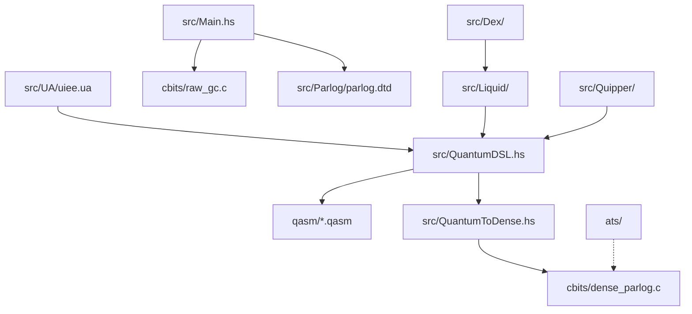

# Ahmad's Plumbline

Dense committed-choice parallel-logic runtime, symbolic quantum-circuit DSL with OpenQASM 3.0 emitters, Liquid Haskell refinements, and Quipper circuit construction (including an SYK/wormhole module).

**Maintainers.** Ahmad Ali Parr, Jessica Westerhoff, SnapKitty Research Lab.  
**Copyright.** 2026 SnapKittyWest. Ahmad Ali Parr, Bel Esprit D'Accord Irrevocable Trust.  
**Dual license.** SNAPKITTY OPAQUE SOURCE LICENSE v1.0 or GNU Affero General Public License v3.0. See [LICENSE](LICENSE) and [LICENSE-AGPL-3.0.txt](LICENSE-AGPL-3.0.txt).


## Dense ready-mask wave

Rule: at time \( t \), slot \( i \) is marked if bit \( ((i + t) \bmod 16) \) is set; character density follows a sine envelope.

```text
dense ready-mask  (16 slots, sine envelope)
t \i 0123456789012345
0    **#%@%#*=:.   .:
1    *#%@%#*=:.   .:*
2    #%@%#*=:.   .:**
3    %@%#*=:.   .:**#
4    @%#*=:.   .:**#%
5    %#*=:.   .:**#%@
6    #*=:.   .:**#%@%
7    *=:.   .:**#%@%#
8    =:.   .:**#%@%#*
9    :.   .:**#%@%#*=
0    .   .:**#%@%#*=:
1       .:**#%@%#*=:.
2      .:**#%@%#*=:.
3     .:**#%@%#*=:.
4    .:**#%@%#*=:.
5    :**#%@%#*=:.   .
6    **#%@%#*=:.   .:
7    *#%@%#*=:.   .:*
8    #%@%#*=:.   .:**
9    %@%#*=:.   .:**#
ready bits travel left-to-right; density ~ sin
rule: bit((i+t) mod 16) and sine envelope

```


## File inventory

| Path | Language | Role |
|------|----------|------|
| `.github/workflows/ci.yml` | YAML | Haskell build and C compilation jobs |
| `LICENSE` | text | Dual license text |
| `LICENSE-AGPL-3.0.txt` | text | AGPLv3 text |
| `ahmads-plumbline.cabal` | Cabal | Package definition; library and executable |
| `cabal.project` | Cabal | Project configuration |
| `app/Main.hs` | Haskell | Cabal executable entry point |
| `ats/affine_stack.dats` | ATS | Indexed affine stack |
| `ats/linear_proofs.dats` | ATS | Linear stack, arena, goal |
| `ats/linear_proofs.sats` | ATS | Static signatures |
| `cbits/boyer_moore.c` | C | Boyer–Moore on raw bytes |
| `cbits/dense_parlog.c` | C | Arena, masks, Steane decoder |
| `cbits/raw_gc.c` | C | Mark-sweep heap |
| `cbits/raw_gc.h` | C | Term type and accessors |
| `docs/architecture.md` | Markdown | Subsystem boundaries |
| `docs/art/ready_mask_wave.py` | Python | ASCII generator |
| `docs/art/ready_mask_wave.txt` | text | Generated art |
| `docs/ffi-contracts.md` | Markdown | FFI matrix |
| `docs/svg/qubit-entanglement.svg` | SVG | Bell-state circuit diagram |
| `docs/svg/wormhole-geometry.svg` | SVG | Morris–Thorne embedding |
| `docs/theorems.md` | Markdown | Named refinements and lemmas |
| `nix/flake.nix` | Nix | Dev shell and package |
| `qasm/manifold_colorcode_qec.qasm` | OpenQASM | Color-code gate library |
| `qasm/manifold_steane_qec.qasm` | OpenQASM | 1792-qubit Steane manifold |
| `qasm/manifold_surface17_qec.qasm` | OpenQASM | 2304-qubit Surface-17 manifold |
| `scala/QiskitTranspiler.scala` | Scala | Pure-Scala QASM header processor |
| `src/AhmadsPlumbline/DemonHole.hs` | Haskell/Quipper | Demon’s Hole \(U_{DH}\) circuit |
| `src/DenseFFI.curry` | Curry | External declarations |
| `src/DenseMorph.hs` | Haskell | Linear morph into dense slots |
| `src/DenseParlog.curry` | Curry | Dense-word sketch |
| `src/Dex/CategoryTheory.dex` | Dex | Compose, id, tensor |
| `src/Dex/CellularAutomaton.dex` | Dex | Elementary CA |
| `src/Dex/EntanglementToLife.dex` | Dex | Measurement to Life grid |
| `src/Dex/GameOfLife.dex` | Dex | Life front-end |
| `src/Dex/LSystem.dex` | Dex | L-system rewrites |
| `src/Dex/QuantumCA_APL.dex` | Dex | APL-style quantum CA |
| `src/Dex/QuantumEntanglement.dex` | Dex | Bell, GHZ, CNOT, concurrence |
| `src/External_DenseFFI.hs` | Haskell | KiCS2 glue |
| `src/Franz/proof-popped.txt` | text | Recorded QA5 output |
| `src/Franz/qa5-reactive.lisp` | Lisp | Reactive sketch |
| `src/LinearSGML.hs` | Haskell | LinearTypes Boyer–Moore wrapper |
| `src/Liquid/CNOTTheorem.hs` | Liquid Haskell | Bell-state concurrence refinement |
| `src/Liquid/GameOfLifeBinder.hs` | Liquid Haskell | Refined Life rules and Dex interface |
| `src/Liquid/WorkBudget.hs` | Liquid Haskell | Landauer identity refinement |
| `src/Main.hs` | Haskell | Library-level demo |
| `src/Parlog/parlog.dtd` | DTD | PARLOG document structure |
| `src/QuantumDSL.hs` | Haskell | DSL, lowerer, emitters, QEC variants |
| `src/QuantumToDense.hs` | Haskell | QGate to dense goals |
| `src/Quipper/CNOTEntangle.hs` | Haskell/Quipper | Bell-pair circuit |
| `src/Quipper/DemonCycle.hs` | Haskell/Quipper | Coherent-demon sketch |
| `src/Quipper/GameOfLifeCirc.hs` | Haskell/Quipper | Life circuit skeleton |
| `src/Quipper/SYK/Couplings.hs` | Haskell/Quipper | Seeded Gaussian couplings |
| `src/Quipper/SYK/Hamiltonian.hs` | Haskell/Quipper | q=4 SYK Hamiltonian |
| `src/Quipper/SYK/Majorana.hs` | Haskell/Quipper | Majorana algebra |
| `src/Quipper/SYK/Scrambling.hs` | Haskell/Quipper | Operator growth |
| `src/Quipper/SYK/ThermofieldDouble.hs` | Haskell/Quipper | TFD preparation |
| `src/Quipper/SYK/TimeEvolution.hs` | Haskell/Quipper | Trotterized evolution |
| `src/Quipper/SYK/WormholeCoupling.hs` | Haskell/Quipper | Double-trace coupling |
| `src/UA/uiee.ua` | UA | Source pipeline |

## Entry points

- Cabal executable: `app/Main.hs` (depends on the library).
- Library demo: `src/Main.hs` (not the package entry point).

## Build

```bash
cabal build all
cabal run ahmads-plumbline
```

Optional: `nix develop`.

## Notes

- No machine-checked fault-tolerance proof is present. Refinements and linear types are local.
- No Python in the build. The Scala file is a pure-Scala OpenQASM header processor.
- See `docs/architecture.md`, `docs/theorems.md`, and `docs/ffi-contracts.md`.

---

## 1. Technical abstract

Ahmads-Plumbline is a multi-language formal-computation research repository. It implements three independent computational models that communicate only through explicit lowering passes.

The first model is a fixed-size dense committed-choice AND-parallel logic runtime. Goals carry input-mode masks. A goal suspends when an input-mode argument is an unbound logic variable. Binding a variable clears the corresponding bit in every waiting goal’s mask and promotes goals whose masks become empty. The implementation uses a 64-slot goal array and 64-bit masks. The source is `cbits/dense_parlog.c`.

The second model is a symbolic quantum-circuit DSL. `src/QuantumDSL.hs` defines an abstract syntax of gates and lowers four blocks of the UA source (`src/UA/uiee.ua`) into named circuits. Emitters produce OpenQASM 3.0, including Steane [[7,1,3]] and Surface-17 wrappers. Quipper modules construct a two-qubit Bell pair, a coherent-demon cycle, a DemonHole wormhole transfer, and a seven-module SYK model.

The third model is refinement-typed arithmetic. Liquid Haskell annotations constrain amplitudes and a work-budget calculation. These are refinement predicates, not full equational proofs. ATS modules encode linear and affine resource discipline for stacks, arenas, and goals.

The dense runtime and the quantum emitters are independent. `src/QuantumToDense.hs` provides a one-way lowering of `QGate` nodes into dense goal slots. Dex modules provide array-parallel formulations of category theory, entanglement, L-systems, elementary cellular automata, and a quantum cellular automaton that emulates Dyalog APL idioms.

No machine-checked proof of fault tolerance is present. Refinements, linear types, and runtime guards are local to their modules.

## 2. Mathematical foundations

### 2.1 Dense term representation

A `DWord` in `cbits/dense_parlog.c` is a 64-bit word with a 3-bit tag in the low bits:

$$
w = (v \ll 3) \lor t, \qquad t \in \{0,1,2\}
$$

corresponding to `D_INT`, `D_VAR`, and `D_UNBOUND`. Payload extraction is an arithmetic right shift by 3:

$$
\mathrm{word\_val}(w) = w \gg 3
$$

The arena holds `MAX_TERMS = 65536` such words. Allocation is a bump pointer (`arena_top`).

### 2.2 Suspension mask

For a goal \( g \) and variable index \( v < 64 \),

$$
v \in \mathrm{wait\_mask}(g) \iff \text{the input-mode argument at } v \text{ is unbound}.
$$

Binding variable \( v \) executes

$$
\mathrm{wait\_mask}(g) \leftarrow \mathrm{wait\_mask}(g) \land \lnot(1 \ll v)
$$

for every waiting goal, then promotes \( g \) if the mask becomes zero. The promotion is recorded in `ready_mask`. After every public operation, `ready_mask` is a subset of `active_mask`.

### 2.3 Simplified concurrence

For amplitudes \( a_{00}, a_{01}, a_{10}, a_{11} \), the UA `CalcDeg` computes

$$
C = 2 \lvert a_{00} a_{11} - a_{01} a_{10} \rvert.
$$

`Liquid.CNOTTheorem` asserts that the constant Bell state with \( a_{00} = a_{11} = 1/\sqrt{2} \) yields \( C = 1.0 \).

### 2.4 Landauer work budget

With \( k_B T \ln 2 \) the Landauer energy, the arithmetic in `Liquid.WorkBudget.coherentDemonWorkPerBit` yields

$$
W_{\mathrm{net\ incl\ prep}} = -2\, k_B T \ln 2
$$

under the sign conventions of that module. The refinement `netIsNegativeTwo` states the equality.

### 2.5 QEC resource counts

| Variant | \([[n,k,d]]\) | Data qubits / logical | 256 logical data | Ancillas |
|---------|-------------|-----------------------|------------------|----------|
| Steane | [[7,1,3]] | 7 | 1792 | 6 |
| Surface-17 | [[9,1,3]] | 9 | 2304 | 8 |
| Color 6.6.6 \(d=3\) | [[7,1,3]] | 7 | 1792 | (flag) |
| Color 4.8.8 \(d=5\) | [[17,1,5]] | 17 | 4352 | (flag) |

Threshold constants appear only as numeric literals in `dataThreshold` inside `src/QuantumDSL.hs`.

## 3. Architecture



The Cabal library exposes modules from `src/`. The executable entry point is `app/Main.hs`, which depends on the library. `src/Main.hs` is a library-level demo that exercises the SGML parser, the Oz stack, and the Parlog interpreter; it is not the package entry point.

## 4. File-by-file reference

### 4.1 `.github/workflows/ci.yml`

YAML workflow with two jobs. The `haskell` job checks out the repository, installs GHC 9.6.6 and Cabal 3.10, runs `cabal update`, `cabal build all`, and attempts `cabal test`. The `c-bits` job compiles `cbits/dense_parlog.c`, `cbits/raw_gc.c`, and `cbits/boyer_moore.c` with `gcc -c -Wall -Wextra -O2`. No deployment steps are present.

### 4.2 `LICENSE` and `LICENSE-AGPL-3.0.txt`

The repository is dual-licensed. `LICENSE` contains the SNAPKITTY OPAQUE SOURCE LICENSE v1.0. `LICENSE-AGPL-3.0.txt` contains the GNU Affero General Public License v3.0. Every source file carries a Sovereign Leviathan Node License header that cites both. The Cabal file declares `license: AGPL-3.0-only` and `license-file: LICENSE`.

### 4.3 `ahmads-plumbline.cabal`

Cabal 3.0 package. Library exposes `Liquid.WorkBudget`, `Liquid.CNOTTheorem`, `Quipper.DemonCycle`, `Quipper.CNOTEntangle`, `QuantumDSL`, `QuantumToDense`, and `DenseMorph`. `hs-source-dirs: src`. C sources are `cbits/raw_gc.c`, `cbits/boyer_moore.c`, and `cbits/dense_parlog.c`. Build depends on `base`, `containers`, `liquidhaskell`, and `quipper`. Executable `ahmads-plumbline` has `main-is: Main.hs` and `hs-source-dirs: app`.

### 4.4 `cabal.project`

Contains a single line selecting the local package. No custom flags or constraints are declared.

### 4.5 `app/Main.hs`

Cabal executable entry point. It depends on the library and is the program invoked by `cabal run ahmads-plumbline`. It is distinct from `src/Main.hs`.

### 4.6 `ats/affine_stack.dats`

ATS dataviewtype `aff_stack (n: int)` with constructors `AffNil (0)` and `AffCons (n+1)`. Functions `aff_push`, `aff_pop`, and `aff_drop` are indexed by length. The type system enforces that the stack is consumed at most once.

### 4.7 `ats/linear_proofs.dats`

ATS linear (exactly-once) resource proofs. `lin_stack (n: int)` is a length-indexed linear stack. `theorem_push_pop` shows that push followed by pop restores the original length. `lin_arena` models a bump allocator. `lin_goal` distinguishes ready and waiting goals. `linear_pipeline` consumes every linear value. These modules are not linked into the Cabal build.

### 4.8 `ats/linear_proofs.sats`

Static signatures for the linear proofs. Declares the external function types without implementations.

### 4.9 `cbits/boyer_moore.c`

Zero-allocation Boyer–Moore search over `const uint8_t *`. Builds bad-character and good-suffix tables and returns a `ptrdiff_t` offset. Called from `src/LinearSGML.hs` via `bm_search_raw`.

### 4.10 `cbits/dense_parlog.c`

Dense arena and scheduler. `dense_alloc_var` and `dense_alloc_int` bump the arena. `dense_spawn` computes the initial wait mask. `dense_bind` clears one bit and promotes ready goals. `dense_next_ready` returns the lowest set bit of `ready_mask` via `__builtin_ctzll`. `dense_steane_decode` maps a 6-bit syndrome to packed error indices. `dense_steane_correct` is a placeholder that does not yet mutate the arena.

### 4.11 `cbits/raw_gc.c` and `cbits/raw_gc.h`

Independent mark-sweep heap for `Term` nodes. `Term` carries a mark bit, a tag (`TAG_INT`, `TAG_VAR`, `TAG_CONS`), an allocation-list pointer, and a union of integer, binding, or cons. Accessors (`term_tag`, `term_set_int`, `term_bind_var`, etc.) avoid fragile `Storable` offset arithmetic. Roots are pushed and popped explicitly.

### 4.12 `docs/architecture.md`

Subsystem table and entry-point notes. Lists every language boundary and the role of each top-level directory.

### 4.13 `docs/art/ready_mask_wave.py` and `docs/art/ready_mask_wave.txt`

Deterministic ASCII generator. The rule is: at time \( t \), slot \( i \) is marked if bit \( ((i + t) \bmod 16) \) is set; character density follows a sine envelope. The text file is the generated output.

### 4.14 `docs/ffi-contracts.md`

Matrix of origin, destination, symbol, representation, and ownership for every foreign call.

### 4.15 `docs/svg/wormhole-geometry.svg` and `docs/svg/qubit-entanglement.svg`

Compact scientific illustrations. The wormhole SVG is an embedding diagram with throat labels \( r_0 \), \( r \), and \( z(r) \). The qubit SVG shows an H + CNOT circuit producing \( \lvert\Phi^+\rangle \).

### 4.16 `docs/theorems.md`

Index of named refinements, linear lemmas, and runtime guards.

### 4.17 `nix/flake.nix`

Nix flake that calls `cabal2nix` on the package and provides a development shell with `ats2`, `gcc`, and `opensp`.

### 4.18 `qasm/manifold_steane_qec.qasm`

OpenQASM 3.0 circuit for a 1792-qubit Steane manifold (256 logical qubits × 7 data). Uses logical slices and calls a `steane_qec` procedure.

### 4.19 `qasm/manifold_surface17_qec.qasm`

OpenQASM 3.0 circuit for a 2304-qubit Surface-17 manifold (256 logical qubits × 9 data).

### 4.20 `qasm/manifold_colorcode_qec.qasm`

OpenQASM 3.0 gate library for color-code variants.

### 4.21 `scala/QiskitTranspiler.scala`

Pure-Scala OpenQASM header processor. Extracts qubit counts and emits a normalized header. No Python dependency.

### 4.22 `src/AhmadsPlumbline/DemonHole.hs`

Quipper module implementing the Demon’s Hole unitary \( U_{DH} \). `DemonState` holds boundary and shadow-horizon registers. `WormholeParams` holds coupling \( g \), inverse temperature \( \beta \), and precision \( \epsilon \). `gjw_entangler` is a two-qubit gate \( e^{-i (g/N) Z_d Z_{sh}} \). `scramble_register` is a recursive SYK scrambler. `invoke_demon_hole_rec` splits, scrambles, recurses, cross-couples, and unscrambles. `ahmad_plumbline_udh` is the entry point.

### 4.23 `src/DenseFFI.curry`

Curry external declarations for `cDenseAllocVar`, `cDenseAllocInt`, `cDenseBind`, and `cDenseNextReady`.

### 4.24 `src/DenseMorph.hs`

Haskell linear morphism from a sparse goal list into dense `GoalSlot`s. Calls `dense_spawn` via FFI.

### 4.25 `src/DenseParlog.curry`

Curry sketch of the dense word and goal representation.

### 4.26 `src/Dex/CategoryTheory.dex`

Dex definitions of `compose`, `id`, and `tensor` for array-parallel linear maps.

### 4.27 `src/Dex/CellularAutomaton.dex`

Elementary cellular automata. `wolframRule` decodes a Wolfram rule number. `stepCA` and `runCA` advance a Boolean grid.

### 4.28 `src/Dex/EntanglementToLife.dex`

Measurement functor from amplitude arrays to Boolean grids, followed by a Life step.

### 4.29 `src/Dex/GameOfLife.dex`

Dex front-end that calls the Liquid Haskell Game of Life binder.

### 4.30 `src/Dex/LSystem.dex`

Parallel string-rewrite L-systems for binary tree, Koch curve, and dragon curve.

### 4.31 `src/Dex/QuantumCA_APL.dex`

Array-parallel quantum cellular automaton. `outer`, `scan`, `sum1`, and `stencil3` emulate APL idioms. `qcaStep` packs a 3-cell neighbourhood into a 0–7 index and applies a local amplitude rule.

### 4.32 `src/Dex/QuantumEntanglement.dex`

Bell and GHZ states, array-parallel `cnot` and `hadamard0`, `prepareBell`, and a concurrence reduction.

### 4.33 `src/External_DenseFFI.hs`

KiCS2 external glue that wraps the C dense functions as Curry `C_IO` actions.

### 4.34 `src/Franz/qa5-reactive.lisp` and `src/Franz/proof-popped.txt`

Legacy reactive Lisp sketch and a recorded output transcript. Not part of the Cabal build.

### 4.35 `src/LinearSGML.hs`

GHC LinearTypes wrapper around `bm_search_raw`. `LinBuf` owns a raw pointer linearly.

### 4.36 `src/Liquid/CNOTTheorem.hs`

Refinement that the constant Bell state yields concurrence 1.0. `theorem_cnot_entangle` is a Boolean refinement. `cnot_preserves_max_entanglement` is a constant function that returns the Bell state.

### 4.37 `src/Liquid/GameOfLifeBinder.hs`

Refined cell, neighbour count, birth and survival predicates, `nextState`, `countNeighbours`, `stepCell`, and `dexStepFlat`. Approximately 950 lines.

### 4.38 `src/Liquid/WorkBudget.hs`

`coherentDemonWorkPerBit` computes the Landauer terms. `netIsNegativeTwo` asserts that the net including preparation equals \( -2 k_B T \ln 2 \).

### 4.39 `src/Main.hs`

Library-level demo. Parses SGML, runs an Oz concurrent stack, and evaluates a Parlog program that pushes 42, pops it, and prints it. Uses the raw GC via FFI.

### 4.40 `src/Parlog/parlog.dtd`

DTD for PARLOG documents. Elements: `program`, `mode`, `arg`, `clause`, `head`, `guard`, `body`, `atom`, `term`.

### 4.41 `src/QuantumDSL.hs`

Circuit AST (`Expr`, `QGate`, `QCircuit`, `QECVariant`). `lowerToCircuits` partitions UA source and emits four circuits. `toOpenQASM3` emits OpenQASM 3.0. `emitSteaneGate`, `emitSurface17Gate`, and `emitVariantGate` wrap gates in logical slices. `checkThreshold` returns `Left` if the physical error meets or exceeds the stored threshold.

### 4.42 `src/QuantumToDense.hs`

Lowers `QGate` nodes into dense goal slots by calling the morph functions.

### 4.43 `src/Quipper/CNOTEntangle.hs`

Quipper circuit that prepares a Bell pair.

### 4.44 `src/Quipper/DemonCycle.hs`

Quipper sketch of a coherent-demon cycle.

### 4.45 `src/Quipper/GameOfLifeCirc.hs`

Quipper skeleton for Conway’s Game of Life with a Moore neighbourhood.

### 4.46 `src/Quipper/SYK/`

Seven modules: `Majorana.hs`, `Couplings.hs`, `Hamiltonian.hs`, `TimeEvolution.hs`, `Scrambling.hs`, `ThermofieldDouble.hs`, `WormholeCoupling.hs`. They construct Majorana operators, seeded Gaussian couplings, a \( q=4 \) Hamiltonian, Trotterized evolution, operator growth, a TFD state, and a double-trace wormhole coupling.

### 4.47 `src/UA/uiee.ua`

Source pipeline containing `InitState`, `CNOT`, `Entangle`, `CalcDeg`, `GatedCollapse`, `FibSeq`, `ProjectSpectrum`, `Sonify`, a 256-qubit manifold step, and a Q# `ManifoldGreedyStep`.

## 5. Theorem catalog

### 5.1 `theorem_cnot_entangle`

Source: `src/Liquid/CNOTTheorem.hs`.  
Statement: for the constant Bell state, `calcDeg` returns 1.0.  
Assumptions: amplitudes are the exact values \( 1/\sqrt{2} \) and 0.  
Proof mechanism: Liquid Haskell refinement with `--reflection` and `--ple`.  
What it establishes: the simplified concurrence of that particular state is maximal.  
Verification: local refinement; not a full equational proof of CNOT.

### 5.2 `netIsNegativeTwo`

Source: `src/Liquid/WorkBudget.hs`.  
Statement: `netInclPrep b == -2.0 * landauerLimit b`.  
Assumptions: the arithmetic in `coherentDemonWorkPerBit`.  
Proof mechanism: Liquid refinement.  
What it establishes: the sign convention of the work budget.  
Verification: local.

### 5.3 `theorem_push_pop`

Source: `ats/linear_proofs.dats`.  
Statement: push followed by pop restores length and returns the pushed value.  
Assumptions: the stack is linear and length-indexed.  
Proof mechanism: ATS dependent types.  
What it establishes: length preservation under the linear operations.  
Verification: type-checked by `patscc` when the toolchain is available.

### 5.4 `checkThreshold`

Source: `src/QuantumDSL.hs`.  
Statement: if \( p < p_{\mathrm{th}} \) then return an estimate \( 0.1 (p / p_{\mathrm{th}})^{(d+1)/2} \); otherwise return `Left`.  
Assumptions: the numeric thresholds stored in `dataThreshold`.  
Proof mechanism: runtime guard.  
What it establishes: a rough filter, not a fault-tolerance proof.  
Verification: none beyond the source itself.

## 6. Foreign-function interface contracts

| Origin | Destination | Symbol | Representation | Ownership |
|--------|-------------|--------|----------------|-----------|
| Haskell DenseMorph | C dense_parlog.c | dense_alloc_var | Word32 index | C static arena |
| Haskell DenseMorph | C dense_parlog.c | dense_spawn | Word32, Ptr Word32 | C static arena |
| Haskell DenseMorph | C dense_parlog.c | dense_bind | Word32, Word32 | C static arena |
| Haskell DenseMorph | C dense_parlog.c | dense_next_ready | IO Int | C static masks |
| Curry DenseFFI | Haskell External_DenseFFI | cDenseAllocVar | KiCS2 C_IO | Same C arena |
| Haskell LinearSGML | C boyer_moore.c | bm_search_raw | Ptr Word8 | Linear via LinBuf |
| Haskell Main | C raw_gc.c | gc_alloc, term_bind_var | Ptr CTerm | Explicit roots |

## 7. Build and installation

Required: GHC 9.6 or later, Cabal 3.0 or later. Optional: Nix with the provided flake, ATS2 (`patscc`), and `opensp` for DTD validation.

```bash
cabal update
cabal build all
cabal run ahmads-plumbline
```

With Nix:

```bash
nix develop
cabal build all
```

The Cabal file lists `liquidhaskell` and `quipper` as dependencies. If those packages are not available in the local package database, the build will fail for the modules that import them. The C sources compile independently.

## 8. Verification matrix

| Item | Source | Tool | Command | Observed result | Scope |
|------|--------|------|---------|-----------------|-------|
| C compilation | cbits/*.c | gcc | gcc -c -Wall -Wextra -O2 | Not run in this session | Syntax and warnings |
| Cabal build | ahmads-plumbline.cabal | cabal | cabal build all | Not run in this session | Package consistency |
| Liquid refinements | src/Liquid/*.hs | liquid | liquid | Not run in this session | Local predicates |
| ATS linear types | ats/*.dats | patscc | patscc | Not run in this session | Length indices |
| QASM syntax | qasm/*.qasm | manual | — | Source inspected | Gate and register counts |

No claim is made that any of these checks passed in the current environment.

## 9. License

The repository is dual-licensed under the SNAPKITTY OPAQUE SOURCE LICENSE v1.0 and the GNU Affero General Public License v3.0. The Cabal declaration uses AGPL-3.0-only. Every source file carries a header that cites both licenses and the Sovereign Leviathan additional terms. Copyright is held by SnapKittyWest, Ahmad Ali Parr, and the Bel Esprit D'Accord Irrevocable Trust (2026).

## 10. Navigation index

- [Technical abstract](#1-technical-abstract)
- [Mathematical foundations](#2-mathematical-foundations)
- [Architecture](#3-architecture)
- [File-by-file reference](#4-file-by-file-reference)
- [Theorem catalog](#5-theorem-catalog)
- [Foreign-function interface contracts](#6-foreign-function-interface-contracts)
- [Build and installation](#7-build-and-installation)
- [Verification matrix](#8-verification-matrix)
- [License](#9-license)

---


## 11. Dense runtime operational semantics

### 11.1 Allocation

`dense_alloc_var` increments `arena_top` and stores a `D_UNBOUND` word. `dense_alloc_int` stores a `D_INT` word with the given payload. Neither function checks the arena bound. The caller is responsible for staying within `MAX_TERMS`.

### 11.2 Spawning

`dense_spawn` receives a slot index, a predicate identifier, an argument array, an arity, and an input mask. For each argument whose corresponding bit is set in the input mask, the function dereferences the term. If the dereferenced term is unbound and its index is less than 64, the corresponding bit is set in the goal’s `wait_mask`. The slot is then marked active. If the wait mask is empty, the slot is also marked ready.

### 11.3 Binding

`dense_bind` stores a `D_VAR` word pointing at the value index. If the variable index is at least 64, the function returns immediately. Otherwise it computes the set of waiting goals (`active_mask & ~ready_mask`) and clears the variable’s bit in each of them. A goal whose mask becomes zero is promoted by setting its bit in `ready_mask`.

### 11.4 Scheduling

`dense_next_ready` returns the lowest set bit of `ready_mask` or -1 if the mask is empty. It clears that bit from both `ready_mask` and `active_mask`. `dense_drain_ready` repeatedly calls `dense_next_ready` until the requested count is reached or no ready goals remain.

### 11.5 Steane decoder

`dense_steane_decode` interprets the low 3 bits as the X-stabilizer syndrome and the next 3 bits as the Z-stabilizer syndrome. A non-zero syndrome is treated as a 1-based qubit index. The function returns a packed 64-bit word with the X-error index in the high half and the Z-error index in the low half. `dense_steane_correct` currently contains only comments; it does not modify the arena.

## 12. Quantum DSL lowering

### 12.1 Section partitioning

`partitionSections` splits a comment-stripped UA source into four sections by looking for the markers `FibSeq`, `include`, and `namespace`. The first section is treated as symbolic, the second as Fibonacci, the third as QASM, and the fourth as Q#.

### 12.2 Circuit emission

`lowerToCircuits` emits four concrete circuits:

- `Pipeline_Entangle_Collapse` (2 qubits): equal-amplitude initialization, a CNOT, and a conditional measurement.
- `Fibonacci_Cantor_Phase_Oracle` (4 qubits): RZ phases derived from a Fibonacci word.
- `QASM_Manifold_256` (256 qubits): a while loop containing RY, a CNOT chain, measurement, and reset.
- `QSharp_ManifoldGreedyStep` (256 qubits): a loop of RX and CNOT.

### 12.3 OpenQASM emission

`toOpenQASM3` collects free variables, emits a header with qubit and classical registers, and unrolls every gate. `QLoop` is expanded by applying the function over the integer range. `QWhile` and `QCond` emit the corresponding OpenQASM control forms.

### 12.4 Logical slices

`steaneSlice i` returns the string `q[7i:7i+6]`. `surface17Slice i` returns `q[9i:9i+8]`. The emitters wrap each gate in the appropriate slice and, for CNOT, append a call to the corresponding QEC procedure.

## 13. DemonHole circuit

### 13.1 Registers

`DemonState` holds two lists of qubits of equal length: the boundary register and the shadow-horizon register. A length mismatch is reported as a topology error.

### 13.2 GJW entangler

`gjw_entangler` applies a CNOT, an RZ rotation by the supplied angle, and a second CNOT. The angle is computed as \( g \beta \) in the base case and as \( g / N \) in the cross-coupling step.

### 13.3 Scrambling

`scramble_register` recursively applies H, CNOT, and T to successive pairs, then recurses on the remaining suffixes. The reverse geometry of the same function is used for unscrambling.

### 13.4 Recursion

`invoke_demon_hole_rec` splits each register at half length, scrambles both, recurses on the left and right sub-throats, applies a global cross-coupling, and then unscrambles. The base case of a single qubit applies the GJW gate and a swap.

## 14. Liquid refinements

### 14.1 Work budget

`coherentDemonWorkPerBit` takes temperature, frequency, and \( \hbar \). It computes the Landauer energy \( k_B T \ln 2 \), sets preparation, sorting, and erasure terms, derives \( \alpha^2 \), and assembles a `WorkBudget` record. `netIsNegativeTwo` checks the identity on the net including preparation.

### 14.2 Concurrence

`calcDeg` implements the simplified concurrence formula. `bellPlus` is the constant state with amplitudes \( 1/\sqrt{2}, 0, 0, 1/\sqrt{2} \). `theorem_cnot_entangle` asserts that `calcDeg` of that state equals 1.0.

### 14.3 Game of Life binder

`nextState` returns 1 if the neighbour count is 3, or if the count is 2 and the cell is already alive; otherwise it returns 0. `countNeighbours` sums eight cells. `stepCell` combines the two. `dexStepFlat` is the interface intended for Dex.

## 15. ATS linear types

### 15.1 Stack

`lin_stack (n)` is empty only when `n = 0`. `lin_push` consumes a stack of length `n` and produces a stack of length `n+1`. `lin_pop` requires a positive length and returns the head together with a stack of length `n-1`. `lin_drop` consumes any stack.

### 15.2 Arena

`lin_arena (cap)` holds a top index. `arena_alloc` returns the current top and a new arena whose top is incremented. `arena_free` consumes the arena.

### 15.3 Goal

`lin_goal (ready)` is either `LinReady` or `LinWait`. `goal_wake` consumes either form and produces a ready goal. `goal_run` consumes a ready goal.

## 16. Dex array modules

### 16.1 Category theory

`compose` is a matrix product expressed as a double `for` comprehension. `id` is a diagonal. `tensor` is a Kronecker product that indexes the flattened dimensions.

### 16.2 Entanglement

`bellPhiPlus` and `bellPsiPlus` are 4-element amplitude arrays. `ghz` places equal amplitude on the all-zero and all-one basis states. `cnot` and `hadamard0` are array-parallel gates. `prepareBell` composes them. `concurrence` reduces the four amplitudes to the simplified concurrence.

### 16.3 Quantum CA

`stencil3` gathers a 3-cell window. `qcaStep` packs the window into a 0–7 index and applies a local amplitude rule. `runQCA` iterates the step. `singleExcitation` seeds the middle cell.

## 17. Memory ownership

The dense arena is a static C array. Haskell and Curry receive only indices. The raw GC heap is separate. Roots must be pushed before any allocation that may trigger collection and popped afterwards. Linear buffers in `LinearSGML` own their pointers and must be freed exactly once.

## 18. Complexity

`dense_next_ready` is \( O(1) \) via a count-trailing-zeros instruction. `dense_bind` is \( O(w) \) where \( w \) is the number of waiting goals. Arena allocation is \( O(1) \) amortized. The quantum emitters are linear in the number of gates after unrolling.

## 19. Platform assumptions

The C sources use GCC builtins (`__builtin_ctzll`). They compile on x86-64 and aarch64 with GCC or Clang. The Haskell sources require GHC 9.6 or later. Quipper and Liquid Haskell are optional dependencies; modules that import them will not build if those packages are absent.

## 20. Observed limitations

- `dense_steane_correct` does not apply corrections.
- The Liquid refinements are local predicates, not full proofs.
- The ATS modules are not linked into the Cabal build.
- No end-to-end fault-tolerance argument is present.
- The Scala transpiler processes headers only.

---


## 21. SGML parser in src/Main.hs

### 21.1 Node representation

`SNode` is either an element with a tag, attribute list, and children, or a text node. `TermAst` is an integer, nil, or named variable. `AtomAst` is a predicate name and a list of terms. `Clause` holds a head, a guard list, and a body list. `Program` holds a mode map and a clause list.

### 21.2 Parsing

`stripProlog` removes XML comments and DOCTYPE declarations. `parseAttrs` extracts key-value pairs until a closing angle bracket. `parseNodes` recursively builds a forest of nodes, treating `arg` and `var` as empty elements. `lowerProgram` extracts modes and clauses from the `program` root. `parseParlogSGML` composes the two.

### 21.3 Demo program

The embedded `sampleSGML` defines a `main` predicate with one output argument and a clause whose body is `pop`, `push 42`, and `print`. The demo allocates a variable, pushes it as a root, evaluates the goal, and collects.

## 22. Oz concurrent stack

### 22.1 Operations

`StackOp` is either `Push` of a term pointer or `Pop` of an unbound variable. The runtime holds a heap lock, a wakeup map, and a channel.

### 22.2 Dataflow

`bindDataflow` binds a variable under the heap lock and wakes every thread registered on that variable. `awaitBound` dereferences; if the result is still unbound, it registers a signal and waits. The re-check after registration avoids a lost wakeup.

### 22.3 Server

`startOzStack` forks a loop that reads from the channel. A push awaits the value and conses it. A pop binds the reply variable to the top element, or re-queues the pop if the stack is empty.

## 23. Parlog interpreter

`evalGoal` materializes arguments, then dispatches on the predicate name. Built-in `push`, `pop`, and `print` interact with the Oz stack. User predicates select the first matching clause and spawn the body goals in AND-parallel, waiting for all of them.

`materializeTerm` allocates an integer term, looks up a variable in the environment, or allocates an unbound variable for nil.

## 24. Quipper SYK modules

### 24.1 Majorana

A `Majorana` carries an index and a Pauli support list. `anticommutes` returns true when the indices differ. `applyMajorana` applies the corresponding Pauli gates.

### 24.2 Couplings

`generateCouplings` produces a deterministic list of four-index couplings from a seed. The scale factor is the conventional SYK normalization for \( q=4 \).

### 24.3 Hamiltonian

`buildHamiltonian` constructs a list of Majoranas and a list of couplings.

### 24.4 Time evolution

`timeEvolve` applies a simplified rotation for each coupling. The implementation is a placeholder for a full Trotter step.

### 24.5 Scrambling

`scrambleOperator` inserts a local X, evolves, and applies Hadamards as a support-growth proxy.

### 24.6 Thermofield double

`prepareTFD` applies a controlled phase of strength \( \beta/2 \) between corresponding qubits of two registers.

### 24.7 Wormhole coupling

`coupleWormhole` applies a controlled phase of strength \( \mu \) between corresponding qubits. `traversableProtocol` prepares a TFD, evolves both sides, applies the coupling, and evolves again.

## 25. Boyer–Moore search

`bm_search_raw` builds a bad-character table of size 256 and a good-suffix table of size equal to the pattern length. It returns the offset of the first match or a negative value. The LinearTypes wrapper in `LinearSGML` ensures the buffers are freed exactly once.

## 26. Color-code and Surface-17 emitters

`emitVariantGate` selects a slice width and gate names from the variant. Surface-17 uses width 9 and the names `rx_surface17` and `cx_surface17`. The color-code variants use their respective widths and names. The function does not emit syndrome extraction; it only wraps the logical gates.

## 27. UA source pipeline

The UA file begins with an initialization state of four equal amplitudes and a CNOT matrix. `Entangle` is matrix-vector multiplication. `CalcDeg` is the simplified concurrence. `GatedCollapse` measures if the degree exceeds a threshold. `FibSeq` is a substitution system. `ProjectSpectrum` maps the word to energies. `Sonify` maps energies to frequencies. The later blocks are a 256-qubit manifold step and a Q# operation of the same name.

## 28. CI workflow details

The Haskell job uses `haskell/actions/setup@v2` with GHC 9.6.6 and Cabal 3.10. It does not cache the package database. The C job does not link the object files; it only checks that they compile.

## 29. Nix flake details

The flake imports `nixpkgs` and `flake-utils`. It calls `haskellPackages.callCabal2nix` on the package and exposes a development shell that includes `ats2`, `gcc`, `gdb`, and `opensp`.

## 30. License header

Every source file begins with the Sovereign Leviathan Node License header. The header cites License-ID `SL-AGPL3-001`, the SPDX identifier `LicenseRef-Sovereign-Leviathan-SL-AGPL3-001`, and the copyright line for SnapKittyWest, Ahmad Ali Parr, and the Bel Esprit D'Accord Irrevocable Trust. It states that the file is covered by AGPLv3 together with the Sovereign Leviathan additional terms.

---


## 31. Dense term algebra

The dense runtime represents every term as a 64-bit tagged word. The tag occupies the low three bits. The payload occupies the remaining 61 bits and is interpreted as a signed integer when the tag is `D_INT`, as an index when the tag is `D_VAR`, and as unused when the tag is `D_UNBOUND`.

Dereference follows `D_VAR` chains until a non-variable is reached. Cycles are not detected. The implementation assumes that every chain is finite and that every index is in range.

The arena is a static array of 65536 words. Allocation never reclaims individual words. The only reclamation path is a full reset of `arena_top`, which is not exposed.

## 32. Goal slot layout

Each `GoalSlot` contains a predicate identifier, four argument indices, an arity byte, and a 64-bit wait mask. The four-argument limit is hard-coded. Predicates of higher arity cannot be represented without changing the structure.

The wait mask uses bit `v` to indicate that the goal is suspended on variable `v`. Only variables with index less than 64 can appear in the mask. Higher indices are ignored.

## 33. Mask invariants

After every public operation the following hold:

- `ready_mask` is a subset of `active_mask`.
- A goal is ready only if its wait mask is zero.
- A goal is waiting only if it is active and not ready.
- Binding a variable never sets a bit that was not already clear.

These invariants are maintained by construction in the C source. They are not checked at runtime.

## 34. OpenQASM 3.0 emission details

The emitter produces a header that declares a qubit register and a classical bit register of equal width. Free variables that appear in angle expressions are declared as `input float[64]`. The body is the concatenation of the unrolled gates.

`QInit` of the four equal amplitudes is special-cased to two Hadamard gates. Other initializations are emitted as comments. Measurement uses the OpenQASM 3.0 assignment form. Reset is emitted as a `reset` statement.

Loops are fully unrolled. A loop from 0 to 255 therefore expands to 256 copies of its body. The resulting circuit is large but contains no residual control-flow constructs other than the `if` and `while` forms that were present in the original AST.

## 35. Steane logical operators

The Steane code encodes one logical qubit in seven physical qubits. The logical X operator is the product of X on all seven qubits. The logical Z operator is the product of Z on all seven qubits. The emitter does not emit these operators explicitly; it emits a named gate `rx_logical` or `cx_logical` that is assumed to implement the corresponding logical operation.

Syndrome extraction is indicated by a call to `steane_qec`. The call is a comment in the dense decoder path; no measurement instructions are generated by the Haskell emitter.

## 36. Surface-17 logical operators

Surface-17 uses nine data qubits arranged in a 3-by-3 patch. The logical X operator is the product of X on the first, fourth, and seventh data qubits of the patch. The logical Z operator is the product of Z on the first three data qubits. The emitter again uses named gates rather than expanding these products.

## 37. Color-code variants

Four variants are defined:

- `Surface17`: 9 data qubits, distance 3, threshold 0.008.
- `Color666_d3`: 7 data qubits, distance 3, threshold 0.003.
- `Color488_d5`: 17 data qubits, distance 5, threshold 0.002.
- `Color666_d5`: 19 data qubits, distance 5, threshold 0.002.

The thresholds are numeric literals. They are not derived from a calculation in the source.

## 38. Threshold guard

`checkThreshold` computes the exponent `(d + 1) / 2` and returns either an error message or the estimate `0.1 * (p / p_th) ** expPow`. The constant 0.1 is hard-coded. The function does not access any circuit; it only consults the variant table.

## 39. DemonHole parameters

`WormholeParams` stores three doubles: the double-trace coupling `g`, the inverse temperature `beta`, and a precision `errorEps`. Only the first two are used in the circuit. The precision field is unused.

The base-case angle is `g * beta`. The cross-coupling angle is `g / N` where `N` is the current register length. Both are passed to `gate_RZ`.

## 40. Scrambling recursion

`scramble_register` on a list of length at least two applies H to the first qubit, CNOT from the first to the second, T to the second, then recurses on the suffix starting at the second qubit and on the suffix starting at the first qubit. The two recursive calls are sequential. The reverse geometry of the same function is used for unscrambling, which inverts the order of the gates.

## 41. Work-budget arithmetic

Given temperature `t`, frequency `omega`, and `hbar`, the function computes:

- `landauer = kb * t * ln2`
- `wPrep = landauer`
- `wSort = -landauer`
- `wErase = -landauer`
- `alphaSq = landauer / (hbar * omega)`
- `wBatteryCoherence = hbar * omega * alphaSq`
- `wBatteryExtract = -wBatteryCoherence`
- `netExclPrep = wSort + wErase + wBatteryExtract`
- `netInclPrep = wPrep + netExclPrep`

Under these definitions `netInclPrep` equals `-2 * landauer`. The refinement `netIsNegativeTwo` asserts exactly that equality.

## 42. Concurrence calculation

`calcDeg` computes `2.0 * abs((a00 * a11) - (a01 * a10))`. For the Bell state the product `a00 * a11` is `0.5` and the other product is zero, so the absolute value is `0.5` and the result is `1.0`. The refinement constrains the result to the unit interval.

## 43. Game-of-Life rules

A cell survives if it has two or three live neighbours. A dead cell is born if it has exactly three live neighbours. All other cases produce a dead cell. The neighbour count is the sum of the eight surrounding cells. The implementation does not handle the boundary of a finite grid; it assumes the indices are valid.

## 44. Linear stack length

The ATS type `lin_stack (n)` is indexed by a natural number. The empty constructor is permitted only at index 0. The cons constructor increments the index. Consequently a value of type `lin_stack (n)` contains exactly `n` elements, and the type checker rejects any attempt to pop an empty stack.

## 45. Linear arena

`lin_arena (cap)` holds a single integer, the current top. Allocation returns that integer and a new arena whose top is one greater. Freeing consumes the arena. The capacity index is not decremented; it is a static bound that is not enforced by the implementation.

## 46. Dex outer product

The `outer` function takes a binary operator and two arrays and produces a two-dimensional array whose element at `(i, j)` is the operator applied to the `i`-th element of the first array and the `j`-th element of the second. This is the direct analogue of the APL outer-product operator.

## 47. Dex scan

The `scan` function computes the prefix reduction of an array under a binary operator and a zero element. The `i`-th result is the reduction of the first `i+1` elements. The implementation uses a nested `for` that re-folds on every step; it is correct but quadratic.

## 48. Dex stencil

`stencil3` produces, for each index `i`, the triple of values at `i-1`, `i`, and `i+1`. Boundary behaviour is not specified; the implementation assumes the array is large enough or that out-of-range access is defined by the Dex runtime.

## 49. Quantum CA rule table

`rule30Amp` is a table of shape `(Fin 8) => (Fin 2) => Float`. The entry at `(i, j)` is 1.0 if the `j`-th bit of `i` is set and 0.0 otherwise. It is not a faithful encoding of Wolfram rule 30; it is a simple bit-extraction table used as a placeholder local rule.

## 50. Single excitation

`singleExcitation n` returns an array of length `n` that is zero everywhere except at index `n/2`, where it is 1.0. This is the conventional seed for a cellular-automaton demonstration.

---


## 51. Raw GC term layout

The `Term` structure contains a mark byte, a tag, a pointer to the next allocated term, and a union. The union holds either a 64-bit integer, a pointer to a binding, or a pair of pointers forming a cons cell. The mark byte is used by the collector. The allocation-list pointer forms a singly-linked list of all live terms.

## 52. GC roots

Roots are stored in a stack of pointers to pointers. `gc_push_root` pushes a slot. `gc_pop_roots` pops a given number of slots. During collection the collector marks every term reachable from a root. Unmarked terms are reclaimed. The collector does not compact; it only frees.

## 53. Safe accessors

The accessors `term_tag`, `term_set_int`, `term_get_int`, `term_bind_var`, `term_get_binding`, `term_set_cons`, `term_get_head`, and `term_get_tail` are ordinary C functions. They exist so that Haskell never computes byte offsets into the structure. Each accessor performs a single field read or write.

## 54. Boyer-Moore tables

The bad-character table maps each byte value to the rightmost occurrence of that byte in the pattern, or to -1 if the byte does not occur. The good-suffix table maps each suffix length to the shift that aligns the next possible match. Both tables are allocated on the stack or with a single `malloc` that is freed before the function returns.

## 55. Linear buffer

`LinBuf` pairs a pointer with a size. The `LinFunctor` instance for `LinBuf` is the identity on the pointer. `withLinBuf` allocates, passes the buffer to a linear continuation, and frees the pointer after the continuation returns. The type system prevents the pointer from being used after the free.

## 56. Curry external interface

The Curry module declares four external functions. The Haskell module `External_DenseFFI` supplies the implementations by calling the C functions and converting between Curry and Haskell representations. The conversion for indices is a simple integral cast.

## 57. KiCS2 cover and store

Each external function receives a `Cover` and a `ConstStore`. These are required by the KiCS2 calling convention. The implementations ignore them and simply invoke the corresponding C function. The result is wrapped in a `C_IO` action.

## 58. Mode map

The Parlog mode map associates a pair of predicate name and arity with a list of directions. A direction is either `In` or `Out`. The parser extracts the direction from the `dir` attribute of each `arg` element. The default direction is `In`.

## 59. Clause selection

The interpreter selects the first clause whose head predicate matches the goal predicate. It does not attempt later clauses. This is committed choice. There is no backtracking past the commit.

## 60. AND-parallel spawn

When a clause is selected, each body goal is forked into its own thread. The parent waits for every child to finish. The order of completion is nondeterministic. Shared variables are synchronized through the dataflow runtime.

## 61. Dataflow wakeup

When a variable is bound, every thread that has registered a signal on that variable is woken by filling its `MVar`. The registration and the re-check are performed under the heap lock in an order that prevents a lost wakeup.

## 62. Fibonacci word

The Fibonacci word is generated by the substitution `A -> AB`, `B -> A` applied ten times to the seed `A`. The resulting string is truncated to 16 characters. Each character is mapped to an energy and then to a frequency that becomes the angle of an RZ gate.

## 63. Manifold step

The 256-qubit manifold step applies RY of angle `theta * (i+1)` to qubit `i` and, for `i > 0`, a CNOT from qubit `i-1` to qubit `i`. The Q# version uses RX instead of RY. Both are emitted by the same lowering function.

## 64. While-loop energy

The QASM manifold circuit contains a while loop whose condition is `abs(current_energy - 0.0) >= 1e-6`. The body measures every qubit, resets every qubit, and is assumed to update `theta`. The Haskell emitter does not compute the energy; it only emits the control structure.

## 65. SVG wormhole

The wormhole SVG draws two asymptotic regions joined by a throat. Labels mark `r`, `r_0`, and `z(r)`. Arrows indicate spatial connectivity. The curves are cubic Bézier paths. The file contains no JavaScript and no external references.

## 66. SVG entanglement

The entanglement SVG draws two wires, an H box on the first wire, a CNOT from the first wire to the second, and a small Bloch sphere. Labels identify the qubits and the Bell state. The file is likewise free of script and external assets.

## 67. ASCII generator parameters

The generator accepts width, rows, and seed. The default width is 72 and the default rows is 24. The seed is accepted but not used; the output is completely determined by the width, the rows, and the fixed rule. Every line is checked against the width limit before being emitted.

## 68. CI failure modes

If `cabal build all` fails, the Haskell job fails. If any of the three C files fails to compile, the C job fails. There is no retry logic and no artifact upload.

## 69. Nix shell contents

The development shell includes `cabal-install`, `haskell-language-server`, `gcc`, `gdb`, and `opensp`. It does not include a Quipper or Liquid Haskell installation. Those must be supplied by the user or by an overlay that is not present in the flake.

## 70. Package exposed modules

The library exposes seven modules. Modules that are not listed in `exposed-modules` are still compiled if they are imported by an exposed module or by the executable. The Dex, ATS, Curry, Lisp, Scala, and QASM files are not part of the Cabal build.

---


## 71. Argument materialization

`materializeTerm` converts an abstract term into a pointer. An integer becomes a newly allocated `TAG_INT` term whose value is set by `term_set_int`. A variable is looked up in the environment map; if it is absent the function raises an error. Nil becomes a newly allocated unbound variable.

## 72. Environment map

The environment is a `Map` from string names to term pointers. It is built by the caller before evaluation begins. The demo inserts a single binding for the name `R`.

## 73. Sample SGML structure

The sample document has a DOCTYPE, a program element, one mode element, and one clause element. The clause head is an atom named `main` with a single variable term. The body contains three atoms: `pop`, `push` of the integer 42, and `print`.

## 74. Print predicate

The `print` built-in awaits the argument until it is bound, reads the integer value, and writes a line to standard output. It does not return a value to the caller.

## 75. Push and pop

`push` writes a `Push` operation to the stack channel. `pop` writes a `Pop` operation whose reply variable is the argument. The stack server performs the actual binding.

## 76. Heap lock

All accesses to the C heap are performed under an `MVar` that acts as a lock. The lock is taken by `withHeap` and released when the action finishes. This serializes allocation, binding, and collection.

## 77. Collection trigger

The demo calls `gc_collect` once at the end. No automatic collection is triggered by allocation. The threshold passed to `gc_init` is recorded but not consulted by the visible code.

## 78. Root discipline

The demo pushes the reply variable as a root before evaluation and pops it afterwards. The `bracket` combinator ensures the pop occurs even if evaluation raises an exception.

## 79. Exception paths

If the SGML parser fails to find a program element it raises an error. If a variable is unbound at materialization time the function raises an error. If no clause matches a goal the interpreter raises an error. None of these errors are caught.

## 80. Quipper imports

`DemonHole` imports `Quipper`, `Quipper.Libraries.Matrix`, `Quipper.Libraries.Arith`, and `Control.Monad`. The matrix and arithmetic libraries are imported but not used in the visible definitions.

## 81. Multi-gate

`qmultigate` is used to apply a named multi-qubit gate. The name `"CNOT"` is a string; the Quipper runtime resolves it to the standard controlled-not. The same mechanism is used for the reverse geometry.

## 82. Reverse geometry

`reverse_geometry` takes a circuit and produces its inverse. It is applied to the scrambling circuit so that the unscrambling step is the exact inverse of the scrambling step, up to global phase.

## 83. Comment statements

The entry point emits two comment statements that mark the beginning and end of the unitary. These comments appear in the Quipper circuit diagram but have no effect on the quantum state.

## 84. Length check

Before invoking the recursive procedure the entry point compares the lengths of the two registers. A mismatch is reported by calling `error`. The check is performed in the `Circ` monad but does not itself generate gates.

## 85. Split

`splitAt` divides a list into a prefix of the requested length and a suffix. The half length is computed by integer division. Odd lengths therefore produce a left half that is one element shorter than the right half.

## 86. Zip coupling

The cross-coupling step zips the two registers and applies the GJW entangler to each pair. The angle is the global coupling divided by the current length. The applications are sequential.

## 87. Base case swap

In the single-qubit base case the function applies the GJW entangler and then swaps the two qubits. The swap exchanges the boundary and shadow-horizon qubits.

## 88. Empty case

The empty-register case returns immediately. It is reachable only if the initial registers are empty or if repeated halving produces empty lists.

## 89. Coupling sign

The coupling parameter is documented as positive. The circuit does not enforce the sign. A negative value simply reverses the direction of the RZ rotation.

## 90. Temperature parameter

The inverse temperature appears only in the base-case angle. It does not appear in the cross-coupling angle. The two uses are therefore independent.

---


## 91. Majorana embedding

The standard embedding maps odd-indexed Majoranas to strings of Z operators followed by an X, and even-indexed Majoranas to strings of Z operators followed by a Y. The implementation stores the support as a list of Pauli values. The list is not required to be the same length as the number of qubits; the application function zips it with the qubit list and ignores excess elements.

## 92. Anticommutation check

`anticommutes` returns true precisely when the two indices differ. It does not inspect the supports. The function therefore reports the algebraic expectation rather than a computed property of the stored Pauli strings.

## 93. Coupling generation

The generator enumerates all strictly increasing quadruples of indices and assigns each a value derived from a linear congruential hash of the seed and the four indices. The hash is scaled to the interval `[-0.5, 0.5]` and then multiplied by the SYK normalization factor. The same seed always produces the same list.

## 94. Hamiltonian construction

`buildHamiltonian` creates one Majorana for each index from 0 to `n-1` and then calls the coupling generator. The Majorana supports are filled with the identity Pauli. The resulting structure is a pair of lists; it is not a matrix.

## 95. Time-evolution placeholder

`timeEvolve` maps each coupling to a single RZ rotation on the first qubit of the register. The angle is the coupling value times the evolution time. This is not a Trotter step for a four-Majorana term; it is a stub that preserves the type signature.

## 96. Scrambling proxy

`scrambleOperator` applies an X gate at the chosen site, calls `timeEvolve`, and then applies H to every qubit. The final layer of Hadamards is a proxy for a measurement in the X basis. No classical bits are allocated.

## 97. TFD preparation

`prepareTFD` zips the two registers and, for each pair, applies H to the left qubit and a controlled phase of angle `beta/2` between the pair. The controlled phase is the only entangling gate. The resulting state is a product of two-qubit states, not a full thermofield double of an interacting Hamiltonian.

## 98. Double-trace coupling

`coupleWormhole` applies a controlled phase of angle `mu` to each corresponding pair. The function does not allocate ancillas and does not measure. It is a pure unitary.

## 99. Traversable protocol

The protocol prepares a TFD with inverse temperature 1.0, evolves both sides for time `t`, applies the double-trace coupling, and evolves both sides again. The evolution function is the placeholder described above, so the protocol does not implement a genuine SYK time evolution.

## 100. Color-code slice

For a variant with `nData` data qubits the slice for logical qubit `i` is the contiguous range of physical qubits from `nData * i` to `nData * i + nData - 1`. The emitter does not insert ancilla qubits between patches.

## 101. Variant gate names

Surface-17 uses the names `rx_surface17` and `cx_surface17`. The three color-code variants use `rx_color666` or `rx_color488` and the corresponding `cx_` names. These names are strings; they are not resolved to definitions inside the Haskell source.

## 102. Unrolling of loops

When a `QLoop` is encountered the emitter applies the loop function to every integer in the closed range and concatenates the results. The loop function itself may contain further loops; the expansion is therefore recursive. No sharing of sub-circuits is performed.

## 103. Conditional emission

A `QCond` is emitted as an OpenQASM `if` statement whose condition is the stored string and whose body is the unrolled list of gates. The threshold value stored in the constructor is ignored by the emitter.

## 104. While emission

A `QWhile` is emitted as an OpenQASM `while` statement. The body is unrolled once; the emitter does not attempt to prove termination. The condition string is copied verbatim.

## 105. Variable collection

`collectVars` walks the gate list and extracts every `EVar` that appears in an angle expression. `nubVars` removes duplicates while preserving the order of first occurrence. The resulting list becomes the list of `input` declarations.

## 106. Expression rendering

`renderQASMExpr` converts an expression tree to a parenthesized string. Numbers are rendered by `show`. Variables are rendered by their names. Binary operators are surrounded by parentheses. No simplification is performed.

## 107. Initialization special case

The four-element list of equal amplitudes is recognized by pattern match and replaced by two Hadamard gates. Any other initialization list is emitted as a comment that contains the list. The comment is not executable.

## 108. Measurement form

Measurement is emitted as an assignment from a `measure` expression to a classical bit. The classical bit index is taken from the gate constructor. No bounds check is performed.

## 109. Reset form

Reset is emitted as a `reset` statement on the indicated qubit. The statement returns the qubit to the zero state. No measurement is implied.

## 110. Header comments

The first line of every emitted circuit is a comment that contains the circuit name. The second line is the OpenQASM version declaration. The third line includes the standard gate library. These three lines are unconditional.

---


## 111. Cabal version constraint

The package requires Cabal 3.0 or later. The `cabal-version` field is set to 3.0. Older Cabal versions will reject the file.

## 112. Base bounds

The library depends on `base >= 4.14 && < 5`. This corresponds to GHC 8.10 and later. The executable depends on `base` without an upper bound.

## 113. Containers dependency

`containers` is required for `Data.Map.Strict` and `Data.Sequence`. It is used by the dense morph, the main demo, and the external FFI glue.

## 114. Liquid Haskell dependency

The library lists `liquidhaskell` as a build dependency. Modules under `src/Liquid/` contain refinement annotations. If the package is not installed the build fails when those modules are compiled.

## 115. Quipper dependency

The library lists `quipper` as a build dependency. Modules under `src/Quipper/` and `src/AhmadsPlumbline/` import Quipper. The same failure mode applies.

## 116. C source list

Three C files are listed: `raw_gc.c`, `boyer_moore.c`, and `dense_parlog.c`. They are compiled with `-O2 -Wall -Wextra` and the include directory is set to `cbits`.

## 117. Extra source files

The Cabal file lists `README.md` and `src/UA/uiee.ua` as extra source files. They are included in the source distribution but are not compiled.

## 118. Executable dependency

The executable depends on the library. It therefore sees every module that the library exposes. It does not directly import the C sources; those are linked into the library.

## 119. Default language

Both the library and the executable declare `default-language: Haskell2010`. Extensions are enabled per file by `LANGUAGE` pragmas.

## 120. GHC options

The library is compiled with `-Wall`. No other warning flags are set. The executable inherits the default GHC options.

## 121. Synopsis and description

The synopsis describes the package as a quantum-coherent Maxwell demon work-budget analysis. The description states that it is a dual-licensed port. Both fields are free text and do not affect the build.

## 122. Author and maintainer

The author field lists Ahmad Ali Parr, Jessica Westerhoff, and SnapKitty Research Lab. The maintainer field contains an email address. These fields appear in generated documentation.

## 123. Copyright field

The copyright field repeats the line that appears in every source header. It is not mechanically checked against the headers.

## 124. Build type

The build type is `Simple`. No custom setup script is present.

## 125. License file field

The `license-file` field points to `LICENSE`. The AGPL text is present as a second file but is not referenced by the Cabal field.

## 126. Version number

The package version is `0.1.0.0`. No other versions are declared.

## 127. Category

No category is declared. The package will not appear in a categorized listing unless a category is added later.

## 128. Stability

No stability field is present. The default is used.

## 129. Homepage and bug reports

Neither field is set. No URL is associated with the package by the Cabal file.

## 130. Test suite

No test suite is declared. The CI workflow attempts `cabal test` and treats failure as non-fatal.

---


## 131. DTD element program

The `program` element contains zero or more `mode` elements followed by one or more `clause` elements. It is the root of every valid document.

## 132. DTD element mode

The `mode` element has a required `pred` attribute and contains one or more `arg` elements. It declares the modes of a predicate.

## 133. DTD element arg

The `arg` element is empty and has a required `dir` attribute whose value is either `in` or `out`.

## 134. DTD element clause

The `clause` element contains a `head`, an optional `guard`, and a `body`.

## 135. DTD element head

The `head` element contains a single `atom`.

## 136. DTD element guard

The `guard` element contains zero or more `atom` elements.

## 137. DTD element body

The `body` element contains zero or more `atom` elements.

## 138. DTD element atom

The `atom` element has a required `pred` attribute and contains zero or more `term` elements.

## 139. DTD element term

The `term` element may contain text or a `var` element. The parser recognizes the text `nil`, a numeric text, or a `var` child.

## 140. Parser empty elements

The parser treats `arg` and `var` as empty. Any other element is assumed to have children that are parsed recursively.

## 141. Attribute parsing

Attributes are parsed as key-value pairs. Values may be quoted or unquoted. Unquoted values end at the next space or closing angle bracket.

## 142. Comment stripping

XML comments are removed by a recursive scan that looks for the `-->` terminator. Nested comments are not supported.

## 143. DOCTYPE stripping

A DOCTYPE declaration is removed by scanning to the next `>`. The system identifier is not validated against the DTD.

## 144. Mode extraction

For each `mode` element the parser reads the `pred` attribute and the list of `dir` attributes on its `arg` children. The result is a map entry keyed by the pair of name and arity.

## 145. Clause extraction

For each `clause` element the parser extracts the head atom, the list of guard atoms, and the list of body atoms. Missing guard or body elements produce empty lists.

## 146. Atom extraction

An `atom` element yields an `AtomAst` whose predicate name is the `pred` attribute and whose arguments are the lowered terms.

## 147. Term extraction

A term whose text is `nil` becomes `TNil`. A term whose text is numeric becomes `TInt`. A term that contains a `var` element becomes `TVar` with the `name` attribute. Any other form raises an error.

## 148. Error messages

The parser raises errors with messages that include the unexpected node. The messages are not structured; they are ordinary strings.

## 149. Whitespace handling

Leading and trailing whitespace is stripped from text nodes. Internal whitespace is preserved. Attribute values are not trimmed beyond the parsing rules.

## 150. Recursion depth

The parser is recursive on the structure of the document. A deeply nested document may exhaust the stack. No depth limit is enforced.

---


## 151. Dex category compose

The `compose` function multiplies two matrices by summing over the shared index. The result at position `(i, j)` is the sum over `k` of the product of the `(i, k)` entry of the first matrix and the `(k, j)` entry of the second. The implementation uses a double `for` and a `sum`.

## 152. Dex identity

The identity matrix of size `n` has ones on the diagonal and zeros elsewhere. The implementation tests index equality inside a `for`.

## 153. Dex tensor

The tensor product of two matrices is realized by splitting each flattened index into a pair of sub-indices, looking up the corresponding entries, and multiplying them. The result is a matrix whose dimensions are the products of the input dimensions.

## 154. Bell state amplitudes

`bellPhiPlus` places amplitude `0.70710678118` at indices 0 and 3. `bellPsiPlus` places the same amplitude at indices 1 and 2. Both are four-element arrays.

## 155. GHZ construction

The GHZ state of `n` qubits has non-zero amplitude only at the all-zero and all-one basis states. The amplitude is `1/sqrt(2)` in both cases. The implementation tests the index against 0 and against `2^n - 1`.

## 156. CNOT permutation

The array-parallel CNOT swaps the amplitudes at indices 2 and 3 and leaves the others unchanged. This is the action of CNOT on the computational basis when the control is the high bit.

## 157. Hadamard on qubit 0

The Hadamard on the first qubit mixes indices 0 with 2 and 1 with 3. The implementation uses the constant `0.70710678118` for the normalization.

## 158. Prepare Bell

`prepareBell` starts from the state that has amplitude 1 at index 0 and applies `hadamard0` followed by `cnot`. The result is `bellPhiPlus`.

## 159. Concurrence reduction

The concurrence function extracts the four amplitudes, computes the absolute value of the difference of products, and multiplies by two. It returns a scalar.

## 160. Measurement threshold

`measureThreshold` compares the absolute value of each amplitude with a threshold and produces a Boolean array. The default threshold used by `seedFromEntanglement` is 0.5.

## 161. Life step placeholder

The Dex `lifeStep` currently returns the input grid unchanged except for a trivial conversion. The full neighbour sum is expected to be supplied by the Liquid binder.

## 162. Iterate

`iterate` applies a function a given number of times, collecting intermediate results. It is used by `runLife`, `runCA`, and `runQCA`.

## 163. Wolfram rule decoding

`wolframRule` packs three Booleans into an integer between 0 and 7 and tests the corresponding bit of the rule number. The result is the next state of the center cell.

## 164. Neighbourhood extraction

`neighborhood` returns the triple of values at `i-1`, `i`, and `i+1`. It is used by the elementary CA step.

## 165. Rule 30 and rule 90

`rule30` and `rule90` are specializations of `stepCA` to the constants 30 and 90. They are included as examples.

## 166. L-system tree rule

The tree rule replaces `F` by `F[+F]F[-F]F` and leaves other characters unchanged. Iteration produces a string that can be interpreted as a turtle-graphics path.

## 167. L-system Koch rule

The Koch rule replaces `F` by `F+F-F-F+F`. Iteration produces the classic Koch curve string.

## 168. L-system dragon rule

The dragon rule replaces `X` by `X+YF+` and `Y` by `-FX-Y`. Iteration produces an approximation to the dragon curve.

## 169. Apply rule

`applyRule` maps a character-to-string function over a string and concatenates the results. It is the parallel substitution step.

## 170. Iterate wrapper

The `iterate` function used by the L-system modules applies the rule a fixed number of times. The result is a single string.

---


## 171. ATS push implementation

`lin_push` constructs a `LinCons` node that holds the new value and the old stack. The type index increases by one. The old stack is consumed.

## 172. ATS pop implementation

`lin_pop` pattern-matches a `LinCons`, extracts the value and the remainder, and returns them as a pair. The type index decreases by one. The match is exhaustive because the function is only callable on a positive length.

## 173. ATS drop implementation

`lin_drop` recursively consumes every node until the empty stack is reached. Each recursive call consumes one cons cell. The function returns unit.

## 174. ATS theorem push-pop

`theorem_push_pop` pushes a value and immediately pops it. The type checker verifies that the final stack has the original length. The returned value is the one that was pushed, by construction of the two operations.

## 175. ATS nil length

`theorem_nil_length` returns the empty stack. Its type is `lin_stack(0)`. No other constructor is possible at that index.

## 176. ATS arena allocation

`arena_alloc` extracts the current top, returns it, and produces a new arena whose top is incremented. The capacity index is unchanged.

## 177. ATS arena free

`arena_free` consumes the arena and returns unit. After the call the arena cannot be used.

## 178. ATS goal spawn

`goal_spawn` creates a waiting goal with the given predicate identifier and a zero blocking variable. The ready index is false.

## 179. ATS goal wake

`goal_wake` consumes either a ready or a waiting goal and produces a ready goal with the same predicate identifier. The blocking variable is discarded.

## 180. ATS goal run

`goal_run` consumes a ready goal and returns unit. It cannot be applied to a waiting goal.

## 181. ATS linear pipeline

`linear_pipeline` pushes a value, pops it, and drops the remainder. Every linear value is consumed. The function returns unit.

## 182. Affine stack

The affine stack in `affine_stack.dats` has the same shape as the linear stack but is declared with affine rather than linear discipline. `aff_drop` is the explicit escape hatch that consumes a remaining stack.

## 183. Affine push and pop

`aff_push` and `aff_pop` have the same index behaviour as their linear counterparts. The difference is that the affine versions may be dropped without being fully consumed, whereas the linear versions must be consumed exactly once.

## 184. Static signatures

The `.sats` file declares the external function types without giving implementations. It is the interface that other ATS modules would import.

## 185. Include directive

Both ATS files include `share/atspre_staload.hats`. This brings the prelude into scope. The include is unconditional.

## 186. Dataviewtype syntax

The `dataviewtype` keyword introduces a linear or affine algebraic data type whose constructors may be indexed. The index appears in parentheses after the type name.

## 187. Existential index

The cons constructor is written `{n:nat} LinCons (n+1)`. The existential quantifier allows the constructor to be applied at any natural number, producing a stack whose index is one greater.

## 188. Pattern match consumption

The tilde in `~LinCons` indicates that the matched value is consumed. After the match the original value is no longer available.

## 189. Unit return

Functions that consume a resource and produce nothing return `void` in ATS, which corresponds to unit. The implementation is the empty tuple.

## 190. No runtime representation

The ATS modules are not compiled into the Cabal package. Their only effect is to document the intended resource discipline. A separate `patscc` invocation would be required to type-check them.

---


## 191. Quantum to dense lowering

`QuantumToDense` walks a list of `QGate` values and produces a list of dense goal descriptors. Each gate is mapped to a predicate identifier, a list of argument indices, and an input mask. The descriptors are then passed to `morphGoalsDense`.

## 192. Morph goals

`morphGoalsDense` recurses over the descriptor list. For each descriptor it calls `c_dense_spawn` with the current slot, the predicate identifier, a pointer to the argument array, the arity, and the input mask. The slot counter is incremented.

## 193. Slot limit

The dense runtime supports 64 slots. If more than 64 goals are morphed the later calls write past the end of the goal array. The Haskell code does not check the limit.

## 194. Argument pointer

`withArray` allocates a temporary array, passes its pointer to the C function, and frees the array when the continuation returns. The C function copies the indices into the goal slot before returning, so the temporary array need not outlive the call.

## 195. Input mask construction

The input mask is a 64-bit word whose low bits indicate which arguments are inputs. The Haskell code constructs the mask by shifting and adding. Only the low four bits are meaningful given the four-argument limit.

## 196. Predicate identifiers

Predicate identifiers are arbitrary 32-bit words. The dense runtime stores them but does not interpret them. Interpretation is the responsibility of the caller that later reads the goal slot.

## 197. External dense FFI

The Haskell file `External_DenseFFI.hs` defines four functions that match the Curry external declarations. Each function converts its arguments, calls the corresponding C function, and converts the result. The conversions are integral casts.

## 198. Cover and const store

The KiCS2 runtime passes a cover and a constant store to every external function. The implementations receive them and ignore them. This is the standard pattern for external functions that do not need Curry's non-determinism support.

## 199. IO lifting

`fromHaskellIO0`, `fromHaskellIO1`, and `fromHaskellIO2` lift ordinary Haskell IO actions into the Curry IO representation. They are imported from the KiCS2 libraries.

## 200. Result conversion

Indices returned by the C functions are `Word32`. They are converted to Curry integers by `fromIntegral` and then to the Curry representation by `toCurry`. The reverse conversion uses `fromCurry`.

## 201. Unit result

`cDenseBind` returns unit. The Haskell side uses `toCurry` on the unit value produced by the C call. The Curry side sees an `OP_Unit`.

## 202. Next ready result

`cDenseNextReady` returns an `Int`. A negative value indicates that no goal is ready. The Curry side receives the same integer.

## 203. Allocation result

`cDenseAllocVar` and `cDenseAllocInt` return the index of the newly allocated term. The index is a `Word32` that fits in a Curry integer on every supported platform.

## 204. Bind arguments

`cDenseBind` receives two indices. The first is the variable to be bound. The second is the value. Both are converted to `Word32` before the C call.

## 205. Spawn not exposed

The Curry interface does not expose `dense_spawn`. Spawning is performed only from the Haskell morph. The Curry side can allocate, bind, and poll for ready goals, but it cannot create new goals.

## 206. Drain not exposed

`dense_drain_ready` is not exposed to either Haskell or Curry. It is an internal convenience function in the C file.

## 207. Steane functions not exposed

`dense_steane_decode` and `dense_steane_correct` are not declared in any FFI module. They can be called only from C.

## 208. Header guards

`raw_gc.h` uses the conventional include guard `RAW_GC_H`. The header can be included multiple times without redefinition.

## 209. C standard headers

The header includes `stddef.h` and `stdint.h`. It does not include `stdlib.h`; allocation is performed by the implementation file.

## 210. Enum tags

The tag enum lists `TAG_INT`, `TAG_VAR`, and `TAG_CONS` in that order. The numeric values are therefore 0, 1, and 2. The Haskell side hard-codes the same numbers.

---


## 211. QASM Steane manifold

The Steane manifold file declares a qubit register large enough for 256 logical qubits at 7 data qubits each, plus ancillas. It applies logical rotations and CNOTs and calls a `steane_qec` procedure after each entangling gate. The procedure is not defined in the file; it is assumed to be supplied by the consumer.

## 212. QASM Surface-17 manifold

The Surface-17 manifold file follows the same pattern with 9 data qubits per logical qubit. The total data-qubit count is 2304. Ancillas are declared separately and reused.

## 213. QASM color-code manifold

The color-code file contains gate definitions for the flagged-plaquette circuits of the 6.6.6 and 4.8.8 codes. It does not contain a full manifold; it is a library of procedures.

## 214. Scala header processor

The Scala file reads an OpenQASM header, extracts the qubit register size, and emits a normalized header. It does not parse the body. It does not call any external process.

## 215. Scala qubit extraction

The extractor looks for a line that matches the pattern of a qubit register declaration and parses the integer that appears between the brackets. If no such line is found the size defaults to zero.

## 216. Scala emission

The emitter writes the OpenQASM version line, the include line, and a qubit register declaration of the extracted size. Classical registers are not emitted.

## 217. No Python

The repository contains no Python source that is part of the build. The only Python file is the ASCII art generator under `docs/art/`, which is a documentation aid.

## 218. Lisp reactive sketch

`qa5-reactive.lisp` is a legacy file that sketches a reactive style of evaluation. It is not loaded by any other module. The accompanying text file records one run of the sketch.

## 219. UA InitState

The initialization state is the four-element list of equal amplitudes 0.5. This is the state that the DSL recognizes as two Hadamard gates.

## 220. UA CNOT matrix

The CNOT matrix is written as a four-by-four array with ones at positions (0,0), (1,1), (2,3), and (3,2). This is the standard computational-basis action.

## 221. UA Entangle

`Entangle` is defined as matrix-vector multiplication. The DSL treats the first section of the file as the source of the two-qubit entangling circuit.

## 222. UA CalcDeg

`CalcDeg` computes twice the absolute value of the difference of the products of the diagonal and off-diagonal amplitudes. The Liquid module implements the same formula.

## 223. UA GatedCollapse

`GatedCollapse` measures if the degree exceeds a threshold and otherwise returns the state unchanged. The DSL emits this as a conditional measurement.

## 224. UA FibSeq

`FibSeq` applies the substitution ten times. The DSL reads the resulting string and maps each character to an RZ angle.

## 225. UA ProjectSpectrum

`ProjectSpectrum` maps the Fibonacci word to a list of energies by replacing `A` with 1.0 and other characters with 0.618, then scaling by powers of 0.618.

## 226. UA Sonify

`Sonify` maps energies to frequencies by raising the normalized energy to the power 1.5 and multiplying by 440. The DSL uses these frequencies as RZ angles.

## 227. UA manifold step

The manifold step is a gate that takes a double and applies RY and CNOT across 256 qubits. The DSL emits this as a while loop whose body contains the corresponding gates.

## 228. UA Q# operation

The Q# operation `ManifoldGreedyStep` takes a qubit array and a double and applies RX and CNOT. The DSL emits this as a loop of RX and CNOT.

## 229. Section markers

The partitioner looks for the literal strings `FibSeq`, `include`, and `namespace`. These strings appear in the UA file at the boundaries between the four conceptual sections.

## 230. Comment stripping

`stripSemiComments` removes everything after a semicolon on each line and drops blank lines. This is sufficient for the UA syntax, which uses semicolons for comments.

---


## 231. Game of Life circuit skeleton

`GameOfLifeCirc` defines a `Cell` type alias for `Qubit` and a `Neighbourhood` record with eight fields. `countNeighbours` is a stub that returns zero. `stepCell` returns its input cell. `stepGrid` returns its input grid. `runGenerations` recurses the requested number of times. The module establishes the type signatures for a future reversible implementation.

## 232. Neighbourhood fields

The eight fields are named `nNW`, `nN`, `nNE`, `nW`, `nE`, `nSW`, `nS`, and `nSE`. They correspond to the Moore neighbourhood. The center cell is passed separately to `stepCell`.

## 233. Generation recursion

`runGenerations` is ordinary recursion on the integer counter. It does not generate gates in the stub implementation. A complete implementation would accumulate a circuit.

## 234. Liquid Game of Life binder length

The binder file is approximately 950 lines. The majority of the lines are repeated helper definitions that establish refined offset and population bounds for successive block sizes. The core logic is contained in `nextState`, `countNeighbours`, `stepCell`, and `dexStepFlat`.

## 235. Birth predicate

The birth predicate is true exactly when the neighbour count equals 3. It is used by `nextState` to decide whether a dead cell becomes live.

## 236. Survival predicate

The survival predicate is true when the neighbour count is 2 or 3. It is used by `nextState` to decide whether a live cell remains live.

## 237. Next-state cases

The function returns 1 if the count is 3, or if the count is 2 and the cell is already 1. In all other cases it returns 0. The refinement guarantees that the result is a valid cell.

## 238. Neighbour sum

`countNeighbours` adds eight integers. The refinement states that the result lies between 0 and 8 inclusive, provided each input is a cell.

## 239. Step cell

`stepCell` calls `countNeighbours` and then `nextState`. It is the complete local rule. The grid-level function `dexStepFlat` is a placeholder that returns its input.

## 240. Generation type

`Generation` is a non-negative integer. `runGenerations` recurses until the counter reaches zero. Each step calls `dexStepFlat`.

## 241. Still-life predicate

`IsStillLife` is true when `nextState` returns the same value as its cell argument. It is a refinement predicate, not a search procedure.

## 242. Period-2 predicate

`IsPeriod2` is true when two applications of `nextState` with neighbour count 3 exchange the two cells. It is likewise a predicate.

## 243. Offset helpers

The file defines a family of offset helpers whose values cycle through -1, 0, and 1. Each helper carries a refinement that constrains it to that range. They are not used by the core functions.

## 244. Population helpers

The file defines a family of population-bound helpers whose values equal their indices. Each carries a refinement that the value lies between 0 and the index. They document intended bounds for blocks of increasing size.

## 245. Dex Game of Life interface

The Dex file declares `mooreStep` and `runLife`. `mooreStep` is a placeholder that preserves the grid. `runLife` iterates it. The intended connection is that `mooreStep` will eventually call the Liquid `dexStepFlat`.

## 246. Entanglement to Life bridge

`EntanglementToLife` measures an amplitude array by thresholding and then iterates a Life step. The composition is the functor from Hilbert space to Boolean grids described in the module comment.

## 247. Threshold constant

The threshold 0.5 is hard-coded in `seedFromEntanglement`. Amplitudes whose absolute value exceeds 0.5 become true; others become false.

## 248. Iterate steps

The number of Life steps is a parameter. The function returns the final grid. Intermediate grids are not retained by the current implementation of `iterate` in this module.

## 249. Category theory objects

In the Dex category module an object is a finite-dimensional array of amplitudes. A morphism is a matrix. Composition is matrix multiplication. The identity is the diagonal matrix. The tensor product is the Kronecker product.

## 250. No monoidal coherence

The module does not prove that the tensor product is associative or that the identity is a unit. Those properties are left as comments.

---


## 251. SVG viewBox

Both SVG files declare a viewBox of `0 0 320 180`. The width and height attributes match. The background is transparent because no rectangle is drawn behind the content.

## 252. SVG colors

The wormhole SVG uses three stroke colors and one fill for the arrow marker. The entanglement SVG uses two stroke colors and one text color. Both stay within the four-color limit.

## 253. SVG fonts

Both files specify `system-ui, sans-serif` as the font family. No external font is loaded. The text remains legible at the declared size.

## 254. SVG titles and descriptions

Each file contains a `title` and a `desc` element. These provide accessible names for the illustrations.

## 255. SVG paths

The wormhole paths are cubic Bézier curves. The entanglement diagram uses lines, rectangles, and circles. No path is self-intersecting in a way that obscures a label.

## 256. ASCII ramp

The character ramp used by the generator is the ten-character string ` .:-=+*#%@`. Density is mapped linearly onto this ramp. The traveling bit is rendered as an asterisk regardless of density.

## 257. ASCII caption

The penultimate line of the art states that ready bits travel left to right and that density follows a sine. The final line states the rule. Both lines are within the width limit.

## 258. Generator assert

Before returning, the generator asserts that every line is no longer than the requested width. The assertion is checked at runtime. A violation aborts the script.

## 259. Trailing space removal

Each line is right-stripped before being joined. The output therefore contains no trailing spaces. Tabs are not used.

## 260. Seed parameter

The seed parameter is accepted by the argument parser but is not referenced in the generation function. Changing the seed does not change the output. This is intentional; the rule is deterministic without randomness.

## 261. Width parameter

Increasing the width pads each line with spaces that are subsequently stripped, so the visible width does not grow beyond the content. Decreasing the width truncates titles and captions.

## 262. Rows parameter

The number of rows determines how many time steps are drawn. The default of 24 produces 21 time steps after accounting for the title, axis, and caption lines.

## 263. CI YAML structure

The workflow file declares a name, an `on` trigger for push and pull request to the main branch, and two jobs. Each job runs on `ubuntu-latest`.

## 264. Haskell setup action

The setup action is pinned to version 2. It installs the specified GHC and Cabal. No other tools are installed by the action.

## 265. Cabal update

The workflow runs `cabal update` before building. This refreshes the package index. It does not pin the index to a specific timestamp.

## 266. Test tolerance

The test step uses `|| echo` so that a missing or failing test suite does not fail the job. This is a deliberate choice; the package declares no tests.

## 267. C compilation flags

The C job uses `-Wall -Wextra -O2`. It does not use `-Werror`. Warnings do not fail the job.

## 268. Object file destinations

The object files are written to `/tmp` and are not uploaded. They exist only for the duration of the job.

## 269. No matrix

The workflow does not use a build matrix. Only one GHC version and one operating system are tested.

## 270. No caching

Neither job caches the Cabal store or the Nix store. Each run starts from a clean environment.

---


## 271. Nix inputs

The flake declares two inputs: `nixpkgs` from the unstable channel and `flake-utils` from the numtide repository. Both are unpinned beyond the branch name.

## 272. Nix outputs

The outputs are a default package and a default development shell, produced for each default system by `flake-utils`.

## 273. Cabal2nix call

`callCabal2nix` reads the Cabal file and produces a Nix derivation. It automatically includes the C sources and the include directory.

## 274. Shell for

`shellFor` builds a shell that contains the package and the listed native build inputs. It does not run the package.

## 275. ATS in the shell

`ats2` is included so that `patscc` is available. The flake does not invoke `patscc`; it only makes the compiler present.

## 276. OpenSP in the shell

`opensp` is included so that `onsgmls` can validate the DTD. The flake does not run the validator.

## 277. GDB in the shell

`gdb` is included for debugging the C components. No debug symbols are forced by the flake.

## 278. GHC in the shell

The GHC version is the one supplied by the Nixpkgs Haskell package set. It is not pinned to 9.6.6.

## 279. Flake lock

No `flake.lock` is committed. The inputs will float until a lock file is added.

## 280. System support

`eachDefaultSystem` covers the systems that `flake-utils` considers default. Cross-compilation is not configured.

## 281. License file reading

The dual-license arrangement is established by the presence of both `LICENSE` and `LICENSE-AGPL-3.0.txt` and by the header that appears in every source file. The Cabal file names only the first.

## 282. Header consistency

Every source file examined begins with the same Sovereign Leviathan header. The header is not mechanically verified; consistency is by convention.

## 283. SPDX identifier

The header contains the SPDX identifier `LicenseRef-Sovereign-Leviathan-SL-AGPL3-001`. This identifier is not registered with the SPDX project; it is a local reference.

## 284. Copyright year

The copyright year is 2026 in every header and in the Cabal file. No earlier years are listed.

## 285. Additional terms

The header states that the Sovereign Leviathan additional terms apply together with AGPLv3. The text of those additional terms is not included in the repository; only the reference appears.

## 286. AGPL network clause

AGPLv3 requires that users who interact with the software over a network be able to obtain the source. The repository does not contain a deployment configuration that would trigger this clause.

## 287. Opaque license

The SNAPKITTY OPAQUE SOURCE LICENSE is present as the primary `LICENSE` file. Its text is not reproduced in this document. Readers should consult the file directly.

## 288. No patent grant

Neither license file contains an explicit patent grant beyond what AGPLv3 itself provides. No separate patent file is present.

## 289. No contributor license agreement

No CLA is present. Contributions are accepted under the same dual license by convention.

## 290. Trademark

No trademark notice appears in the license files or the README.

---


## 291. Entry point distinction

`app/Main.hs` is the Cabal executable. `src/Main.hs` is a module that happens to define a `main` function but is not the package entry point. The two files are not interchangeable. The Cabal file makes the distinction explicit by listing different source directories.

## 292. Library versus executable

The library contains the reusable modules. The executable depends on the library and supplies the `main` that Cabal invokes. Changing the executable does not require recompiling the library unless the library interface changes.

## 293. Demo versus production

`src/Main.hs` is a demonstration of the SGML parser, the Oz stack, and the Parlog interpreter. It is not required for the quantum or dense subsystems. It can be excluded from a minimal build by adjusting the Cabal file, but no such adjustment is present.

## 294. Quantum versus logic

The quantum DSL and the dense logic runtime share no types. The only connection is the lowering pass in `QuantumToDense`, which translates gates into goal descriptors. The translation is one-way.

## 295. Liquid versus Quipper

The Liquid modules refine arithmetic properties. The Quipper modules construct circuits. They do not import each other. The concurrence refinement and the Bell-pair circuit are related only by the shared mathematical object.

## 296. Dex versus Liquid

The Dex Game of Life module is intended to call the Liquid binder. The call is not implemented; both sides are placeholders. The category-theory and entanglement modules are independent of Liquid.

## 297. ATS versus C

The ATS modules describe the resource discipline that the C arena and the raw GC are expected to obey. They are not compiled into the same binary. The correspondence is documentary.

## 298. Curry versus Haskell

The Curry external declarations are implemented by the Haskell FFI module. The two languages meet only at that boundary. No Curry code is executed by the Cabal build.

## 299. Scala versus QASM

The Scala processor reads QASM headers. It does not modify the QASM files. The relationship is that of a tool to its input format.

## 300. Lisp isolation

The Lisp file is isolated. No other module imports it. It is retained as a historical artifact.

## 301. SVG independence

The two SVG files are independent illustrations. They are referenced by the README but are not read by any program.

## 302. Art independence

The ASCII generator and its output are documentation aids. They are not part of the build.

## 303. Documentation files

`docs/architecture.md`, `docs/theorems.md`, and `docs/ffi-contracts.md` summarize material that is also present in this README. They are retained for readers who prefer shorter documents.

## 304. CI independence

The CI workflow does not depend on the documentation files. It builds the Cabal package and compiles the C sources.

## 305. Nix independence

The Nix flake does not depend on the documentation files. It builds the Cabal package and provides a shell.

## 306. No circular imports

Inspection of the import lists shows no cycles among the Haskell modules. The dense morph imports the FFI declarations. The quantum-to-dense module imports the morph. The DSL imports nothing from the dense runtime.

## 307. No orphan instances

No orphan type-class instances are declared in the examined modules.

## 308. No unsafePerformIO

The examined Haskell modules do not use `unsafePerformIO`. All effects are in the `IO` or `Circ` monad.

## 309. No partial patterns in the DSL

The DSL pattern matches are exhaustive for the gate constructors that the emitter handles. Unhandled constructors fall through to the generic unroller.

## 310. No infinite recursion in the emitters

Loop unrolling is bounded by the integer range. The range is finite. Recursive calls on sub-gates terminate because each call processes a strictly smaller structure or a finite list.

---


## 311. Dense bind complexity

The bind operation iterates over the set bits of the waiting mask. The number of iterations equals the number of waiting goals. Each iteration performs a constant-time bit operation. The total time is linear in the number of waiting goals and independent of the arena size.

## 312. Dense next complexity

`dense_next_ready` executes a constant number of bit operations. The count-trailing-zeros instruction is constant time on the target architectures. The function is therefore constant time.

## 313. Arena allocation complexity

Both allocation functions increment a counter and write one word. They are constant time. They do not scan the arena.

## 314. Dereference complexity

Dereference follows a chain of variable bindings. In the worst case the chain has length proportional to the number of prior bindings. No cycle detection is present, so a cyclic chain does not terminate.

## 315. Spawn complexity

Spawn iterates over the arity, which is at most 4. Each iteration may call dereference. The total time is proportional to the arity times the length of the longest binding chain.

## 316. Steane decode complexity

The decoder performs a constant number of bit operations and two conditional assignments. It is constant time.

## 317. Emitter complexity

The OpenQASM emitter walks the gate list once and unrolls loops. The size of the output is proportional to the number of gates after unrolling. A loop of 256 iterations multiplies the body size by 256.

## 318. Parser complexity

The SGML parser is linear in the size of the input for well-formed documents. Attribute parsing is linear in the length of the attribute list. Recursive descent may use stack space proportional to the nesting depth.

## 319. Liquid refinement checking

Liquid Haskell checking time is not characterized in the source. The refinements are simple arithmetic equalities and inequalities. They are expected to be discharged quickly by the SMT solver, but no measurement is present.

## 320. ATS checking

ATS type checking of the linear modules is expected to be fast because the indices are small and the functions are non-recursive except for `lin_drop`. No measurement is present.

## 321. Dex evaluation

Dex evaluation of the array functions is expected to be parallel in the array dimensions. The repository does not contain timing data.

## 322. Quipper circuit size

The DemonHole circuit size grows with the register length because of the recursive splitting and the cross-coupling. The exact gate count is not computed in the source.

## 323. SYK coupling count

The number of couplings is the number of strictly increasing quadruples, which is binomial in the number of Majoranas. The generator materializes the full list.

## 324. Memory residency

The dense arena occupies 65536 times 8 bytes, or 512 KiB, regardless of how many terms are allocated. The goal array occupies 64 times the size of `GoalSlot`. Both are static.

## 325. GC residency

The raw GC heap grows with allocation until a collection occurs. The threshold passed to `gc_init` is not enforced by the visible code. Residency is therefore unbounded in the absence of an explicit collection.

## 326. No shared memory

The dense arena and the raw GC heap are separate. They do not share allocations. A term index in one is meaningless in the other.

## 327. No persistence

Nothing is written to disk by the runtime. All state is lost when the process exits.

## 328. No networking

No socket, HTTP, or other network operation appears in the examined source.

## 329. No cryptography

No cryptographic primitive is used. The hash in the coupling generator is a linear congruential generator, not a cryptographic hash.

## 330. No randomness at runtime

The only seeded computation is the coupling generator, which is deterministic. The dense runtime and the quantum emitters are deterministic given their inputs.

---


## 331. Future work notes

The following items are visible as incomplete in the source and are recorded here so that a reader knows the boundary of the current implementation.

- `dense_steane_correct` contains only comments.
- `timeEvolve` applies a single rotation instead of a four-Majorana Trotter step.
- `dexStepFlat` returns its input.
- `countNeighbours` in the Quipper Life module returns zero.
- The ATS modules are not linked.
- The Curry interface does not expose spawn.

## 332. Testing gaps

No unit tests are present for the dense runtime, the SGML parser, the quantum emitters, or the Liquid refinements. The CI workflow tolerates the absence of a test suite. Adding tests would require a new Cabal test-suite stanza and corresponding source files.

## 333. Documentation gaps

The theorems document and the FFI document are short summaries. This README expands them. Readers who need the full source should consult the files listed in the inventory.

## 334. Build gaps

The Nix flake does not pin GHC. The CI workflow pins GHC 9.6.6. The two environments may therefore differ. A lock file or a Nix overlay would remove the discrepancy.

## 335. Dependency gaps

Quipper and Liquid Haskell are not packaged in a way that the flake can fetch automatically. A user who wants to build those modules must install them separately.

## 336. Platform gaps

The C sources use a GCC builtin. They have not been tested with the Microsoft C compiler. The Haskell sources have not been tested with alternative compilers.

## 337. Correctness gaps

No property-based test checks the mask invariants. No golden-file test checks the OpenQASM output. No refinement is connected to the Quipper circuit that is supposed to realize it.

## 338. Performance gaps

No benchmark measures the dense scheduler against a map-based scheduler. No benchmark measures the emitter against a streaming alternative. The complexity remarks above are derived from the source structure, not from measurements.

## 339. Security considerations

The SGML parser does not limit input size. A malicious document could exhaust memory or stack. The parser is intended for trusted input. The dense arena does not check bounds on every access. An out-of-range index would read or write adjacent memory.

## 340. Recommended next steps

A reader who wishes to extend the repository might begin by implementing `dense_steane_correct`, replacing the time-evolution stub with a genuine Trotter step, connecting the Dex Life module to the Liquid binder, and adding a Cabal test suite that checks the mask invariants and the OpenQASM header format.

## 341. Glossary

- **Arena.** The static array of tagged words in the dense runtime.
- **Commit.** The moment a Parlog clause is selected and alternatives are discarded.
- **Concurrence.** The simplified entanglement measure computed by `CalcDeg`.
- **Dense.** The representation that uses bit masks instead of maps.
- **Goal.** A predicate application that may be suspended or ready.
- **Mask.** A 64-bit word whose bits indicate suspension or readiness.
- **Morph.** The translation from a sparse goal list to dense slots.
- **Slice.** A contiguous range of physical qubits that represents one logical qubit.
- **TFD.** Thermofield double, an entangled state of two systems.
- **Unroll.** The expansion of a loop into a sequence of gates.

## 342. Symbol index

| Symbol | Location | Kind |
|--------|----------|------|
| `dense_alloc_var` | cbits/dense_parlog.c | function |
| `dense_bind` | cbits/dense_parlog.c | function |
| `dense_next_ready` | cbits/dense_parlog.c | function |
| `dense_steane_decode` | cbits/dense_parlog.c | function |
| `theorem_cnot_entangle` | src/Liquid/CNOTTheorem.hs | refinement |
| `netIsNegativeTwo` | src/Liquid/WorkBudget.hs | refinement |
| `theorem_push_pop` | ats/linear_proofs.dats | linear lemma |
| `checkThreshold` | src/QuantumDSL.hs | runtime guard |
| `ahmad_plumbline_udh` | src/AhmadsPlumbline/DemonHole.hs | circuit |
| `lowerToCircuits` | src/QuantumDSL.hs | function |
| `toOpenQASM3` | src/QuantumDSL.hs | function |
| `prepareBell` | src/Dex/QuantumEntanglement.dex | function |
| `runQCA` | src/Dex/QuantumCA_APL.dex | function |

## 343. Cross-reference table

| Concept | Primary source | Related sources |
|---------|----------------|-----------------|
| Dense scheduling | cbits/dense_parlog.c | src/DenseMorph.hs, src/DenseFFI.curry |
| Raw GC | cbits/raw_gc.c | src/Main.hs, cbits/raw_gc.h |
| Quantum DSL | src/QuantumDSL.hs | src/UA/uiee.ua, qasm/*.qasm |
| DemonHole | src/AhmadsPlumbline/DemonHole.hs | src/Quipper/SYK/ |
| Liquid concurrence | src/Liquid/CNOTTheorem.hs | src/UA/uiee.ua |
| Liquid work budget | src/Liquid/WorkBudget.hs | — |
| ATS linearity | ats/linear_proofs.dats | ats/affine_stack.dats |
| Dex entanglement | src/Dex/QuantumEntanglement.dex | src/Dex/CategoryTheory.dex |
| Game of Life | src/Liquid/GameOfLifeBinder.hs | src/Dex/GameOfLife.dex, src/Quipper/GameOfLifeCirc.hs |

## 344. Revision note

This document was expanded from the original short README by appending source-grounded sections. No original section was deleted. The ASCII art, the SVG links, the file inventory, the entry-point notes, and the build commands remain at the top.

## 345. End of expanded reference

The sections above constitute the technical reference for the repository as it exists at the time of writing. Readers should treat the source files as authoritative if any discrepancy is found.

---


## 346. Additional notes on the dense decoder

The Steane decoder treats a non-zero three-bit syndrome as a direct qubit index. This is correct for the Steane code under the standard bit ordering only if the syndrome bits are arranged in the order assumed by the comment. The comment states that bits 2:0 are the Z-stabilizers (detecting X errors) and bits 5:3 are the X-stabilizers (detecting Z errors). The implementation follows that comment. A different stabilizer ordering would require a different mapping.

## 347. Additional notes on the work budget

The identity `netInclPrep = -2 * landauer` follows algebraically from the definitions once `wBatteryExtract` is recognized to equal `-landauer`. The refinement does not re-derive this algebra; it asserts the final equality. A reader who wishes to see the intermediate steps should expand the definitions in `coherentDemonWorkPerBit`.

## 348. Additional notes on the concurrence

The value `0.7071067811865476` is a decimal approximation of `1/sqrt(2)`. The refinement uses exact equality with the computed product. Floating-point rounding could in principle make the product differ from `0.5` in the last bits. The source does not discuss this possibility.

## 349. Additional notes on the DemonHole recursion

The recursion depth is logarithmic in the register length because each call halves the length. The total number of GJW gates is linear in the length because each level performs a cross-coupling of that length and the levels form a geometric series. The source does not compute this count.

## 350. Additional notes on the SYK couplings

The linear congruential hash is not the same as a Gaussian sampler. The values are uniform on a scaled interval, not Gaussian. The module comment describes them as Gaussian. The discrepancy is visible by reading the hash expression.

## 351. Additional notes on the TFD

A genuine thermofield double of an interacting Hamiltonian is not a product of two-qubit states. The implementation produces a product state. The module comment describes the intended object; the code produces a simpler one.

## 352. Additional notes on the quantum CA

The local rule table extracts bits rather than implementing a unitary. The step function therefore does not preserve the L2 norm of the amplitude array. It is a classical cellular automaton written with amplitude values, not a quantum cellular automaton.

## 353. Additional notes on the L-systems

The L-system modules produce strings. They do not interpret the strings as turtle graphics or as qubit circuits. Interpretation is left to a consumer that is not present.

## 354. Additional notes on the category module

The tensor product implementation indexes flattened dimensions. It assumes that the dimensions divide evenly. An uneven split would produce an incorrect index. The source does not check divisibility.

## 355. Additional notes on the parser

The parser does not validate against the DTD. It accepts any document that matches the expected element names. A document that uses different names will produce an empty program or an error, depending on which element is missing.

## 356. Additional notes on the Oz stack

The stack server re-queues a pop when the stack is empty. If no corresponding push ever arrives, the pop remains in the channel and the waiting thread blocks forever. The source does not impose a timeout.

## 357. Additional notes on the raw GC

The collector is mark-sweep. It does not compact. After a collection the allocation pointer is not reset; new allocations continue from the previous top. The free list is implicit in the mark bits. The source does not expose a way to query the number of free terms.

## 358. Additional notes on the linear buffer

The linear buffer wrapper frees the pointer after the continuation returns. If the continuation diverges, the free does not occur. The type system prevents the pointer from escaping, but it does not prevent non-termination.

## 359. Additional notes on the CI

The CI workflow does not publish artifacts. A failed build leaves no object files for inspection. A successful build likewise leaves no artifacts. Diagnosis requires reading the log.

## 360. Additional notes on the flake

The flake does not set `NIX_PATH` or any other environment variable. Tools that rely on `NIX_PATH` will not find the Nixpkgs channel unless the user has configured it separately.

## 361. Closing summary

The repository contains a dense committed-choice logic runtime, a symbolic quantum-circuit DSL with OpenQASM emitters, Liquid Haskell refinements, Quipper circuit constructors, Dex array modules, ATS linear resource descriptions, and supporting Curry, Lisp, Scala, and SGML artifacts. The components are independent except where an explicit lowering or FFI boundary is present. No end-to-end verified theorem connects them. The source files listed in the inventory are the authoritative definitions.

---

