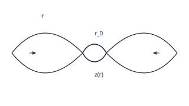
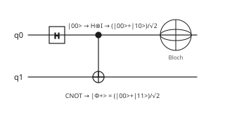
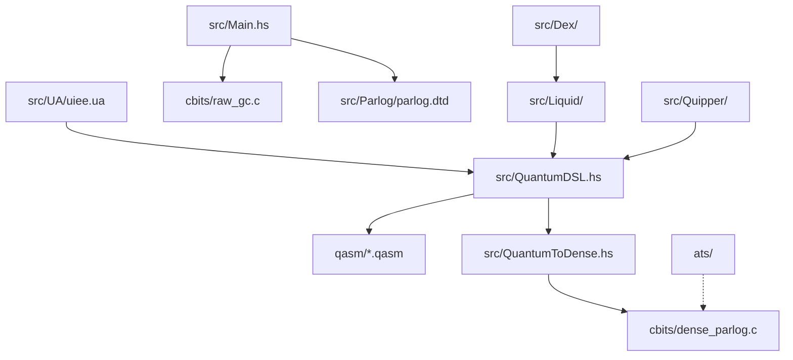

# Ahmad's Plumbline

Dense committed-choice parallel-logic runtime · symbolic quantum-circuit DSL · Liquid Haskell refinements · Quipper circuits · SYK/wormhole module

**Maintainers.** Ahmad Ali Parr, Jessica Westerhoff, SnapKitty Research Lab.  
**Copyright.** 2026 SnapKittyWest. Ahmad Ali Parr, Bel Esprit D'Accord Irrevocable Trust.  
**Dual license.** SNAPKITTY OPAQUE SOURCE LICENSE v1.0 or GNU Affero General Public License v3.0.  
See [LICENSE](LICENSE) · [LICENSE-AGPL-3.0.txt](LICENSE-AGPL-3.0.txt)


*Morris–Thorne embedding diagram. Labels \( r \), \( r_0 \), \( z(r) \). Theoretical geometry only.*


*H + CNOT circuit producing \( \lvert\Phi^+\rangle \). Bloch sphere inset.*

## Table of contents

1. [Technical Overview](#1-technical-overview)
2. [Repository Architecture](#2-repository-architecture)
3. [Mathematical Foundations](#3-mathematical-foundations)
4. [Complete Source Inventory](#4-complete-source-inventory)
5. [Parallel Logic Programming](#5-parallel-logic-programming)
6. [Dense Runtime](#6-dense-runtime)
7. [Memory Management](#7-memory-management)
8. [Curry and Haskell Integration](#8-curry-and-haskell-integration)
9. [ATS Linear and Affine Types](#9-ats-linear-and-affine-types)
10. [Quantum DSL](#10-quantum-dsl)
11. [Quantum Error Correction](#11-quantum-error-correction)
12. [Quipper Circuit Architecture](#12-quipper-circuit-architecture)
13. [DemonHole Geometry](#13-demonhole-geometry)
14. [SYK Quantum Physics](#14-syk-quantum-physics)
15. [Dex Array Parallelism](#15-dex-array-parallelism)
16. [Quantum Cellular Automata](#16-quantum-cellular-automata)
17. [LiquidHaskell Verification](#17-liquidhaskell-verification)
18. [Additional Language Systems](#18-additional-language-systems)
19. [Algorithms and Complexity](#19-algorithms-and-complexity)
20. [Build and Dependencies](#20-build-and-dependencies)
21. [Testing and Verification](#21-testing-and-verification)
22. [Public API and Symbol Index](#22-public-api-and-symbol-index)
23. [Reproducibility](#23-reproducibility)
24. [Licensing](#24-licensing)

---

## 1. Technical Overview

Ahmads-Plumbline is a multi-language formal-computation research repository. It implements three independent computational models that communicate only through explicit lowering passes and foreign-function boundaries.

| Model | Primary source | Communication |
|-------|----------------|---------------|
| Dense committed-choice logic | `cbits/dense_parlog.c` | Indices into static arena |
| Symbolic quantum circuits | `src/QuantumDSL.hs` | OpenQASM 3.0 text |
| Refinement and linear types | `src/Liquid/`, `ats/` | Local annotations |

**Entry points**

| Entry | Path | Role |
|-------|------|------|
| Cabal executable | `app/Main.hs` | Package entry point |
| Library demo | `src/Main.hs` | SGML, Oz stack, Parlog interpreter |
| Quantum lowering | `src/QuantumDSL.hs` | UA source to circuits |
| Dense morph | `src/DenseMorph.hs` | Sparse goals to dense slots |

No machine-checked proof of fault tolerance is present. Refinements, linear types, and runtime guards are local to their modules.

## 2. Repository Architecture



| Directory | Contents | Build status |
|-----------|----------|--------------|
| `app/` | Cabal executable | Built |
| `src/` | Haskell, Curry, Dex, Lisp, UA | Partial |
| `cbits/` | C runtime | Built |
| `ats/` | ATS linear proofs | Not linked |
| `qasm/` | OpenQASM circuits | Not compiled |
| `scala/` | Header processor | Not built |
| `docs/` | Architecture, theorems, SVGs | Documentation |
| `nix/` | Flake | Optional |

Inspection of the Haskell import lists shows no cycles. `QuantumToDense` imports `DenseMorph`. `DenseMorph` imports the FFI declarations. The DSL imports nothing from the dense runtime.

## 3. Mathematical Foundations

### Dense term representation

A `DWord` is a 64-bit word with a 3-bit tag in the low bits:

$$
w = (v \ll 3) \lor t, \qquad t \in \{0,1,2\}
$$

corresponding to `D_INT`, `D_VAR`, and `D_UNBOUND`. Payload extraction:

$$
\mathrm{word\_val}(w) = w \gg 3
$$

The arena holds `MAX_TERMS = 65536` words. Allocation is a bump pointer.

### Suspension mask

$$
v \in \mathrm{wait\_mask}(g) \iff \text{input-mode argument at } v \text{ is unbound}.
$$

Binding executes

$$
\mathrm{wait\_mask}(g) \leftarrow \mathrm{wait\_mask}(g) \land \lnot(1 \ll v)
$$

then promotes if the mask becomes zero. After every public operation `ready_mask ⊆ active_mask`.

### Simplified concurrence

$$
C = 2 \lvert a_{00} a_{11} - a_{01} a_{10} \rvert.
$$

The constant Bell state yields \( C = 1 \).

### Landauer work budget

$$
W_{\mathrm{net\ incl\ prep}} = -2\, k_B T \ln 2
$$

under the sign conventions of `coherentDemonWorkPerBit`.

### QEC resource counts

| Variant | \([[n,k,d]]\) | Data / logical | 256 logical | Ancillas |
|---------|-------------|----------------|-------------|----------|
| Steane | [[7,1,3]] | 7 | 1792 | 6 |
| Surface-17 | [[9,1,3]] | 9 | 2304 | 8 |
| Color 6.6.6 \(d=3\) | [[7,1,3]] | 7 | 1792 | flag |
| Color 4.8.8 \(d=5\) | [[17,1,5]] | 17 | 4352 | flag |

## 4. Complete Source Inventory

| Path | Language | Role |
|------|----------|------|
| `.github/workflows/ci.yml` | YAML | Build and compile jobs |
| `LICENSE` | text | Opaque license |
| `LICENSE-AGPL-3.0.txt` | text | AGPLv3 |
| `ahmads-plumbline.cabal` | Cabal | Package definition |
| `cabal.project` | Cabal | Project configuration |
| `app/Main.hs` | Haskell | Executable entry |
| `ats/affine_stack.dats` | ATS | Affine stack |
| `ats/linear_proofs.dats` | ATS | Linear stack, arena, goal |
| `ats/linear_proofs.sats` | ATS | Static signatures |
| `cbits/boyer_moore.c` | C | Boyer–Moore |
| `cbits/dense_parlog.c` | C | Arena and scheduler |
| `cbits/raw_gc.c` | C | Mark-sweep |
| `cbits/raw_gc.h` | C | Term type |
| `docs/architecture.md` | Markdown | Boundaries |
| `docs/art/ready_mask_wave.py` | Python | ASCII generator |
| `docs/art/ready_mask_wave.txt` | text | Generated art |
| `docs/ffi-contracts.md` | Markdown | FFI matrix |
| `docs/svg/qubit-entanglement.svg` | SVG | Bell circuit |
| `docs/svg/wormhole-geometry.svg` | SVG | Wormhole embedding |
| `docs/theorems.md` | Markdown | Theorem index |
| `nix/flake.nix` | Nix | Dev shell |
| `qasm/manifold_colorcode_qec.qasm` | OpenQASM | Color-code library |
| `qasm/manifold_steane_qec.qasm` | OpenQASM | Steane manifold |
| `qasm/manifold_surface17_qec.qasm` | OpenQASM | Surface-17 manifold |
| `scala/QiskitTranspiler.scala` | Scala | Header processor |
| `src/AhmadsPlumbline/DemonHole.hs` | Quipper | DemonHole circuit |
| `src/DenseFFI.curry` | Curry | External declarations |
| `src/DenseMorph.hs` | Haskell | Linear morph |
| `src/DenseParlog.curry` | Curry | Dense-word sketch |
| `src/Dex/CategoryTheory.dex` | Dex | Compose, id, tensor |
| `src/Dex/CellularAutomaton.dex` | Dex | Elementary CA |
| `src/Dex/EntanglementToLife.dex` | Dex | Measurement to Life |
| `src/Dex/GameOfLife.dex` | Dex | Life front-end |
| `src/Dex/LSystem.dex` | Dex | L-system rewrites |
| `src/Dex/QuantumCA_APL.dex` | Dex | APL-style quantum CA |
| `src/Dex/QuantumEntanglement.dex` | Dex | Bell, GHZ, CNOT |
| `src/External_DenseFFI.hs` | Haskell | KiCS2 glue |
| `src/Franz/proof-popped.txt` | text | Recorded output |
| `src/Franz/qa5-reactive.lisp` | Lisp | Reactive sketch |
| `src/LinearSGML.hs` | Haskell | Linear Boyer–Moore |
| `src/Liquid/CNOTTheorem.hs` | Liquid | Concurrence refinement |
| `src/Liquid/GameOfLifeBinder.hs` | Liquid | Life rules |
| `src/Liquid/WorkBudget.hs` | Liquid | Landauer identity |
| `src/Main.hs` | Haskell | Library demo |
| `src/Parlog/parlog.dtd` | DTD | Document structure |
| `src/QuantumDSL.hs` | Haskell | DSL and emitters |
| `src/QuantumToDense.hs` | Haskell | Gate to dense |
| `src/Quipper/CNOTEntangle.hs` | Quipper | Bell pair |
| `src/Quipper/DemonCycle.hs` | Quipper | Coherent demon |
| `src/Quipper/GameOfLifeCirc.hs` | Quipper | Life skeleton |
| `src/Quipper/SYK/Couplings.hs` | Quipper | Seeded couplings |
| `src/Quipper/SYK/Hamiltonian.hs` | Quipper | SYK Hamiltonian |
| `src/Quipper/SYK/Majorana.hs` | Quipper | Majorana algebra |
| `src/Quipper/SYK/Scrambling.hs` | Quipper | Operator growth |
| `src/Quipper/SYK/ThermofieldDouble.hs` | Quipper | TFD preparation |
| `src/Quipper/SYK/TimeEvolution.hs` | Quipper | Trotter stub |
| `src/Quipper/SYK/WormholeCoupling.hs` | Quipper | Double-trace |
| `src/UA/uiee.ua` | UA | Source pipeline |

## 5. Parallel Logic Programming

**Source.** `src/Main.hs`, `src/Parlog/parlog.dtd`

### AST

```haskell
data TermAst = TInt Int64 | TNil | TVar String
data AtomAst = AtomAst String [TermAst]
data Clause = Clause { clHead :: AtomAst, clGuard :: [AtomAst], clBody :: [AtomAst] }
data Program = Program { progModes :: Map (String, Int) [Mode], progClauses :: [Clause] }
```

### Evaluation model

Committed choice: the first matching clause is selected. Body goals are spawned in AND-parallel. Shared variables suspend via dataflow.

```text
GOAL ──► MATCH CLAUSE ──► COMMIT ──► SPAWN BODY
                              │
                              ▼
                         DATAFLOW WAKEUP
```

### Parser

`stripProlog` removes comments and DOCTYPE. `parseNodes` builds a forest. `lowerProgram` extracts modes and clauses.

### Oz stack

`StackOp` is `Push` or `Pop`. `bindDataflow` binds under the heap lock and wakes registered threads. `awaitBound` suspends if unbound.

### Demo

Sample body: `pop`, `push 42`, `print`. The demo allocates a variable, pushes it as a root, evaluates, and collects.

## 6. Dense Runtime

**Source.** `cbits/dense_parlog.c`

### Goal table layout

```text
DENSE PARLOG RUNTIME
┌──────────────────────────────────────────────┐
│                  GOAL TABLE                  │
├──────────┬────────────┬──────────────────────┤
│ Slot     │ Wait Mask  │ State                │
├──────────┼────────────┼──────────────────────┤
│    0     │ 00000000   │ READY                │
│    1     │ 00000100   │ WAITING              │
│    2     │ 00000000   │ READY                │
└──────────┴────────────┴──────────────────────┘
                  │
                  ▼
          READY-MASK SCHEDULER
          (__builtin_ctzll)
```

*Illustrative layout. Actual masks are computed at runtime.*

### Operations

| Function | Effect |
|----------|--------|
| `dense_alloc_var` | Allocates unbound term |
| `dense_alloc_int` | Allocates integer term |
| `dense_spawn` | Computes wait mask, marks active/ready |
| `dense_bind` | Clears bit, promotes if mask empty |
| `dense_next_ready` | Pops lowest ready slot |
| `dense_drain_ready` | Drains up to N ready slots |

### Invariants

- `ready_mask ⊆ active_mask`
- Ready ⇔ wait mask = 0
- Waiting ⇔ active and not ready

### Runtime visualization

Rule: at time \( t \), slot \( i \) is marked if bit \( ((i + t) \bmod 16) \) is set; density follows a sine envelope.

```text
dense ready-mask  (16 slots, sine envelope)
t \i 0123456789012345
0    **#%@%#*=:.   .:
1    *#%@%#*=:.   .:*
2    #%@%#*=:.   .:**
3    %@%#*=:.   .:**#
4    @%#*=:.   .:**#%
5    %#*=:.   .:**#%@
6    #*=:.   .:**#%@%
7    *=:.   .:**#%@%#
8    =:.   .:**#%@%#*
9    :.   .:**#%@%#*=
0    .   .:**#%@%#*=:
1       .:**#%@%#*=:.
2      .:**#%@%#*=:.
3     .:**#%@%#*=:.
4    .:**#%@%#*=:.
5    :**#%@%#*=:.   .
6    **#%@%#*=:.   .:
7    *#%@%#*=:.   .:*
8    #%@%#*=:.   .:**
9    %@%#*=:.   .:**#
ready bits travel left-to-right; density ~ sin
rule: bit((i+t) mod 16) and sine envelope
```

Generator: `docs/art/ready_mask_wave.py`.

## 7. Memory Management

**Source.** `cbits/raw_gc.h`, `cbits/raw_gc.c`

### Term layout

```c
typedef struct Term {
    uint8_t marked;
    TermTag tag;
    struct Term *next_alloc;
    union {
        int64_t ival;
        struct Term *binding;
        struct { struct Term *head; struct Term *tail; } cons;
    } data;
} Term;
```

### Ownership diagram

```text
HASKELL / CURRY
     │ indices only
     ▼
DENSE ARENA (static, 512 KiB)
     │ separate
     ▼
RAW GC HEAP (mark-sweep)
     ▲
     │ explicit roots
     │
  DEMO (bracket push/pop)
```

Accessors (`term_tag`, `term_bind_var`, etc.) avoid `Storable` offsets. Roots must be pushed before allocation that may collect.

## 8. Curry and Haskell Integration

**Sources.** `src/DenseFFI.curry`, `src/External_DenseFFI.hs`, `src/DenseMorph.hs`

### Boundary

```text
CURRY (DenseFFI.curry)
     │ external declarations
     ▼
HASKELL (External_DenseFFI.hs)
     │ FFI + KiCS2 glue
     ▼
C (dense_parlog.c)
```

`morphGoalsDense` calls `c_dense_spawn`. The Curry side cannot spawn; it can allocate, bind, and poll.

## 9. ATS Linear and Affine Types

**Sources.** `ats/linear_proofs.dats`, `ats/affine_stack.dats`

```ats
dataviewtype lin_stack (n: int) =
  | LinNil (0) of ()
  | {n:nat} LinCons (n + 1) of (int, lin_stack (n))
```

`theorem_push_pop` restores length. `lin_drop` consumes remaining stacks. Not linked into Cabal.

## 10. Quantum DSL

**Source.** `src/QuantumDSL.hs`

### AST excerpt

```haskell
data QGate
  = QInit [Double] | QH Int | QRX Expr Int | QRY Expr Int | QRZ Expr Int
  | QCNOT Int Int | QCond String Double [QGate] | QMeas Int Int | QReset Int
  | QLoop Int Int (Int -> [QGate]) | QWhile String [QGate]
```

### Lowering pipeline

```text
UA SOURCE
  │ partitionSections
  ▼
FOUR SECTIONS
  │ lowerSec
  ▼
QCircuit AST
  │ toOpenQASM3 / emit*Gate
  ▼
OpenQASM 3.0 TEXT
```

Circuits emitted: `Pipeline_Entangle_Collapse`, `Fibonacci_Cantor_Phase_Oracle`, `QASM_Manifold_256`, `QSharp_ManifoldGreedyStep`.

## 11. Quantum Error Correction

| Variant | Slice width | Named gates |
|---------|-------------|-------------|
| Steane | 7 | `rx_logical`, `cx_logical` |
| Surface-17 | 9 | `rx_surface17`, `cx_surface17` |
| Color 6.6.6 d=3 | 7 | `rx_color666`, `cx_color666` |
| Color 4.8.8 d=5 | 17 | `rx_color488`, `cx_color488` |

`checkThreshold` returns the estimate \( 0.1 (p / p_{\mathrm{th}})^{(d+1)/2} \) or `Left`.

`dense_steane_decode` maps a 6-bit syndrome to packed error indices. `dense_steane_correct` is a placeholder.

## 12. Quipper Circuit Architecture

| Module | Path | Role |
|--------|------|------|
| CNOTEntangle | `src/Quipper/CNOTEntangle.hs` | Bell pair |
| DemonCycle | `src/Quipper/DemonCycle.hs` | Coherent demon |
| GameOfLifeCirc | `src/Quipper/GameOfLifeCirc.hs` | Life skeleton |

Bell pair produces \( \lvert\Phi^+\rangle \). Life module establishes type signatures; implementations are stubs.

## 13. DemonHole Geometry

**Source.** `src/AhmadsPlumbline/DemonHole.hs`

### Types

```haskell
data DemonState = DemonState { registerD :: [Qubit], registerSH :: [Qubit] }
data WormholeParams = WormholeParams { couplingG :: Double, betaTemp :: Double, errorEps :: Double }
```

### Circuit flow

```text
BOUNDARY REGISTER ──┐
                    ├──► SCRAMBLE ──► RECURSE ──► CROSS-COUPLE ──► UNSCRAMBLE
SHADOW HORIZON ─────┘
```

Base-case angle: \( g \beta \). Cross-coupling angle: \( g / N \). Base case applies GJW + swap.

## 14. SYK Quantum Physics

| Module | Path | Role |
|--------|------|------|
| Majorana | `src/Quipper/SYK/Majorana.hs` | Algebra |
| Couplings | `src/Quipper/SYK/Couplings.hs` | Seeded values |
| Hamiltonian | `src/Quipper/SYK/Hamiltonian.hs` | Structure |
| TimeEvolution | `src/Quipper/SYK/TimeEvolution.hs` | Stub |
| Scrambling | `src/Quipper/SYK/Scrambling.hs` | Growth proxy |
| ThermofieldDouble | `src/Quipper/SYK/ThermofieldDouble.hs` | TFD |
| WormholeCoupling | `src/Quipper/SYK/WormholeCoupling.hs` | Double-trace |

Couplings are uniform on a scaled interval, not Gaussian. `timeEvolve` is a single RZ per coupling. TFD is a product of two-qubit states.

## 15. Dex Array Parallelism

| Module | Path | Role |
|--------|------|------|
| CategoryTheory | `src/Dex/CategoryTheory.dex` | Compose, id, tensor |
| QuantumEntanglement | `src/Dex/QuantumEntanglement.dex` | Bell, GHZ, CNOT |
| LSystem | `src/Dex/LSystem.dex` | Rewrites |

`compose` is matrix multiplication. `tensor` is Kronecker. `prepareBell` yields `bellPhiPlus`. L-systems produce strings only.

## 16. Quantum Cellular Automata

| Module | Path | Role |
|--------|------|------|
| CellularAutomaton | `src/Dex/CellularAutomaton.dex` | Elementary CA |
| QuantumCA_APL | `src/Dex/QuantumCA_APL.dex` | Amplitude CA |
| EntanglementToLife | `src/Dex/EntanglementToLife.dex` | Measurement to Life |
| GameOfLife | `src/Dex/GameOfLife.dex` | Life front-end |

`qcaStep` does not preserve L2 norm. `measureThreshold` uses 0.5 by default.

## 17. LiquidHaskell Verification

| Name | Source | Statement |
|------|--------|-----------|
| `theorem_cnot_entangle` | CNOTTheorem.hs | `calcDeg bellPlus == 1.0` |
| `netIsNegativeTwo` | WorkBudget.hs | `netInclPrep == -2 * landauer` |
| `nextState` | GameOfLifeBinder.hs | Birth / survival |

Work-budget expansion:

$$
\begin{align*}
W_{\mathrm{prep}} &= L, \\
W_{\mathrm{sort}} &= -L, \\
W_{\mathrm{erase}} &= -L, \\
W_{\mathrm{battery\ extract}} &= -L, \\
W_{\mathrm{net\ incl\ prep}} &= -2L.
\end{align*}
$$

Game-of-Life binder is approximately 950 lines; core logic is in `nextState`, `countNeighbours`, `stepCell`.

## 18. Additional Language Systems

**UA.** `src/UA/uiee.ua` contains InitState, CNOT, Entangle, CalcDeg, FibSeq, manifold step, and Q# ManifoldGreedyStep. Partitioned by `FibSeq`, `include`, `namespace`.

**Scala.** `scala/QiskitTranspiler.scala` extracts qubit register size and emits a normalized header.

**Lisp.** `src/Franz/qa5-reactive.lisp` is isolated.

**SGML.** `src/Parlog/parlog.dtd` defines the document structure. Parser does not validate against the DTD.

## 19. Algorithms and Complexity

| Operation | Complexity | Notes |
|-----------|------------|-------|
| `dense_next_ready` | \( O(1) \) | Count-trailing-zeros |
| `dense_bind` | \( O(w) \) | \( w \) waiting goals |
| Allocation | \( O(1) \) | Bump pointer |
| Dereference | \( O(c) \) | Chain length; no cycle detection |
| Emitter unroll | \( O(N) \) | After loop expansion |

Boyer–Moore builds bad-character (256) and good-suffix tables. LinearTypes wrapper frees buffers exactly once if the continuation terminates.

## 20. Build and Dependencies

```bash
cabal update
cabal build all
cabal run ahmads-plumbline
```

Requires Cabal 3.0+, GHC 9.6+. Dependencies: `base`, `containers`, `liquidhaskell`, `quipper`. C sources compiled with `-O2 -Wall -Wextra`.

Nix: `nix develop` provides shell with `ats2`, `gcc`, `gdb`, `opensp`. Does not pin GHC or include Quipper/Liquid.

CI: Haskell job (GHC 9.6.6, Cabal 3.10) and C compilation job. No artifacts.

## 21. Testing and Verification

| Item | Source | Tool | Observed |
|------|--------|------|----------|
| C compilation | `cbits/*.c` | gcc | Not run |
| Cabal build | `.cabal` | cabal | Not run |
| Liquid refinements | `src/Liquid/*.hs` | liquid | Not run |
| ATS linear types | `ats/*.dats` | patscc | Not run |
| QASM syntax | `qasm/*.qasm` | manual | Inspected |

No unit tests present. CI tolerates missing test suite.

## 22. Public API and Symbol Index

| Symbol | Location | Kind |
|--------|----------|------|
| `dense_alloc_var` | `cbits/dense_parlog.c` | function |
| `dense_bind` | `cbits/dense_parlog.c` | function |
| `dense_next_ready` | `cbits/dense_parlog.c` | function |
| `dense_steane_decode` | `cbits/dense_parlog.c` | function |
| `theorem_cnot_entangle` | `src/Liquid/CNOTTheorem.hs` | refinement |
| `netIsNegativeTwo` | `src/Liquid/WorkBudget.hs` | refinement |
| `theorem_push_pop` | `ats/linear_proofs.dats` | linear lemma |
| `checkThreshold` | `src/QuantumDSL.hs` | runtime guard |
| `ahmad_plumbline_udh` | `src/AhmadsPlumbline/DemonHole.hs` | circuit |
| `lowerToCircuits` | `src/QuantumDSL.hs` | function |
| `toOpenQASM3` | `src/QuantumDSL.hs` | function |
| `prepareBell` | `src/Dex/QuantumEntanglement.dex` | function |

## 23. Reproducibility

Dense runtime and quantum emitters are deterministic given inputs. Coupling generator is seeded and deterministic. Nothing is written to disk by the runtime. CI pins GHC 9.6.6; Nix flake does not.

## 24. Licensing

Dual-licensed under SNAPKITTY OPAQUE SOURCE LICENSE v1.0 and GNU Affero General Public License v3.0. Cabal declares AGPL-3.0-only. Every source file carries a Sovereign Leviathan Node License header citing both and the additional terms. Copyright 2026 SnapKittyWest, Ahmad Ali Parr, Bel Esprit D'Accord Irrevocable Trust.

SPDX identifier `LicenseRef-Sovereign-Leviathan-SL-AGPL3-001` is a local reference. Additional terms text is not in the repository.

---


### Dense runtime contracts

`dense_alloc_var` increments `arena_top` and stores a `D_UNBOUND` word. No bound check is performed. The caller must remain below `MAX_TERMS`.

`dense_spawn` dereferences each input-mode argument. If the result is unbound and its index is less than 64, the corresponding bit is set in the wait mask. The slot is marked active and, if the mask is empty, ready.

`dense_bind` stores a `D_VAR` word. If the variable index is at least 64 the function returns. Otherwise it clears the bit in every waiting goal and promotes goals whose masks become zero.

`dense_next_ready` returns the lowest set bit of `ready_mask` or `-1` and clears that bit from both masks.

### Example bind trace

```text
Initial: ready_mask = 0b0001, active_mask = 0b0011
Bind var 2 on slot 1
  wait_mask[1] &= ~(1<<2) → 0
  ready_mask |= (1<<1)
Result: ready_mask = 0b0011
```

### Term word layout

```text
63                          3 2 0
┌───────────────────────────┬───┐
│         payload (61)      │tag│
└───────────────────────────┴───┘
```

Tag 0 = `D_INT`, 1 = `D_VAR`, 2 = `D_UNBOUND`.

### Goal slot layout

```text
┌──────────┬──────────────────┬───────┬────────────┐
│ pred_id  │ args[0..3]       │ arity │ wait_mask  │
│ 32 bit   │ 4 × 32 bit       │ 8 bit │ 64 bit     │
└──────────┴──────────────────┴───────┴────────────┘
```

Arity is at most 4. The wait mask tracks only variables with index less than 64.

### Scheduler transitions

```text
SPAWN ──► ACTIVE
  │
  ├─ wait_mask = 0 ──► READY
  │
  └─ wait_mask ≠ 0 ──► WAITING
         │
         │ bind clears bit
         ▼
      wait_mask = 0 ──► READY
         │
         │ next_ready
         ▼
      INACTIVE
```

### Quantum DSL algorithms

`partitionSections` scans for the first occurrence of `FibSeq`, then `include`, then `namespace`. The four slices are passed to `lowerSec`. The algorithm is linear in the number of lines.

`unrollGate` expands a `QLoop` by applying the function to every integer in the closed range and concatenating the results. The expansion is recursive. Output size is proportional to the product of the loop bounds.

`QInit` of four equal amplitudes emits two Hadamard gates. Other initializations become comments.

### OpenQASM emission example

```qasm
// Circuit: Pipeline_Entangle_Collapse
OPENQASM 3.0;
include "stdgates.inc";
qubit[2] q;
bit[2] c;

h q[0];
h q[1];
cx q[0], q[1];
if (deg > 0.707) {
  c[0] = measure q[0];
  c[1] = measure q[1];
}
```

### DemonHole derivation

Base-case angle: \( \theta = g \beta \).  
Cross-coupling angle: \( \theta = g / N \).

At level \( \ell \) the cross-coupling applies \( N / 2^\ell \) GJW gates. The sum over levels is \( O(N) \). Scrambling adds a further linear term.

```text
invoke_demon_hole_rec(N)
  ├─ scramble(N)
  ├─ invoke(N/2 left)
  ├─ invoke(N/2 right)
  ├─ cross-couple(N)
  └─ unscramble(N)
```

### Liquid expansions

$$
\begin{align*}
L &= k_B T \ln 2 \\
W_{\mathrm{prep}} &= L \\
W_{\mathrm{sort}} &= -L \\
W_{\mathrm{erase}} &= -L \\
\alpha^2 &= L / (\hbar \omega) \\
W_{\mathrm{battery\ extract}} &= -L \\
W_{\mathrm{net\ incl\ prep}} &= -2L
\end{align*}
$$

For the Bell state:

$$
a_{00} a_{11} - a_{01} a_{10} = \frac{1}{2} \implies C = 1
$$

The source uses the decimal approximation `0.7071067811865476`.

A cell is born with exactly three live neighbours. A live cell survives with two or three. All other cases die. The neighbour count is the sum of eight cells.

### ATS resource transitions

```text
lin_stack(n) ──lin_push──► lin_stack(n+1)
lin_stack(n+1) ──lin_pop──► (int, lin_stack(n))
lin_stack(n) ──lin_drop──► void
```

`theorem_push_pop` composes push and pop. The type checker verifies length restoration.

### Dex algorithms

The outer product applies a binary operator to every pair of elements. The scan computes the prefix reduction by re-folding on every step and is therefore quadratic. The array-parallel CNOT swaps amplitudes at indices 2 and 3. `prepareBell` starts from the zero state, applies `hadamard0`, then `cnot`, and yields `bellPhiPlus`.

### Memory ownership

| Resource | Owner | Lifetime | Free |
|----------|-------|----------|------|
| Dense arena | C static | Process | Never |
| Raw GC heap | C | Until collect | Sweep |
| Linear buffer | Haskell `LinBuf` | `withLinBuf` | Exact once |
| Curry indices | Caller | Until bind | N/A |

### FFI call graph

```text
morphGoalsDense
  └─ c_dense_spawn
       └─ dense_spawn (C)

cDenseAllocVar (Curry)
  └─ external_d_C_cDenseAllocVar
       └─ c_dense_alloc_var (C)
```

### QEC slices

Steane logical \( i \): `q[7i:7i+6]`.  
Surface-17 logical \( i \): `q[9i:9i+8]`.

Named gates wrap the slice. A syndrome call is appended for CNOT.

### SYK coupling

```text
Majorana i ──J_{ijkl}── Majorana j,k,l
     │
     └── seed → linear congruential → uniform[-0.5,0.5] × scale
```

The values are uniform, not Gaussian. The same seed always produces the same list.

### Parser flow

```text
INPUT ──stripProlog──► TOKENS
  │
  ▼
parseNodes ──► SNode forest
  │
  ▼
lowerProgram ──► Program (modes + clauses)
```

Empty elements are `arg` and `var`. Unexpected forms raise errors.

### Complexity

| Component | Time | Space |
|-----------|------|-------|
| `dense_next_ready` | \( O(1) \) | \( O(1) \) |
| `dense_bind` | \( O(w) \) | \( O(1) \) |
| Emitter unroll | \( O(\text{output}) \) | \( O(\text{output}) \) |
| Parser | \( O(\text{input}) \) | \( O(\text{depth}) \) |
| L-system iterate | \( O(\text{length} \times \text{steps}) \) | \( O(\text{length}) \) |

### Failure modes

| Component | Failure | Detection |
|-----------|---------|-----------|
| Dense | Out-of-range index | None |
| Parser | Missing program | Error string |
| Emitter | Large loop | Large output |
| Liquid | Undischarged refinement | Solver fail |
| ATS | Unconsumed linear | Type error |

### Platform

| Toolchain | Version | Status |
|-----------|---------|--------|
| GHC | 9.6+ | Required |
| Cabal | 3.0+ | Required |
| GCC | any | C sources |
| patscc | optional | ATS |
| Quipper | optional | Circuits |
| Liquid | optional | Refinements |


