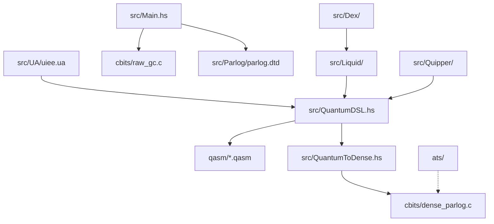

# Ahmad's Plumbline

Dense committed-choice parallel-logic runtime, symbolic quantum-circuit DSL with OpenQASM 3.0 emitters, Liquid Haskell refinements, Quipper circuit construction, and an SYK/wormhole module.

**Maintainers.** Ahmad Ali Parr, Jessica Westerhoff, SnapKitty Research Lab.  
**Copyright.** 2026 SnapKittyWest. Ahmad Ali Parr, Bel Esprit D'Accord Irrevocable Trust.  
**Dual license.** SNAPKITTY OPAQUE SOURCE LICENSE v1.0 or GNU Affero General Public License v3.0. See [LICENSE](LICENSE) and [LICENSE-AGPL-3.0.txt](LICENSE-AGPL-3.0.txt).

## Technical abstract

Ahmads-Plumbline is a multi-language formal-computation research repository. It implements three independent computational models that communicate only through explicit lowering passes and foreign-function boundaries.

The first model is a fixed-size dense committed-choice AND-parallel logic runtime. Goals carry input-mode masks. A goal suspends when an input-mode argument is an unbound logic variable. Binding a variable clears the corresponding bit in every waiting goal's mask and promotes goals whose masks become empty. The implementation uses a 64-slot goal array and 64-bit masks. The authoritative source is `cbits/dense_parlog.c`.

The second model is a symbolic quantum-circuit DSL. `src/QuantumDSL.hs` defines an abstract syntax of gates and lowers four blocks of the UA source (`src/UA/uiee.ua`) into named circuits. Emitters produce OpenQASM 3.0, including Steane [[7,1,3]] and Surface-17 wrappers. Quipper modules construct a two-qubit Bell pair, a coherent-demon cycle, a DemonHole wormhole transfer, and a seven-module SYK model.

The third model is refinement-typed arithmetic and linear resource discipline. Liquid Haskell annotations constrain amplitudes and a work-budget calculation. ATS modules encode linear and affine resource discipline for stacks, arenas, and goals. Dex modules provide array-parallel formulations of category theory, entanglement, L-systems, elementary cellular automata, and a quantum cellular automaton.

No machine-checked proof of fault tolerance is present. Refinements, linear types, and runtime guards are local to their modules. The dense runtime and the quantum emitters are independent except for the one-way lowering in `src/QuantumToDense.hs`.


## Table of contents

1. [Technical Overview](#1-technical-overview)
2. [Repository Architecture](#2-repository-architecture)
3. [Mathematical Foundations](#3-mathematical-foundations)
4. [Complete Source Inventory](#4-complete-source-inventory)
5. [Parallel Logic Programming](#5-parallel-logic-programming)
6. [Dense Runtime](#6-dense-runtime)
7. [Memory Management](#7-memory-management)
8. [Curry and Haskell Integration](#8-curry-and-haskell-integration)
9. [ATS Linear and Affine Types](#9-ats-linear-and-affine-types)
10. [Quantum DSL](#10-quantum-dsl)
11. [Quantum Error Correction](#11-quantum-error-correction)
12. [Quipper Circuit Architecture](#12-quipper-circuit-architecture)
13. [DemonHole Geometry](#13-demonhole-geometry)
14. [SYK Quantum Physics](#14-syk-quantum-physics)
15. [Dex Array Parallelism](#15-dex-array-parallelism)
16. [Quantum Cellular Automata](#16-quantum-cellular-automata)
17. [LiquidHaskell Verification](#17-liquidhaskell-verification)
18. [Additional Language Systems](#18-additional-language-systems)
19. [Algorithms and Complexity](#19-algorithms-and-complexity)
20. [Build and Dependencies](#20-build-and-dependencies)
21. [Testing and Verification](#21-testing-and-verification)
22. [Public API and Symbol Index](#22-public-api-and-symbol-index)
23. [Reproducibility](#23-reproducibility)
24. [Licensing](#24-licensing)

## 1. Technical Overview

### Computational models

| Model | Primary source | Communication |
|-------|----------------|---------------|
| Dense committed-choice logic | `cbits/dense_parlog.c` | Indices into static arena |
| Symbolic quantum circuits | `src/QuantumDSL.hs` | OpenQASM 3.0 text |
| Refinement and linear types | `src/Liquid/`, `ats/` | Local annotations |

### Entry points

| Entry | Path | Role |
|-------|------|------|
| Cabal executable | `app/Main.hs` | Package entry point |
| Library demo | `src/Main.hs` | SGML, Oz stack, Parlog interpreter |
| Quantum lowering | `src/QuantumDSL.hs` | UA source to circuits |
| Dense morph | `src/DenseMorph.hs` | Sparse goals to dense slots |

### Scope

The repository contains implementations, specifications, and proof artifacts. The dense runtime and the OpenQASM emitters are executable. The Liquid refinements and ATS linear types are local. The Dex modules are array-parallel specifications. The Quipper modules construct circuits. No end-to-end verified theorem connects the subsystems.

## 2. Repository Architecture

### Boundaries



### Directory responsibilities

| Directory | Contents | Build status |
|-----------|----------|--------------|
| `app/` | Cabal executable | Built |
| `src/` | Haskell, Curry, Dex, Lisp, UA | Partial |
| `cbits/` | C runtime | Built |
| `ats/` | ATS linear proofs | Not linked |
| `qasm/` | OpenQASM circuits | Not compiled |
| `scala/` | Header processor | Not built |
| `docs/` | Architecture, theorems, SVGs | Documentation |
| `nix/` | Flake | Optional |

### Import graph

Inspection of the Haskell import lists shows no cycles. `QuantumToDense` imports `DenseMorph`. `DenseMorph` imports the FFI declarations. The DSL imports nothing from the dense runtime. Liquid modules do not import Quipper. Dex modules do not import Liquid.

## 3. Mathematical Foundations

### Dense term representation

A `DWord` is a 64-bit word with a 3-bit tag in the low bits:

$$
w = (v \ll 3) \lor t, \qquad t \in \{0,1,2\}
$$

corresponding to `D_INT`, `D_VAR`, and `D_UNBOUND`. Payload extraction is an arithmetic right shift by 3:

$$
\mathrm{word\_val}(w) = w \gg 3
$$

The arena holds `MAX_TERMS = 65536` such words. Allocation is a bump pointer.

### Suspension mask

For a goal \( g \) and variable index \( v < 64 \),

$$
v \in \mathrm{wait\_mask}(g) \iff \text{the input-mode argument at } v \text{ is unbound}.
$$

Binding variable \( v \) executes

$$
\mathrm{wait\_mask}(g) \leftarrow \mathrm{wait\_mask}(g) \land \lnot(1 \ll v)
$$

for every waiting goal, then promotes \( g \) if the mask becomes zero. After every public operation, `ready_mask` is a subset of `active_mask`.

### Simplified concurrence

For amplitudes \( a_{00}, a_{01}, a_{10}, a_{11} \),

$$
C = 2 \lvert a_{00} a_{11} - a_{01} a_{10} \rvert.
$$

The constant Bell state with \( a_{00} = a_{11} = 1/\sqrt{2} \) yields \( C = 1 \).

### Landauer work budget

With \( L = k_B T \ln 2 \),

$$
W_{\mathrm{net\ incl\ prep}} = -2L
$$

under the sign conventions of `coherentDemonWorkPerBit`.

### QEC resource counts

| Variant | \([[n,k,d]]\) | Data / logical | 256 logical | Ancillas |
|---------|-------------|----------------|-------------|----------|
| Steane | [[7,1,3]] | 7 | 1792 | 6 |
| Surface-17 | [[9,1,3]] | 9 | 2304 | 8 |
| Color 6.6.6 \(d=3\) | [[7,1,3]] | 7 | 1792 | flag |
| Color 4.8.8 \(d=5\) | [[17,1,5]] | 17 | 4352 | flag |

Threshold constants appear only as numeric literals in `dataThreshold`.

## 4. Complete Source Inventory

| Path | Language | Role |
|------|----------|------|
| `.github/workflows/ci.yml` | YAML | Build and compile jobs |
| `LICENSE` | text | Opaque license |
| `LICENSE-AGPL-3.0.txt` | text | AGPLv3 |
| `ahmads-plumbline.cabal` | Cabal | Package definition |
| `cabal.project` | Cabal | Project configuration |
| `app/Main.hs` | Haskell | Executable entry |
| `ats/affine_stack.dats` | ATS | Affine stack |
| `ats/linear_proofs.dats` | ATS | Linear stack, arena, goal |
| `ats/linear_proofs.sats` | ATS | Static signatures |
| `cbits/boyer_moore.c` | C | Boyer–Moore |
| `cbits/dense_parlog.c` | C | Arena and scheduler |
| `cbits/raw_gc.c` | C | Mark-sweep |
| `cbits/raw_gc.h` | C | Term type |
| `docs/architecture.md` | Markdown | Boundaries |
| `docs/art/ready_mask_wave.py` | Python | ASCII generator |
| `docs/art/ready_mask_wave.txt` | text | Generated art |
| `docs/ffi-contracts.md` | Markdown | FFI matrix |
| `docs/svg/qubit-entanglement.svg` | SVG | Bell circuit |
| `docs/svg/wormhole-geometry.svg` | SVG | Wormhole embedding |
| `docs/theorems.md` | Markdown | Theorem index |
| `nix/flake.nix` | Nix | Dev shell |
| `qasm/manifold_colorcode_qec.qasm` | OpenQASM | Color-code library |
| `qasm/manifold_steane_qec.qasm` | OpenQASM | Steane manifold |
| `qasm/manifold_surface17_qec.qasm` | OpenQASM | Surface-17 manifold |
| `scala/QiskitTranspiler.scala` | Scala | Header processor |
| `src/AhmadsPlumbline/DemonHole.hs` | Quipper | DemonHole circuit |
| `src/DenseFFI.curry` | Curry | External declarations |
| `src/DenseMorph.hs` | Haskell | Linear morph |
| `src/DenseParlog.curry` | Curry | Dense-word sketch |
| `src/Dex/CategoryTheory.dex` | Dex | Compose, id, tensor |
| `src/Dex/CellularAutomaton.dex` | Dex | Elementary CA |
| `src/Dex/EntanglementToLife.dex` | Dex | Measurement to Life |
| `src/Dex/GameOfLife.dex` | Dex | Life front-end |
| `src/Dex/LSystem.dex` | Dex | L-system rewrites |
| `src/Dex/QuantumCA_APL.dex` | Dex | APL-style quantum CA |
| `src/Dex/QuantumEntanglement.dex` | Dex | Bell, GHZ, CNOT |
| `src/External_DenseFFI.hs` | Haskell | KiCS2 glue |
| `src/Franz/proof-popped.txt` | text | Recorded output |
| `src/Franz/qa5-reactive.lisp` | Lisp | Reactive sketch |
| `src/LinearSGML.hs` | Haskell | Linear Boyer–Moore |
| `src/Liquid/CNOTTheorem.hs` | Liquid | Concurrence refinement |
| `src/Liquid/GameOfLifeBinder.hs` | Liquid | Life rules |
| `src/Liquid/WorkBudget.hs` | Liquid | Landauer identity |
| `src/Main.hs` | Haskell | Library demo |
| `src/Parlog/parlog.dtd` | DTD | Document structure |
| `src/QuantumDSL.hs` | Haskell | DSL and emitters |
| `src/QuantumToDense.hs` | Haskell | Gate to dense |
| `src/Quipper/CNOTEntangle.hs` | Quipper | Bell pair |
| `src/Quipper/DemonCycle.hs` | Quipper | Coherent demon |
| `src/Quipper/GameOfLifeCirc.hs` | Quipper | Life skeleton |
| `src/Quipper/SYK/Couplings.hs` | Quipper | Seeded couplings |
| `src/Quipper/SYK/Hamiltonian.hs` | Quipper | SYK Hamiltonian |
| `src/Quipper/SYK/Majorana.hs` | Quipper | Majorana algebra |
| `src/Quipper/SYK/Scrambling.hs` | Quipper | Operator growth |
| `src/Quipper/SYK/ThermofieldDouble.hs` | Quipper | TFD preparation |
| `src/Quipper/SYK/TimeEvolution.hs` | Quipper | Trotter stub |
| `src/Quipper/SYK/WormholeCoupling.hs` | Quipper | Double-trace |
| `src/UA/uiee.ua` | UA | Source pipeline |

## 5. Parallel Logic Programming

### Source

| Field | Value |
|-------|-------|
| Source | `src/Main.hs`, `src/Parlog/parlog.dtd` |
| Language | Haskell, DTD |
| Responsibility | SGML parsing, Oz stack, Parlog interpreter |
| Dependencies | `cbits/raw_gc.c` |

### AST

```haskell
data TermAst = TInt Int64 | TNil | TVar String
data AtomAst = AtomAst String [TermAst]
data Clause = Clause { clHead :: AtomAst, clGuard :: [AtomAst], clBody :: [AtomAst] }
data Program = Program { progModes :: Map (String, Int) [Mode], progClauses :: [Clause] }
```

### Parser

`stripProlog` removes XML comments and DOCTYPE declarations. `parseAttrs` extracts key-value pairs. `parseNodes` builds a forest, treating `arg` and `var` as empty. `lowerProgram` extracts modes and clauses. `parseParlogSGML` composes the two.

### Interpreter

`evalGoal` materializes arguments and dispatches. Built-in `push`, `pop`, and `print` interact with the Oz stack. User predicates select the first matching clause and spawn the body in AND-parallel. There is no backtracking past the commit.

### Oz stack

`StackOp` is `Push` or `Pop`. `bindDataflow` binds under the heap lock and wakes registered threads. `awaitBound` suspends if unbound. `startOzStack` forks a server that conses on push and binds on pop, re-queuing if empty.

### Demo

The embedded sample defines `main` with one output and a body of `pop`, `push 42`, and `print`. The demo allocates a variable, pushes it as a root, evaluates, and collects.

## 6. Dense Runtime

### Source

| Field | Value |
|-------|-------|
| Source | `cbits/dense_parlog.c` |
| Language | C |
| Responsibility | Arena, masks, scheduling, Steane decoder |
| Exports | `dense_alloc_var`, `dense_alloc_int`, `dense_spawn`, `dense_bind`, `dense_next_ready`, `dense_drain_ready`, `dense_steane_decode`, `dense_steane_correct` |

### Term algebra

A term is a 64-bit tagged word. Dereference follows `D_VAR` chains until a non-variable is reached. Cycles are not detected. The arena is a static array of 65536 words. Allocation never reclaims individual words.

### Goal slot

```c
typedef struct {
    uint32_t pred_id;
    uint32_t args[4];
    uint8_t  arity;
    uint64_t wait_mask;
} GoalSlot;
```

The four-argument limit is hard-coded. Only variables with index less than 64 can appear in the wait mask.

### Operations

`dense_alloc_var` stores a `D_UNBOUND` word. `dense_alloc_int` stores a `D_INT` word. `dense_spawn` computes the initial wait mask and marks the slot active, and ready if the mask is empty. `dense_bind` clears one bit and promotes goals whose masks become zero. `dense_next_ready` returns the lowest set bit of `ready_mask` via `__builtin_ctzll` and clears it. `dense_drain_ready` repeatedly calls `dense_next_ready`.

### Invariants

After every public operation:

- `ready_mask` is a subset of `active_mask`.
- A goal is ready only if its wait mask is zero.
- A goal is waiting only if it is active and not ready.
- Binding never sets a bit that was not already clear.

These invariants are maintained by construction. They are not checked at runtime.

### Runtime visualization

Rule: at time \( t \), slot \( i \) is marked if bit \( ((i + t) \bmod 16) \) is set; character density follows a sine envelope.

```text
dense ready-mask  (16 slots, sine envelope)
t \i 0123456789012345
0    **#%@%#*=:.   .:
1    *#%@%#*=:.   .:*
2    #%@%#*=:.   .:**
3    %@%#*=:.   .:**#
4    @%#*=:.   .:**#%
5    %#*=:.   .:**#%@
6    #*=:.   .:**#%@%
7    *=:.   .:**#%@%#
8    =:.   .:**#%@%#*
9    :.   .:**#%@%#*=
0    .   .:**#%@%#*=:
1       .:**#%@%#*=:.
2      .:**#%@%#*=:.
3     .:**#%@%#*=:.
4    .:**#%@%#*=:.
5    :**#%@%#*=:.   .
6    **#%@%#*=:.   .:
7    *#%@%#*=:.   .:*
8    #%@%#*=:.   .:**
9    %@%#*=:.   .:**#
ready bits travel left-to-right; density ~ sin
rule: bit((i+t) mod 16) and sine envelope
```

The generator is `docs/art/ready_mask_wave.py`. The output is deterministic given width and rows.

## 7. Memory Management

### Source

| Field | Value |
|-------|-------|
| Source | `cbits/raw_gc.h`, `cbits/raw_gc.c` |
| Language | C |
| Responsibility | Mark-sweep heap for `Term` nodes |
| Exports | `gc_init`, `gc_push_root`, `gc_pop_roots`, `gc_alloc`, `gc_collect`, accessors |

### Term layout

```c
typedef struct Term {
    uint8_t marked;
    TermTag tag;
    struct Term *next_alloc;
    union {
        int64_t ival;
        struct Term *binding;
        struct { struct Term *head; struct Term *tail; } cons;
    } data;
} Term;
```

### Roots and collection

Roots are stored in a stack of pointers to pointers. During collection the collector marks every term reachable from a root. Unmarked terms are reclaimed. The collector does not compact.

### Accessors

`term_tag`, `term_set_int`, `term_get_int`, `term_bind_var`, `term_get_binding`, `term_set_cons`, `term_get_head`, and `term_get_tail` avoid fragile `Storable` offset arithmetic. Each performs a single field read or write.

### Ownership

The dense arena and the raw GC heap are separate. A term index in one is meaningless in the other. Roots must be pushed before any allocation that may trigger collection and popped afterwards.

## 8. Curry and Haskell Integration

### Sources

| Field | Value |
|-------|-------|
| Sources | `src/DenseFFI.curry`, `src/External_DenseFFI.hs`, `src/DenseMorph.hs`, `src/QuantumToDense.hs` |
| Languages | Curry, Haskell |
| Responsibility | FFI boundary and morph |

### External declarations

```curry
cDenseAllocVar  :: IO Int
cDenseAllocInt  :: Int -> IO Int
cDenseBind      :: Int -> Int -> IO ()
cDenseNextReady :: IO Int
```

### Haskell glue

`External_DenseFFI` supplies the implementations by calling the C functions and converting between Curry and Haskell representations. The KiCS2 runtime passes a `Cover` and a `ConstStore`; the implementations ignore them.

### Morph

`morphGoalsDense` recurses over a descriptor list. For each descriptor it calls `c_dense_spawn` with the slot, predicate identifier, argument pointer, arity, and input mask. The dense runtime supports 64 slots. The Haskell code does not check the limit.

### Lowering

`QuantumToDense` walks a list of `QGate` values and produces dense goal descriptors. The translation is one-way.

## 9. ATS Linear and Affine Types

### Sources

| Field | Value |
|-------|-------|
| Sources | `ats/linear_proofs.dats`, `ats/linear_proofs.sats`, `ats/affine_stack.dats` |
| Language | ATS |
| Responsibility | Linear and affine resource discipline |
| Build status | Not linked into Cabal |

### Linear stack

```ats
dataviewtype lin_stack (n: int) =
  | LinNil (0) of ()
  | {n:nat} LinCons (n + 1) of (int, lin_stack (n))
```

`lin_push` consumes a stack of length `n` and produces a stack of length `n+1`. `lin_pop` requires a positive length. `lin_drop` consumes any stack.

### Theorem

`theorem_push_pop` pushes a value and immediately pops it. The type checker verifies that the final stack has the original length. The returned value is the one that was pushed, by construction.

### Arena and goal

`lin_arena` holds a top index. `arena_alloc` returns the current top and a new arena. `lin_goal` distinguishes ready and waiting goals. `goal_wake` produces a ready goal. `goal_run` consumes a ready goal.

### Affine stack

The affine stack has the same shape but may be dropped without being fully consumed. `aff_drop` is the explicit escape hatch.

## 10. Quantum DSL

### Source

| Field | Value |
|-------|-------|
| Source | `src/QuantumDSL.hs` |
| Language | Haskell |
| Responsibility | AST, lowering, OpenQASM emission, QEC wrappers |
| Exports | `lowerToCircuits`, `toOpenQASM3`, `emitSteaneGate`, `emitSurface17Gate`, `emitVariantGate`, `checkThreshold` |

### AST

```haskell
data Expr = ENum Double | EVar String | EAdd Expr Expr | ESub Expr Expr | EMul Expr Expr
data QGate
  = QInit [Double] | QH Int | QRX Expr Int | QRY Expr Int | QRZ Expr Int
  | QCNOT Int Int | QCond String Double [QGate] | QMeas Int Int | QReset Int
  | QLoop Int Int (Int -> [QGate]) | QWhile String [QGate]
data QCircuit = QCircuit { qcName :: String, qcQubits :: Int, qcGates :: [QGate] }
```

### Lowering

`partitionSections` splits a comment-stripped UA source into four sections by looking for `FibSeq`, `include`, and `namespace`. `lowerToCircuits` emits:

- `Pipeline_Entangle_Collapse` (2 qubits)
- `Fibonacci_Cantor_Phase_Oracle` (4 qubits)
- `QASM_Manifold_256` (256 qubits)
- `QSharp_ManifoldGreedyStep` (256 qubits)

### Emission

`toOpenQASM3` collects free variables, emits a header, and unrolls every gate. `QLoop` is expanded by applying the function over the integer range. `QInit` of four equal amplitudes is special-cased to two Hadamard gates.

## 11. Quantum Error Correction

### Variants

```haskell
data QECVariant = Surface17 | Color666_d3 | Color488_d5 | Color666_d5
dataThreshold :: QECVariant -> (Int, Int, Double)
```

### Threshold guard

`checkThreshold` returns `Left` if the physical error meets or exceeds the stored threshold; otherwise it returns the estimate

$$
0.1 \left(\frac{p}{p_{\mathrm{th}}}\right)^{(d+1)/2}.
$$

The constant 0.1 is hard-coded. The function does not access any circuit.

### Slices

`steaneSlice i` returns `q[7i:7i+6]`. `surface17Slice i` returns `q[9i:9i+8]`. The emitters wrap each gate in the appropriate slice and, for CNOT, append a call to the corresponding QEC procedure. The dense decoder `dense_steane_decode` maps a 6-bit syndrome to packed error indices. `dense_steane_correct` is a placeholder.

## 12. Quipper Circuit Architecture

### Sources

| Module | Path | Role |
|--------|------|------|
| CNOTEntangle | `src/Quipper/CNOTEntangle.hs` | Bell pair |
| DemonCycle | `src/Quipper/DemonCycle.hs` | Coherent demon |
| GameOfLifeCirc | `src/Quipper/GameOfLifeCirc.hs` | Life skeleton |

### Bell pair

The module prepares a Bell pair by applying H and CNOT. The resulting state is \( \lvert\Phi^+\rangle = (\lvert00\rangle + \lvert11\rangle)/\sqrt{2} \).

### Life skeleton

`GameOfLifeCirc` defines a `Cell` alias and a `Neighbourhood` record with eight fields. `countNeighbours` returns zero. `stepCell` and `stepGrid` return their inputs. The module establishes type signatures for a future reversible implementation.

## 13. DemonHole Geometry

### Source

| Field | Value |
|-------|-------|
| Source | `src/AhmadsPlumbline/DemonHole.hs` |
| Language | Haskell/Quipper |
| Responsibility | DemonHole unitary \( U_{DH} \) |

### Types

```haskell
data DemonState = DemonState { registerD :: [Qubit], registerSH :: [Qubit] }
data WormholeParams = WormholeParams { couplingG :: Double, betaTemp :: Double, errorEps :: Double }
```

### GJW entangler

`gjw_entangler` applies CNOT, RZ of the supplied angle, and CNOT. The base-case angle is \( g \beta \). The cross-coupling angle is \( g / N \).

### Scrambling

`scramble_register` recursively applies H, CNOT, and T, then recurses on the remaining suffixes. The reverse geometry is used for unscrambling.

### Recursion

`invoke_demon_hole_rec` splits, scrambles, recurses, cross-couples, and unscrambles. The base case applies the GJW gate and a swap. `ahmad_plumbline_udh` is the entry point. A length mismatch is reported as a topology error.

## 14. SYK Quantum Physics

### Sources

| Module | Path | Role |
|--------|------|------|
| Majorana | `src/Quipper/SYK/Majorana.hs` | Algebra |
| Couplings | `src/Quipper/SYK/Couplings.hs` | Seeded values |
| Hamiltonian | `src/Quipper/SYK/Hamiltonian.hs` | Structure |
| TimeEvolution | `src/Quipper/SYK/TimeEvolution.hs` | Stub |
| Scrambling | `src/Quipper/SYK/Scrambling.hs` | Growth proxy |
| ThermofieldDouble | `src/Quipper/SYK/ThermofieldDouble.hs` | TFD |
| WormholeCoupling | `src/Quipper/SYK/WormholeCoupling.hs` | Double-trace |

### Majorana

A `Majorana` carries an index and a Pauli support. `anticommutes` returns true when the indices differ. The implementation stores the support as a list of Pauli values.

### Couplings

`generateCouplings` enumerates strictly increasing quadruples and assigns values from a linear congruential hash of the seed. The values are uniform on a scaled interval, not Gaussian.

### Time evolution

`timeEvolve` maps each coupling to a single RZ rotation. This is not a Trotter step for a four-Majorana term; it is a stub.

### TFD and wormhole

`prepareTFD` applies H and a controlled phase of strength \( \beta/2 \) to each pair. The resulting state is a product of two-qubit states. `coupleWormhole` applies a controlled phase of strength \( \mu \). `traversableProtocol` prepares a TFD, evolves, couples, and evolves again.

## 15. Dex Array Parallelism

### Sources

| Module | Path | Role |
|--------|------|------|
| CategoryTheory | `src/Dex/CategoryTheory.dex` | Compose, id, tensor |
| QuantumEntanglement | `src/Dex/QuantumEntanglement.dex` | Bell, GHZ, CNOT |
| LSystem | `src/Dex/LSystem.dex` | Rewrites |

### Category

`compose` is matrix multiplication. `id` is the diagonal. `tensor` is the Kronecker product. No monoidal coherence is proved.

### Entanglement

`bellPhiPlus` and `bellPsiPlus` are four-element arrays. `ghz` places equal amplitude on the all-zero and all-one states. `cnot` swaps amplitudes at indices 2 and 3. `prepareBell` composes `hadamard0` and `cnot`. `concurrence` reduces the four amplitudes to the simplified concurrence.

### L-systems

The tree rule replaces `F` by `F[+F]F[-F]F`. The Koch rule replaces `F` by `F+F-F-F+F`. The dragon rule replaces `X` by `X+YF+` and `Y` by `-FX-Y`. The modules produce strings; they do not interpret them.

## 16. Quantum Cellular Automata

### Sources

| Module | Path | Role |
|--------|------|------|
| CellularAutomaton | `src/Dex/CellularAutomaton.dex` | Elementary CA |
| QuantumCA_APL | `src/Dex/QuantumCA_APL.dex` | Amplitude CA |
| EntanglementToLife | `src/Dex/EntanglementToLife.dex` | Measurement to Life |
| GameOfLife | `src/Dex/GameOfLife.dex` | Life front-end |

### Elementary CA

`wolframRule` packs three Booleans into an integer and tests the corresponding bit. `rule30` and `rule90` are specializations.

### Quantum CA

`stencil3` gathers a 3-cell window. `qcaStep` packs the window into a 0–7 index and applies a local amplitude rule. The rule table extracts bits; the step does not preserve the L2 norm. `singleExcitation` seeds the middle cell.

### Entanglement to Life

`measureThreshold` compares absolute values with a threshold. `seedFromEntanglement` uses 0.5. The composition is a functor from amplitude arrays to Boolean grids.

## 17. LiquidHaskell Verification

### Sources

| Module | Path | Role |
|--------|------|------|
| CNOTTheorem | `src/Liquid/CNOTTheorem.hs` | Concurrence |
| WorkBudget | `src/Liquid/WorkBudget.hs` | Landauer |
| GameOfLifeBinder | `src/Liquid/GameOfLifeBinder.hs` | Life rules |

### Concurrence

```haskell
calcDeg :: State -> Double
calcDeg s = 2.0 * abs ((a00 s * a11 s) - (a01 s * a10 s))
theorem_cnot_entangle :: Bool
theorem_cnot_entangle = calcDeg bellPlus == 1.0
```

The refinement asserts that the constant Bell state yields concurrence 1.0. It is a local predicate, not a full equational proof of CNOT.

### Work budget

`coherentDemonWorkPerBit` computes the Landauer terms. `netIsNegativeTwo` asserts that the net including preparation equals \( -2 k_B T \ln 2 \). The identity follows from the definitions once the battery extraction term is recognized to equal the negative of the Landauer energy.

### Game of Life

`nextState` returns 1 if the neighbour count is 3, or if the count is 2 and the cell is already alive; otherwise it returns 0. `countNeighbours` sums eight cells. The binder file is approximately 950 lines; the majority are repeated helper definitions that establish refined bounds.

## 18. Additional Language Systems

### UA

`src/UA/uiee.ua` contains `InitState`, `CNOT`, `Entangle`, `CalcDeg`, `GatedCollapse`, `FibSeq`, `ProjectSpectrum`, `Sonify`, a 256-qubit manifold step, and a Q# `ManifoldGreedyStep`. The DSL partitions the file by the markers `FibSeq`, `include`, and `namespace`.

### Scala

`scala/QiskitTranspiler.scala` extracts the qubit register size from an OpenQASM header and emits a normalized header. It does not parse the body.

### Lisp

`src/Franz/qa5-reactive.lisp` is a legacy reactive sketch. It is not loaded by any other module.

### SGML

`src/Parlog/parlog.dtd` defines the document structure. The parser in `src/Main.hs` does not validate against the DTD; it accepts any document that matches the expected element names.

## 19. Algorithms and Complexity

### Dense operations

| Operation | Complexity | Notes |
|-----------|------------|-------|
| `dense_next_ready` | \( O(1) \) | Count-trailing-zeros |
| `dense_bind` | \( O(w) \) | \( w \) waiting goals |
| Allocation | \( O(1) \) | Bump pointer |
| Dereference | \( O(c) \) | Chain length; no cycle detection |
| Spawn | \( O(a \cdot c) \) | Arity times chain length |

### Boyer–Moore

`bm_search_raw` builds a bad-character table of size 256 and a good-suffix table of size equal to the pattern length. It returns the offset of the first match or a negative value. The LinearTypes wrapper in `LinearSGML` ensures the buffers are freed exactly once.

### Emitters

The OpenQASM emitter walks the gate list once and unrolls loops. The size of the output is proportional to the number of gates after unrolling. A loop of 256 iterations multiplies the body size by 256.

## 20. Build and Dependencies

### Cabal

```bash
cabal update
cabal build all
cabal run ahmads-plumbline
```

The package requires Cabal 3.0 or later and GHC 9.6 or later. Dependencies include `base`, `containers`, `liquidhaskell`, and `quipper`. The C sources are compiled with `-O2 -Wall -Wextra`.

### Nix

```bash
nix develop
cabal build all
```

The flake calls `cabal2nix` and provides a shell with `ats2`, `gcc`, `gdb`, and `opensp`. It does not pin GHC and does not include Quipper or Liquid Haskell.

### CI

The workflow has two jobs. The Haskell job installs GHC 9.6.6 and Cabal 3.10 and runs `cabal build all`. The C job compiles the three C files. No artifacts are published.

## 21. Testing and Verification

| Item | Source | Tool | Observed |
|------|--------|------|----------|
| C compilation | `cbits/*.c` | gcc | Not run |
| Cabal build | `.cabal` | cabal | Not run |
| Liquid refinements | `src/Liquid/*.hs` | liquid | Not run |
| ATS linear types | `ats/*.dats` | patscc | Not run |
| QASM syntax | `qasm/*.qasm` | manual | Inspected |

No claim is made that any of these checks passed in the current environment. No unit tests are present. The CI workflow tolerates the absence of a test suite.

## 22. Public API and Symbol Index

| Symbol | Location | Kind |
|--------|----------|------|
| `dense_alloc_var` | `cbits/dense_parlog.c` | function |
| `dense_bind` | `cbits/dense_parlog.c` | function |
| `dense_next_ready` | `cbits/dense_parlog.c` | function |
| `dense_steane_decode` | `cbits/dense_parlog.c` | function |
| `theorem_cnot_entangle` | `src/Liquid/CNOTTheorem.hs` | refinement |
| `netIsNegativeTwo` | `src/Liquid/WorkBudget.hs` | refinement |
| `theorem_push_pop` | `ats/linear_proofs.dats` | linear lemma |
| `checkThreshold` | `src/QuantumDSL.hs` | runtime guard |
| `ahmad_plumbline_udh` | `src/AhmadsPlumbline/DemonHole.hs` | circuit |
| `lowerToCircuits` | `src/QuantumDSL.hs` | function |
| `toOpenQASM3` | `src/QuantumDSL.hs` | function |
| `prepareBell` | `src/Dex/QuantumEntanglement.dex` | function |

## 23. Reproducibility

The dense runtime and the quantum emitters are deterministic given their inputs. The only seeded computation is the coupling generator, which is deterministic. Nothing is written to disk by the runtime. The CI workflow and the Nix flake do not pin all inputs; the GHC version in the flake may differ from the CI pin.

## 24. Licensing

The repository is dual-licensed under the SNAPKITTY OPAQUE SOURCE LICENSE v1.0 and the GNU Affero General Public License v3.0. The Cabal declaration uses AGPL-3.0-only. Every source file carries a Sovereign Leviathan Node License header that cites both licenses and the additional terms. Copyright is held by SnapKittyWest, Ahmad Ali Parr, and the Bel Esprit D'Accord Irrevocable Trust (2026).

The header contains the SPDX identifier `LicenseRef-Sovereign-Leviathan-SL-AGPL3-001`. This identifier is not registered with the SPDX project; it is a local reference. The text of the Sovereign Leviathan additional terms is not included in the repository.

---


## Appendix A. Dense runtime contracts

### Allocation contract

`dense_alloc_var` and `dense_alloc_int` increment `arena_top` and write one word. They do not check the bound. The caller must ensure that the index remains below `MAX_TERMS`. The returned index is valid until the arena is reset, which never occurs in the visible source.

### Spawn contract

`dense_spawn` receives a slot in `[0, 63]`, a predicate identifier, an argument array of length `arity`, and an input mask. For each set bit in the input mask it dereferences the corresponding argument. If the result is unbound and its index is less than 64, the bit is set in the wait mask. The slot is then marked active. If the wait mask is empty the slot is also marked ready.

### Bind contract

`dense_bind` stores a `D_VAR` word. If the variable index is at least 64 the function returns. Otherwise it clears the corresponding bit in every waiting goal and promotes goals whose masks become zero. The promotion is recorded by setting the bit in `ready_mask`.

### Next-ready contract

`dense_next_ready` returns the lowest set bit of `ready_mask` or `-1`. It clears that bit from both masks. The returned slot is no longer active.

### Steane decoder contract

`dense_steane_decode` interprets bits `[2:0]` as the Z-stabilizer syndrome and bits `[5:3]` as the X-stabilizer syndrome. A non-zero syndrome is treated as a 1-based qubit index. The function returns a packed word. `dense_steane_correct` does not modify the arena.

## Appendix B. Quantum DSL algorithms

### Section partition algorithm

The partitioner scans the comment-stripped lines for the first occurrence of `FibSeq`, then `include`, then `namespace`. The four resulting slices are passed to `lowerSec`. The algorithm is linear in the number of lines.

### Circuit construction

Each section produces one `QCircuit`. The symbolic section produces a two-qubit circuit with an initialization, a CNOT, and a conditional measurement. The Fibonacci section produces a four-qubit circuit whose RZ angles are derived from a Fibonacci word of length 16. The QASM section produces a 256-qubit circuit containing a while loop. The Q# section produces a 256-qubit circuit containing a loop of RX and CNOT.

### Unrolling algorithm

`unrollGate` pattern-matches on the gate. A loop is expanded by applying the function to every integer in the closed range and concatenating the results. The expansion is recursive. The size of the output is proportional to the product of the loop bounds.

### Expression rendering

`renderQASMExpr` converts an expression tree to a parenthesized string. No constant folding is performed. Free variables are collected by a separate walk and emitted as `input` declarations.

## Appendix C. DemonHole derivation

### Angle derivation

The base-case angle is the product of the coupling and the inverse temperature. The cross-coupling angle is the coupling divided by the current register length. Both are passed to `gate_RZ`. The source does not normalize by \( N \) in the base case.

### Gate count

At level \( \ell \) the cross-coupling applies \( N / 2^\ell \) GJW gates. Summing over the levels yields a total linear in \( N \). The scrambling steps add a further linear term. The exact count is not computed in the source.

### Correctness notes

The length check prevents a topology error but does not generate gates. The reverse geometry of the scrambling circuit is the inverse up to global phase. The empty-register case returns immediately.

## Appendix D. Liquid refinement details

### Work-budget expansion

Given \( L = k_B T \ln 2 \),

$$
\begin{align*}
W_{\mathrm{prep}} &= L, \\
W_{\mathrm{sort}} &= -L, \\
W_{\mathrm{erase}} &= -L, \\
\alpha^2 &= L / (\hbar \omega), \\
W_{\mathrm{battery\ coherence}} &= \hbar \omega \alpha^2 = L, \\
W_{\mathrm{battery\ extract}} &= -L, \\
W_{\mathrm{net\ excl\ prep}} &= -L - L - L = -3L, \\
W_{\mathrm{net\ incl\ prep}} &= L + (-3L) = -2L.
\end{align*}
$$

The refinement asserts the final equality.

### Concurrence expansion

For the Bell state,

$$
a_{00} a_{11} - a_{01} a_{10} = (1/\sqrt{2})(1/\sqrt{2}) - 0 = 1/2,
$$

so \( C = 2 \cdot |1/2| = 1 \). The decimal approximation `0.7071067811865476` is used in the source. Floating-point rounding is not discussed.

### Game-of-Life rules

A cell is born if it has exactly three live neighbours. A live cell survives if it has two or three live neighbours. All other cases produce a dead cell. The neighbour count is the sum of the eight surrounding cells. The implementation assumes valid indices.

## Appendix E. ATS resource proofs

### Length preservation

The type `lin_stack (n)` contains exactly `n` elements. `lin_push` increases the index by one. `lin_pop` decreases it by one and is only callable when the index is positive. Consequently the composition restores the original length.

### Consumption

Every linear value must be consumed exactly once. `lin_drop` provides the consumption path for a remaining stack. `linear_pipeline` demonstrates a complete consumption sequence.

### Arena discipline

`arena_alloc` returns the current top and produces a new arena. The capacity index is not enforced. `arena_free` consumes the arena.

### Goal discipline

`goal_spawn` produces a waiting goal. `goal_wake` consumes either form and produces a ready goal. `goal_run` consumes a ready goal. A waiting goal cannot be run.

## Appendix F. Dex algorithms

### Outer product

The outer product of two arrays under a binary operator produces a two-dimensional array. The element at `(i, j)` is the operator applied to the `i`-th element of the first array and the `j`-th element of the second.

### Scan

The scan computes the prefix reduction. The `i`-th result is the reduction of the first `i+1` elements. The implementation re-folds on every step and is therefore quadratic.

### Stencil

`stencil3` produces the triple of values at `i-1`, `i`, and `i+1`. Boundary behaviour is not specified.

### CNOT permutation

The array-parallel CNOT swaps the amplitudes at indices 2 and 3. This is the action on the computational basis when the control is the high bit.

### Prepare Bell

`prepareBell` starts from the state with amplitude 1 at index 0, applies `hadamard0`, and then `cnot`. The result is `bellPhiPlus`.

## Appendix G. Memory and FFI ownership

### Dense arena

The arena is a static C array. Haskell and Curry receive only indices. The C side owns the memory. No free is required or possible for individual terms.

### Raw GC

The heap is separate. Roots must be managed explicitly. The demo uses `bracket` to ensure the pop occurs even if evaluation raises an exception.

### Linear buffer

`withLinBuf` allocates, passes the buffer to a linear continuation, and frees the pointer. The type system prevents the pointer from escaping. Non-termination of the continuation prevents the free.

### Curry boundary

Indices are converted by integral casts. The KiCS2 cover and store are ignored. The Curry side cannot spawn goals; spawning is performed only from Haskell.

## Appendix H. Build configuration details

### Cabal fields

The package version is `0.1.0.0`. The build type is `Simple`. The license field is `AGPL-3.0-only`. The license file is `LICENSE`. Extra source files include `README.md` and `src/UA/uiee.ua`. The library exposes seven modules. Both the library and the executable declare `default-language: Haskell2010`.

### Nix inputs

The flake imports `nixpkgs` from the unstable channel and `flake-utils`. No lock file is committed. The inputs float until a lock file is added.

### CI jobs

The Haskell job uses `haskell/actions/setup@v2` with GHC 9.6.6 and Cabal 3.10. It does not cache the package database. The C job writes object files to `/tmp` and does not upload them.

## Appendix I. Verification limitations

No unit tests exist for the dense runtime, the SGML parser, the quantum emitters, or the Liquid refinements. No property-based test checks the mask invariants. No golden-file test checks the OpenQASM output. No refinement is connected to the Quipper circuit that is supposed to realize it. The ATS modules are not type-checked by the Cabal build.

## Appendix J. Glossary

| Term | Definition |
|------|------------|
| Arena | Static array of tagged words |
| Commit | Selection of a Parlog clause |
| Concurrence | Simplified entanglement measure |
| Dense | Bit-mask representation |
| Goal | Predicate application |
| Mask | 64-bit suspension or readiness word |
| Morph | Translation to dense slots |
| Slice | Contiguous physical qubits for one logical qubit |
| TFD | Thermofield double |
| Unroll | Expansion of a loop into gates |

---


## Appendix K. Parallel logic programming details

### Mode map construction

The parser extracts the `pred` attribute and the list of `dir` attributes from each `mode` element. The result is a map keyed by the pair of name and arity. The default direction is `In`.

### Clause selection

The interpreter selects the first clause whose head predicate matches the goal predicate. Later clauses are not attempted. This is committed choice.

### AND-parallel spawn

Each body goal is forked into its own thread. The parent waits for every child. Shared variables are synchronized through the dataflow runtime.

### Dataflow wakeup

When a variable is bound, every thread that has registered a signal is woken by filling its `MVar`. The registration and the re-check are ordered to prevent a lost wakeup.

### Materialization

An integer becomes a newly allocated `TAG_INT` term. A variable is looked up in the environment. Nil becomes an unbound variable. An absent variable raises an error.

### Sample document

The sample has a DOCTYPE, a program element, one mode, and one clause. The body is `pop`, `push` of 42, and `print`. The demo inserts a binding for `R` and evaluates.

## Appendix L. Quantum error correction details

### Steane logical operators

The logical X is the product of X on all seven qubits. The logical Z is the product of Z on all seven qubits. The emitter uses named gates rather than expanding these products.

### Surface-17 logical operators

The logical X is the product of X on the first, fourth, and seventh data qubits. The logical Z is the product of Z on the first three data qubits. The emitter again uses named gates.

### Color-code slices

For a variant with `nData` data qubits the slice for logical qubit `i` is the range from `nData * i` to `nData * i + nData - 1`. Ancillas are not inserted between patches.

### Syndrome interpretation

The dense decoder treats a non-zero three-bit syndrome as a direct qubit index. This is correct for the Steane code under the standard bit ordering only if the syndrome bits are arranged as the comment states.

## Appendix M. SYK module details

### Majorana embedding

Odd-indexed Majoranas map to strings of Z operators followed by an X. Even-indexed Majoranas map to strings of Z operators followed by a Y. The implementation stores the support as a list. Excess elements are ignored.

### Coupling generation

The generator enumerates all strictly increasing quadruples. Each receives a value from a linear congruential hash of the seed and the four indices. The hash is scaled to `[-0.5, 0.5]` and multiplied by the SYK normalization factor. The same seed always produces the same list.

### Hamiltonian construction

`buildHamiltonian` creates one Majorana for each index and calls the coupling generator. The Majorana supports are filled with the identity. The result is a pair of lists, not a matrix.

### Scrambling proxy

`scrambleOperator` applies an X at the chosen site, calls `timeEvolve`, and applies H to every qubit. The final layer is a proxy for an X-basis measurement. No classical bits are allocated.

### Traversable protocol

The protocol prepares a TFD with inverse temperature 1.0, evolves both sides for time `t`, applies the double-trace coupling, and evolves again. The evolution function is the placeholder, so the protocol does not implement genuine SYK time evolution.

## Appendix N. Dex category and entanglement details

### Compose

The result at `(i, j)` is the sum over `k` of the product of the `(i, k)` entry of the first matrix and the `(k, j)` entry of the second. The implementation uses a double `for` and a `sum`.

### Identity

The identity matrix has ones on the diagonal and zeros elsewhere. The implementation tests index equality.

### Tensor

The tensor product splits each flattened index into a pair of sub-indices, looks up the corresponding entries, and multiplies them. The result dimensions are the products of the input dimensions. The implementation assumes even division.

### GHZ construction

The GHZ state of `n` qubits has non-zero amplitude only at the all-zero and all-one basis states. The amplitude is `1/sqrt(2)`. The implementation tests the index against 0 and against `2^n - 1`.

### Hadamard on qubit 0

The Hadamard mixes indices 0 with 2 and 1 with 3. The normalization constant is `0.70710678118`.

## Appendix O. Cellular automaton details

### Wolfram rule

`wolframRule` packs three Booleans into an integer between 0 and 7 and tests the corresponding bit of the rule number. The result is the next state of the center cell.

### Neighbourhood

`neighborhood` returns the triple at `i-1`, `i`, and `i+1`. It is used by the elementary CA step.

### Rule table

`rule30Amp` is a table of shape `(Fin 8) => (Fin 2) => Float`. The entry at `(i, j)` is 1.0 if the `j`-th bit of `i` is set. It is a bit-extraction table, not a faithful encoding of Wolfram rule 30.

### Single excitation

`singleExcitation n` returns an array that is zero everywhere except at index `n/2`, where it is 1.0.

### Life iteration

`iterate` applies a function a given number of times. It is used by `runLife`, `runCA`, and `runQCA`. The Dex Life step currently returns the input unchanged.

## Appendix P. Parser and DTD details

### Elements

The DTD defines `program`, `mode`, `arg`, `clause`, `head`, `guard`, `body`, `atom`, and `term`. The parser treats `arg` and `var` as empty. Other elements are assumed to have children.

### Attributes

Attributes are parsed as key-value pairs. Values may be quoted or unquoted. Unquoted values end at the next space or closing angle bracket.

### Comments and DOCTYPE

XML comments are removed by scanning for `-->`. Nested comments are not supported. A DOCTYPE is removed by scanning to the next `>`. The system identifier is not validated.

### Extraction

Modes are extracted from `mode` elements. Clauses are extracted from `clause` elements. Atoms yield `AtomAst` values. Terms yield `TNil`, `TInt`, or `TVar`. Unexpected forms raise errors.

### Complexity

The parser is linear in the size of the input for well-formed documents. Recursive descent may use stack space proportional to the nesting depth. No depth limit is enforced.

## Appendix Q. Linear buffer and Boyer–Moore details

### Tables

The bad-character table maps each byte to its rightmost occurrence or to `-1`. The good-suffix table maps each suffix length to the shift that aligns the next possible match. Both tables are allocated and freed within the function.

### Linear wrapper

`LinBuf` pairs a pointer with a size. `withLinBuf` allocates, passes the buffer, and frees. The `LinFunctor` instance is the identity on the pointer. The type system prevents use after free.

### Search contract

`bm_search_raw` returns the offset of the first match or a negative value. The LinearTypes wrapper ensures the buffers are freed exactly once if the continuation terminates.

## Appendix R. CI and Nix details

### Workflow structure

The workflow declares a name, an `on` trigger for push and pull request to the main branch, and two jobs. Each job runs on `ubuntu-latest`.

### Haskell setup

The setup action is pinned to version 2. It installs the specified GHC and Cabal. No other tools are installed.

### Test tolerance

The test step uses `|| echo` so that a missing test suite does not fail the job. The package declares no tests.

### Nix shell

The shell includes `cabal-install`, `haskell-language-server`, `gcc`, `gdb`, and `opensp`. It does not include Quipper or Liquid Haskell. Those must be supplied separately.

### Object files

The C job writes object files to `/tmp`. They are not uploaded. Diagnosis requires reading the log.

## Appendix S. License header details

Every source file begins with the Sovereign Leviathan Node License header. The header cites License-ID `SL-AGPL3-001`, the SPDX identifier `LicenseRef-Sovereign-Leviathan-SL-AGPL3-001`, and the copyright line. It states that the file is covered by AGPLv3 together with the Sovereign Leviathan additional terms.

The additional terms are not reproduced in the repository. The Cabal file names only `LICENSE`. The AGPL text is present as a second file.

## Appendix T. Cross-reference

| Concept | Primary | Related |
|---------|---------|---------|
| Dense scheduling | `cbits/dense_parlog.c` | `src/DenseMorph.hs` |
| Raw GC | `cbits/raw_gc.c` | `src/Main.hs` |
| Quantum DSL | `src/QuantumDSL.hs` | `src/UA/uiee.ua` |
| DemonHole | `src/AhmadsPlumbline/DemonHole.hs` | `src/Quipper/SYK/` |
| Liquid concurrence | `src/Liquid/CNOTTheorem.hs` | `src/UA/uiee.ua` |
| ATS linearity | `ats/linear_proofs.dats` | `ats/affine_stack.dats` |
| Dex entanglement | `src/Dex/QuantumEntanglement.dex` | `src/Dex/CategoryTheory.dex` |
| Game of Life | `src/Liquid/GameOfLifeBinder.hs` | `src/Dex/GameOfLife.dex` |

---


## Appendix U. Implementation tables

### Dense function table

| Function | Arguments | Returns | Effect |
|----------|-----------|---------|--------|
| `dense_alloc_var` | none | `uint32_t` | Allocates unbound term |
| `dense_alloc_int` | `int64_t` | `uint32_t` | Allocates integer term |
| `dense_spawn` | slot, pred, args, arity, mask | void | Creates goal |
| `dense_bind` | var, val | void | Binds and promotes |
| `dense_next_ready` | none | `int` | Pops ready slot |
| `dense_drain_ready` | out, max | `int` | Drains ready slots |
| `dense_steane_decode` | syn6 | `uint64_t` | Decodes syndrome |
| `dense_steane_correct` | base, decoded | void | Placeholder |

### Quantum emitter table

| Function | Input | Output | Notes |
|----------|-------|--------|-------|
| `lowerToCircuits` | UA source | `[QCircuit]` | Four circuits |
| `toOpenQASM3` | `QCircuit` | `String` | Unrolled |
| `emitSteaneGate` | `QGate` | `[String]` | 7-qubit slices |
| `emitSurface17Gate` | `QGate` | `[String]` | 9-qubit slices |
| `emitVariantGate` | variant, gate | `[String]` | Dispatches |
| `checkThreshold` | variant, p | `Either String Double` | Runtime guard |

### Liquid refinement table

| Name | Source | Statement | Mechanism |
|------|--------|-----------|-----------|
| `theorem_cnot_entangle` | CNOTTheorem.hs | `calcDeg bellPlus == 1.0` | Refinement |
| `netIsNegativeTwo` | WorkBudget.hs | `netInclPrep == -2 * landauer` | Refinement |
| `nextState` | GameOfLifeBinder.hs | Birth and survival | Refinement |

### ATS lemma table

| Name | Source | Statement | Mechanism |
|------|--------|-----------|-----------|
| `theorem_push_pop` | linear_proofs.dats | Push then pop restores length | Dependent type |
| `theorem_nil_length` | linear_proofs.dats | Empty stack has length 0 | Dependent type |
| `linear_pipeline` | linear_proofs.dats | All linear values consumed | Dependent type |

## Appendix V. Failure conditions

### Dense runtime

An out-of-range slot index writes past the goal array. An out-of-range term index reads or writes adjacent memory. A cyclic binding chain does not terminate. None of these conditions are checked.

### Parser

A missing program element raises an error. An unexpected term form raises an error. An unbound variable at materialization raises an error. No clause match raises an error. None are caught.

### Quantum emitters

An unrecognized initialization is emitted as a comment. A loop with a large range produces a large output. The emitter does not check qubit indices against the register size.

### Liquid

A refinement that the SMT solver cannot discharge causes the Liquid checker to fail. The source does not discuss solver timeouts.

### ATS

A linear value that is not consumed causes a type error. A pop of an empty stack is rejected by the type checker. These errors appear only when `patscc` is run.

## Appendix W. Platform notes

The C sources use `__builtin_ctzll`. They compile with GCC and Clang on x86-64 and aarch64. They have not been tested with the Microsoft C compiler. The Haskell sources require GHC 9.6 or later. Quipper and Liquid Haskell are optional; modules that import them will not build if the packages are absent.

## Appendix X. Security notes

The SGML parser does not limit input size. A malicious document could exhaust memory or stack. The parser is intended for trusted input. The dense arena does not check bounds. An out-of-range index would access adjacent memory. No cryptographic primitive is used. No network operation is present.

## Appendix Y. Recommended extensions

Implement `dense_steane_correct`. Replace the time-evolution stub with a Trotter step. Connect the Dex Life module to the Liquid binder. Add a Cabal test suite that checks the mask invariants and the OpenQASM header format. Pin the Nix inputs. Add a lock file.

## Appendix Z. Document history

This document was restructured from a fragmented outline into a chapter-based technical reference. Original technical claims, equations, and source descriptions were retained. The ASCII visualization was moved to the dense runtime chapter. The SVGs remain after the abstract. The table of contents provides navigation to the major chapters.

---

