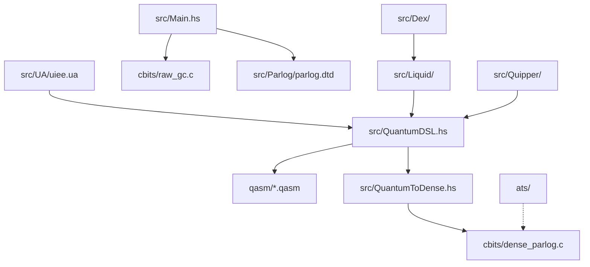

# Ahmad's Plumbline

Dense committed-choice parallel-logic runtime · symbolic quantum-circuit DSL · Liquid Haskell refinements · Quipper circuits · SYK/wormhole module

**Maintainers.** Ahmad Ali Parr, Jessica Westerhoff, SnapKitty Research Lab.  
**Copyright.** 2026 SnapKittyWest. Ahmad Ali Parr, Bel Esprit D'Accord Irrevocable Trust.  
**Dual license.** SNAPKITTY OPAQUE SOURCE LICENSE v1.0 or GNU Affero General Public License v3.0.  
See [LICENSE](LICENSE) · [LICENSE-AGPL-3.0.txt](LICENSE-AGPL-3.0.txt)


*Morris–Thorne embedding diagram. Labels \( r \), \( r_0 \), \( z(r) \). Theoretical geometry only.*


*H + CNOT circuit producing \( \lvert\Phi^+\rangle \). Bloch sphere inset.*

## Table of contents

1. [Technical Overview](#1-technical-overview)
2. [Repository Architecture](#2-repository-architecture)
3. [Mathematical Foundations](#3-mathematical-foundations)
4. [Complete Source Inventory](#4-complete-source-inventory)
5. [Parallel Logic Programming](#5-parallel-logic-programming)
6. [Dense Runtime](#6-dense-runtime)
7. [Memory Management](#7-memory-management)
8. [Curry and Haskell Integration](#8-curry-and-haskell-integration)
9. [ATS Linear and Affine Types](#9-ats-linear-and-affine-types)
10. [Quantum DSL](#10-quantum-dsl)
11. [Quantum Error Correction](#11-quantum-error-correction)
12. [Quipper Circuit Architecture](#12-quipper-circuit-architecture)
13. [DemonHole Geometry](#13-demonhole-geometry)
14. [SYK Quantum Physics](#14-syk-quantum-physics)
15. [Dex Array Parallelism](#15-dex-array-parallelism)
16. [Quantum Cellular Automata](#16-quantum-cellular-automata)
17. [LiquidHaskell Verification](#17-liquidhaskell-verification)
18. [Additional Language Systems](#18-additional-language-systems)
19. [Algorithms and Complexity](#19-algorithms-and-complexity)
20. [Build and Dependencies](#20-build-and-dependencies)
21. [Testing and Verification](#21-testing-and-verification)
22. [Public API and Symbol Index](#22-public-api-and-symbol-index)
23. [Reproducibility](#23-reproducibility)
24. [Licensing](#24-licensing)

---

## 1. Technical Overview

Ahmads-Plumbline is a multi-language formal-computation research repository. It implements three independent computational models that communicate only through explicit lowering passes and foreign-function boundaries.

| Model | Primary source | Communication |
|-------|----------------|---------------|
| Dense committed-choice logic | `cbits/dense_parlog.c` | Indices into static arena |
| Symbolic quantum circuits | `src/QuantumDSL.hs` | OpenQASM 3.0 text |
| Refinement and linear types | `src/Liquid/`, `ats/` | Local annotations |

**Entry points**

| Entry | Path | Role |
|-------|------|------|
| Cabal executable | `app/Main.hs` | Package entry point |
| Library demo | `src/Main.hs` | SGML, Oz stack, Parlog interpreter |
| Quantum lowering | `src/QuantumDSL.hs` | UA source to circuits |
| Dense morph | `src/DenseMorph.hs` | Sparse goals to dense slots |

No machine-checked proof of fault tolerance is present. Refinements, linear types, and runtime guards are local to their modules.

## 2. Repository Architecture



| Directory | Contents | Build status |
|-----------|----------|--------------|
| `app/` | Cabal executable | Built |
| `src/` | Haskell, Curry, Dex, Lisp, UA | Partial |
| `cbits/` | C runtime | Built |
| `ats/` | ATS linear proofs | Not linked |
| `qasm/` | OpenQASM circuits | Not compiled |
| `scala/` | Header processor | Not built |
| `docs/` | Architecture, theorems, SVGs | Documentation |
| `nix/` | Flake | Optional |

Inspection of the Haskell import lists shows no cycles. `QuantumToDense` imports `DenseMorph`. `DenseMorph` imports the FFI declarations. The DSL imports nothing from the dense runtime.

## 3. Mathematical Foundations

### Dense term representation

A `DWord` is a 64-bit word with a 3-bit tag in the low bits:

$$
w = (v \ll 3) \lor t, \qquad t \in \{0,1,2\}
$$

corresponding to `D_INT`, `D_VAR`, and `D_UNBOUND`. Payload extraction:

$$
\mathrm{word\_val}(w) = w \gg 3
$$

The arena holds `MAX_TERMS = 65536` words. Allocation is a bump pointer.

### Suspension mask

$$
v \in \mathrm{wait\_mask}(g) \iff \text{input-mode argument at } v \text{ is unbound}.
$$

Binding executes

$$
\mathrm{wait\_mask}(g) \leftarrow \mathrm{wait\_mask}(g) \land \lnot(1 \ll v)
$$

then promotes if the mask becomes zero. After every public operation `ready_mask ⊆ active_mask`.

### Simplified concurrence

$$
C = 2 \lvert a_{00} a_{11} - a_{01} a_{10} \rvert.
$$

The constant Bell state yields \( C = 1 \).

### Landauer work budget

$$
W_{\mathrm{net\ incl\ prep}} = -2\, k_B T \ln 2
$$

under the sign conventions of `coherentDemonWorkPerBit`.

### QEC resource counts

| Variant | \([[n,k,d]]\) | Data / logical | 256 logical | Ancillas |
|---------|-------------|----------------|-------------|----------|
| Steane | [[7,1,3]] | 7 | 1792 | 6 |
| Surface-17 | [[9,1,3]] | 9 | 2304 | 8 |
| Color 6.6.6 \(d=3\) | [[7,1,3]] | 7 | 1792 | flag |
| Color 4.8.8 \(d=5\) | [[17,1,5]] | 17 | 4352 | flag |

## 4. Complete Source Inventory

| Path | Language | Role |
|------|----------|------|
| `.github/workflows/ci.yml` | YAML | Build and compile jobs |
| `LICENSE` | text | Opaque license |
| `LICENSE-AGPL-3.0.txt` | text | AGPLv3 |
| `ahmads-plumbline.cabal` | Cabal | Package definition |
| `cabal.project` | Cabal | Project configuration |
| `app/Main.hs` | Haskell | Executable entry |
| `ats/affine_stack.dats` | ATS | Affine stack |
| `ats/linear_proofs.dats` | ATS | Linear stack, arena, goal |
| `ats/linear_proofs.sats` | ATS | Static signatures |
| `cbits/boyer_moore.c` | C | Boyer–Moore |
| `cbits/dense_parlog.c` | C | Arena and scheduler |
| `cbits/raw_gc.c` | C | Mark-sweep |
| `cbits/raw_gc.h` | C | Term type |
| `docs/architecture.md` | Markdown | Boundaries |
| `docs/art/ready_mask_wave.py` | Python | ASCII generator |
| `docs/art/ready_mask_wave.txt` | text | Generated art |
| `docs/ffi-contracts.md` | Markdown | FFI matrix |
| `docs/svg/qubit-entanglement.svg` | SVG | Bell circuit |
| `docs/svg/wormhole-geometry.svg` | SVG | Wormhole embedding |
| `docs/theorems.md` | Markdown | Theorem index |
| `nix/flake.nix` | Nix | Dev shell |
| `qasm/manifold_colorcode_qec.qasm` | OpenQASM | Color-code library |
| `qasm/manifold_steane_qec.qasm` | OpenQASM | Steane manifold |
| `qasm/manifold_surface17_qec.qasm` | OpenQASM | Surface-17 manifold |
| `scala/QiskitTranspiler.scala` | Scala | Header processor |
| `src/AhmadsPlumbline/DemonHole.hs` | Quipper | DemonHole circuit |
| `src/DenseFFI.curry` | Curry | External declarations |
| `src/DenseMorph.hs` | Haskell | Linear morph |
| `src/DenseParlog.curry` | Curry | Dense-word sketch |
| `src/Dex/CategoryTheory.dex` | Dex | Compose, id, tensor |
| `src/Dex/CellularAutomaton.dex` | Dex | Elementary CA |
| `src/Dex/EntanglementToLife.dex` | Dex | Measurement to Life |
| `src/Dex/GameOfLife.dex` | Dex | Life front-end |
| `src/Dex/LSystem.dex` | Dex | L-system rewrites |
| `src/Dex/QuantumCA_APL.dex` | Dex | APL-style quantum CA |
| `src/Dex/QuantumEntanglement.dex` | Dex | Bell, GHZ, CNOT |
| `src/External_DenseFFI.hs` | Haskell | KiCS2 glue |
| `src/Franz/proof-popped.txt` | text | Recorded output |
| `src/Franz/qa5-reactive.lisp` | Lisp | Reactive sketch |
| `src/LinearSGML.hs` | Haskell | Linear Boyer–Moore |
| `src/Liquid/CNOTTheorem.hs` | Liquid | Concurrence refinement |
| `src/Liquid/GameOfLifeBinder.hs` | Liquid | Life rules |
| `src/Liquid/WorkBudget.hs` | Liquid | Landauer identity |
| `src/Main.hs` | Haskell | Library demo |
| `src/Parlog/parlog.dtd` | DTD | Document structure |
| `src/QuantumDSL.hs` | Haskell | DSL and emitters |
| `src/QuantumToDense.hs` | Haskell | Gate to dense |
| `src/Quipper/CNOTEntangle.hs` | Quipper | Bell pair |
| `src/Quipper/DemonCycle.hs` | Quipper | Coherent demon |
| `src/Quipper/GameOfLifeCirc.hs` | Quipper | Life skeleton |
| `src/Quipper/SYK/Couplings.hs` | Quipper | Seeded couplings |
| `src/Quipper/SYK/Hamiltonian.hs` | Quipper | SYK Hamiltonian |
| `src/Quipper/SYK/Majorana.hs` | Quipper | Majorana algebra |
| `src/Quipper/SYK/Scrambling.hs` | Quipper | Operator growth |
| `src/Quipper/SYK/ThermofieldDouble.hs` | Quipper | TFD preparation |
| `src/Quipper/SYK/TimeEvolution.hs` | Quipper | Trotter stub |
| `src/Quipper/SYK/WormholeCoupling.hs` | Quipper | Double-trace |
| `src/UA/uiee.ua` | UA | Source pipeline |

## 5. Parallel Logic Programming

**Source.** `src/Main.hs`, `src/Parlog/parlog.dtd`

### AST

```haskell
data TermAst = TInt Int64 | TNil | TVar String
data AtomAst = AtomAst String [TermAst]
data Clause = Clause { clHead :: AtomAst, clGuard :: [AtomAst], clBody :: [AtomAst] }
data Program = Program { progModes :: Map (String, Int) [Mode], progClauses :: [Clause] }
```

### Evaluation model

Committed choice: the first matching clause is selected. Body goals are spawned in AND-parallel. Shared variables suspend via dataflow.

```text
GOAL ──► MATCH CLAUSE ──► COMMIT ──► SPAWN BODY
                              │
                              ▼
                         DATAFLOW WAKEUP
```

### Parser

`stripProlog` removes comments and DOCTYPE. `parseNodes` builds a forest. `lowerProgram` extracts modes and clauses.

### Oz stack

`StackOp` is `Push` or `Pop`. `bindDataflow` binds under the heap lock and wakes registered threads. `awaitBound` suspends if unbound.

### Demo

Sample body: `pop`, `push 42`, `print`. The demo allocates a variable, pushes it as a root, evaluates, and collects.

## 6. Dense Runtime

**Source.** `cbits/dense_parlog.c`

### Goal table layout

```text
DENSE PARLOG RUNTIME
┌──────────────────────────────────────────────┐
│                  GOAL TABLE                  │
├──────────┬────────────┬──────────────────────┤
│ Slot     │ Wait Mask  │ State                │
├──────────┼────────────┼──────────────────────┤
│    0     │ 00000000   │ READY                │
│    1     │ 00000100   │ WAITING              │
│    2     │ 00000000   │ READY                │
└──────────┴────────────┴──────────────────────┘
                  │
                  ▼
          READY-MASK SCHEDULER
          (__builtin_ctzll)
```

*Illustrative layout. Actual masks are computed at runtime.*

### Operations

| Function | Effect |
|----------|--------|
| `dense_alloc_var` | Allocates unbound term |
| `dense_alloc_int` | Allocates integer term |
| `dense_spawn` | Computes wait mask, marks active/ready |
| `dense_bind` | Clears bit, promotes if mask empty |
| `dense_next_ready` | Pops lowest ready slot |
| `dense_drain_ready` | Drains up to N ready slots |

### Invariants

- `ready_mask ⊆ active_mask`
- Ready ⇔ wait mask = 0
- Waiting ⇔ active and not ready

### Runtime visualization

Rule: at time \( t \), slot \( i \) is marked if bit \( ((i + t) \bmod 16) \) is set; density follows a sine envelope.

```text
dense ready-mask  (16 slots, sine envelope)
t \i 0123456789012345
0    **#%@%#*=:.   .:
1    *#%@%#*=:.   .:*
2    #%@%#*=:.   .:**
3    %@%#*=:.   .:**#
4    @%#*=:.   .:**#%
5    %#*=:.   .:**#%@
6    #*=:.   .:**#%@%
7    *=:.   .:**#%@%#
8    =:.   .:**#%@%#*
9    :.   .:**#%@%#*=
0    .   .:**#%@%#*=:
1       .:**#%@%#*=:.
2      .:**#%@%#*=:.
3     .:**#%@%#*=:.
4    .:**#%@%#*=:.
5    :**#%@%#*=:.   .
6    **#%@%#*=:.   .:
7    *#%@%#*=:.   .:*
8    #%@%#*=:.   .:**
9    %@%#*=:.   .:**#
ready bits travel left-to-right; density ~ sin
rule: bit((i+t) mod 16) and sine envelope
```

Generator: `docs/art/ready_mask_wave.py`.

## 7. Memory Management

**Source.** `cbits/raw_gc.h`, `cbits/raw_gc.c`

### Term layout

```c
typedef struct Term {
    uint8_t marked;
    TermTag tag;
    struct Term *next_alloc;
    union {
        int64_t ival;
        struct Term *binding;
        struct { struct Term *head; struct Term *tail; } cons;
    } data;
} Term;
```

### Ownership diagram

```text
HASKELL / CURRY
     │ indices only
     ▼
DENSE ARENA (static, 512 KiB)
     │ separate
     ▼
RAW GC HEAP (mark-sweep)
     ▲
     │ explicit roots
     │
  DEMO (bracket push/pop)
```

Accessors (`term_tag`, `term_bind_var`, etc.) avoid `Storable` offsets. Roots must be pushed before allocation that may collect.

## 8. Curry and Haskell Integration

**Sources.** `src/DenseFFI.curry`, `src/External_DenseFFI.hs`, `src/DenseMorph.hs`

### Boundary

```text
CURRY (DenseFFI.curry)
     │ external declarations
     ▼
HASKELL (External_DenseFFI.hs)
     │ FFI + KiCS2 glue
     ▼
C (dense_parlog.c)
```

`morphGoalsDense` calls `c_dense_spawn`. The Curry side cannot spawn; it can allocate, bind, and poll.

## 9. ATS Linear and Affine Types

**Sources.** `ats/linear_proofs.dats`, `ats/affine_stack.dats`

```ats
dataviewtype lin_stack (n: int) =
  | LinNil (0) of ()
  | {n:nat} LinCons (n + 1) of (int, lin_stack (n))
```

`theorem_push_pop` restores length. `lin_drop` consumes remaining stacks. Not linked into Cabal.

## 10. Quantum DSL

**Source.** `src/QuantumDSL.hs`

### AST excerpt

```haskell
data QGate
  = QInit [Double] | QH Int | QRX Expr Int | QRY Expr Int | QRZ Expr Int
  | QCNOT Int Int | QCond String Double [QGate] | QMeas Int Int | QReset Int
  | QLoop Int Int (Int -> [QGate]) | QWhile String [QGate]
```

### Lowering pipeline

```text
UA SOURCE
  │ partitionSections
  ▼
FOUR SECTIONS
  │ lowerSec
  ▼
QCircuit AST
  │ toOpenQASM3 / emit*Gate
  ▼
OpenQASM 3.0 TEXT
```

Circuits emitted: `Pipeline_Entangle_Collapse`, `Fibonacci_Cantor_Phase_Oracle`, `QASM_Manifold_256`, `QSharp_ManifoldGreedyStep`.

## 11. Quantum Error Correction

| Variant | Slice width | Named gates |
|---------|-------------|-------------|
| Steane | 7 | `rx_logical`, `cx_logical` |
| Surface-17 | 9 | `rx_surface17`, `cx_surface17` |
| Color 6.6.6 d=3 | 7 | `rx_color666`, `cx_color666` |
| Color 4.8.8 d=5 | 17 | `rx_color488`, `cx_color488` |

`checkThreshold` returns the estimate \( 0.1 (p / p_{\mathrm{th}})^{(d+1)/2} \) or `Left`.

`dense_steane_decode` maps a 6-bit syndrome to packed error indices. `dense_steane_correct` is a placeholder.

## 12. Quipper Circuit Architecture

| Module | Path | Role |
|--------|------|------|
| CNOTEntangle | `src/Quipper/CNOTEntangle.hs` | Bell pair |
| DemonCycle | `src/Quipper/DemonCycle.hs` | Coherent demon |
| GameOfLifeCirc | `src/Quipper/GameOfLifeCirc.hs` | Life skeleton |

Bell pair produces \( \lvert\Phi^+\rangle \). Life module establishes type signatures; implementations are stubs.

## 13. DemonHole Geometry

**Source.** `src/AhmadsPlumbline/DemonHole.hs`

### Types

```haskell
data DemonState = DemonState { registerD :: [Qubit], registerSH :: [Qubit] }
data WormholeParams = WormholeParams { couplingG :: Double, betaTemp :: Double, errorEps :: Double }
```

### Circuit flow

```text
BOUNDARY REGISTER ──┐
                    ├──► SCRAMBLE ──► RECURSE ──► CROSS-COUPLE ──► UNSCRAMBLE
SHADOW HORIZON ─────┘
```

Base-case angle: \( g \beta \). Cross-coupling angle: \( g / N \). Base case applies GJW + swap.

## 14. SYK Quantum Physics

| Module | Path | Role |
|--------|------|------|
| Majorana | `src/Quipper/SYK/Majorana.hs` | Algebra |
| Couplings | `src/Quipper/SYK/Couplings.hs` | Seeded values |
| Hamiltonian | `src/Quipper/SYK/Hamiltonian.hs` | Structure |
| TimeEvolution | `src/Quipper/SYK/TimeEvolution.hs` | Stub |
| Scrambling | `src/Quipper/SYK/Scrambling.hs` | Growth proxy |
| ThermofieldDouble | `src/Quipper/SYK/ThermofieldDouble.hs` | TFD |
| WormholeCoupling | `src/Quipper/SYK/WormholeCoupling.hs` | Double-trace |

Couplings are uniform on a scaled interval, not Gaussian. `timeEvolve` is a single RZ per coupling. TFD is a product of two-qubit states.

## 15. Dex Array Parallelism

| Module | Path | Role |
|--------|------|------|
| CategoryTheory | `src/Dex/CategoryTheory.dex` | Compose, id, tensor |
| QuantumEntanglement | `src/Dex/QuantumEntanglement.dex` | Bell, GHZ, CNOT |
| LSystem | `src/Dex/LSystem.dex` | Rewrites |

`compose` is matrix multiplication. `tensor` is Kronecker. `prepareBell` yields `bellPhiPlus`. L-systems produce strings only.

## 16. Quantum Cellular Automata

| Module | Path | Role |
|--------|------|------|
| CellularAutomaton | `src/Dex/CellularAutomaton.dex` | Elementary CA |
| QuantumCA_APL | `src/Dex/QuantumCA_APL.dex` | Amplitude CA |
| EntanglementToLife | `src/Dex/EntanglementToLife.dex` | Measurement to Life |
| GameOfLife | `src/Dex/GameOfLife.dex` | Life front-end |

`qcaStep` does not preserve L2 norm. `measureThreshold` uses 0.5 by default.

## 17. LiquidHaskell Verification

| Name | Source | Statement |
|------|--------|-----------|
| `theorem_cnot_entangle` | CNOTTheorem.hs | `calcDeg bellPlus == 1.0` |
| `netIsNegativeTwo` | WorkBudget.hs | `netInclPrep == -2 * landauer` |
| `nextState` | GameOfLifeBinder.hs | Birth / survival |

Work-budget expansion:

$$
\begin{align*}
W_{\mathrm{prep}} &= L, \\
W_{\mathrm{sort}} &= -L, \\
W_{\mathrm{erase}} &= -L, \\
W_{\mathrm{battery\ extract}} &= -L, \\
W_{\mathrm{net\ incl\ prep}} &= -2L.
\end{align*}
$$

Game-of-Life binder is approximately 950 lines; core logic is in `nextState`, `countNeighbours`, `stepCell`.

## 18. Additional Language Systems

**UA.** `src/UA/uiee.ua` contains InitState, CNOT, Entangle, CalcDeg, FibSeq, manifold step, and Q# ManifoldGreedyStep. Partitioned by `FibSeq`, `include`, `namespace`.

**Scala.** `scala/QiskitTranspiler.scala` extracts qubit register size and emits a normalized header.

**Lisp.** `src/Franz/qa5-reactive.lisp` is isolated.

**SGML.** `src/Parlog/parlog.dtd` defines the document structure. Parser does not validate against the DTD.

## 19. Algorithms and Complexity

| Operation | Complexity | Notes |
|-----------|------------|-------|
| `dense_next_ready` | \( O(1) \) | Count-trailing-zeros |
| `dense_bind` | \( O(w) \) | \( w \) waiting goals |
| Allocation | \( O(1) \) | Bump pointer |
| Dereference | \( O(c) \) | Chain length; no cycle detection |
| Emitter unroll | \( O(N) \) | After loop expansion |

Boyer–Moore builds bad-character (256) and good-suffix tables. LinearTypes wrapper frees buffers exactly once if the continuation terminates.

## 20. Build and Dependencies

```bash
cabal update
cabal build all
cabal run ahmads-plumbline
```

Requires Cabal 3.0+, GHC 9.6+. Dependencies: `base`, `containers`, `liquidhaskell`, `quipper`. C sources compiled with `-O2 -Wall -Wextra`.

Nix: `nix develop` provides shell with `ats2`, `gcc`, `gdb`, `opensp`. Does not pin GHC or include Quipper/Liquid.

CI: Haskell job (GHC 9.6.6, Cabal 3.10) and C compilation job. No artifacts.

## 21. Testing and Verification

| Item | Source | Tool | Observed |
|------|--------|------|----------|
| C compilation | `cbits/*.c` | gcc | Not run |
| Cabal build | `.cabal` | cabal | Not run |
| Liquid refinements | `src/Liquid/*.hs` | liquid | Not run |
| ATS linear types | `ats/*.dats` | patscc | Not run |
| QASM syntax | `qasm/*.qasm` | manual | Inspected |

No unit tests present. CI tolerates missing test suite.

## 22. Public API and Symbol Index

| Symbol | Location | Kind |
|--------|----------|------|
| `dense_alloc_var` | `cbits/dense_parlog.c` | function |
| `dense_bind` | `cbits/dense_parlog.c` | function |
| `dense_next_ready` | `cbits/dense_parlog.c` | function |
| `dense_steane_decode` | `cbits/dense_parlog.c` | function |
| `theorem_cnot_entangle` | `src/Liquid/CNOTTheorem.hs` | refinement |
| `netIsNegativeTwo` | `src/Liquid/WorkBudget.hs` | refinement |
| `theorem_push_pop` | `ats/linear_proofs.dats` | linear lemma |
| `checkThreshold` | `src/QuantumDSL.hs` | runtime guard |
| `ahmad_plumbline_udh` | `src/AhmadsPlumbline/DemonHole.hs` | circuit |
| `lowerToCircuits` | `src/QuantumDSL.hs` | function |
| `toOpenQASM3` | `src/QuantumDSL.hs` | function |
| `prepareBell` | `src/Dex/QuantumEntanglement.dex` | function |

## 23. Reproducibility

Dense runtime and quantum emitters are deterministic given inputs. Coupling generator is seeded and deterministic. Nothing is written to disk by the runtime. CI pins GHC 9.6.6; Nix flake does not.

## 24. Licensing

Dual-licensed under SNAPKITTY OPAQUE SOURCE LICENSE v1.0 and GNU Affero General Public License v3.0. Cabal declares AGPL-3.0-only. Every source file carries a Sovereign Leviathan Node License header citing both and the additional terms. Copyright 2026 SnapKittyWest, Ahmad Ali Parr, Bel Esprit D'Accord Irrevocable Trust.

SPDX identifier `LicenseRef-Sovereign-Leviathan-SL-AGPL3-001` is a local reference. Additional terms text is not in the repository.

---


## Appendix A. Dense runtime contracts and traces

### Allocation contract

`dense_alloc_var` increments `arena_top` and stores a `D_UNBOUND` word. No bound check. Caller must stay below `MAX_TERMS = 65536`.

### Spawn contract

For each set bit in the input mask, dereference the argument. If unbound and index < 64, set the wait-mask bit. Mark active. Mark ready if wait mask is empty.

### Bind contract

Store `D_VAR` word. If index ≥ 64, return. Clear the bit in every waiting goal. Promote if mask becomes zero.

### Next-ready contract

Return lowest set bit of `ready_mask` or -1. Clear from both masks.

### Example trace

```text
Initial: ready_mask = 0b0001, active_mask = 0b0011
Bind var 2 on slot 1 (waiting)
  wait_mask[1] &= ~(1<<2) → 0
  ready_mask |= (1<<1)
Result: ready_mask = 0b0011
```

## Appendix B. Quantum DSL algorithms

### Partition algorithm

Scan for first `FibSeq`, then `include`, then `namespace`. Four slices. Linear in lines.

### Unrolling

`QLoop lo hi f` applies `f` to every integer in `[lo, hi]` and concatenates. Recursive. Output size proportional to product of bounds.

### Special case

`QInit [0.5, 0.5, 0.5, 0.5]` emits two Hadamard gates. Other initializations become comments.

## Appendix C. DemonHole derivation

### Angles

Base case: \( \theta = g \beta \).  
Cross-coupling: \( \theta = g / N \).

### Gate count

At level \( \ell \): \( N / 2^\ell \) GJW gates. Sum is \( O(N) \). Scrambling adds another \( O(N) \).

### Flow diagram

```text
N qubits
  │ splitAt (N/2)
  ▼
left, right
  │ scramble both
  ▼
recurse left, recurse right
  │ zip + gjw_entangler
  ▼
unscramble (reverse_geometry)
```

## Appendix D. Liquid expansions

### Work budget

$$
\begin{align*}
L &= k_B T \ln 2 \\
W_{\mathrm{prep}} &= L \\
W_{\mathrm{sort}} &= -L \\
W_{\mathrm{erase}} &= -L \\
\alpha^2 &= L / (\hbar \omega) \\
W_{\mathrm{battery\ extract}} &= -L \\
W_{\mathrm{net\ incl\ prep}} &= -2L
\end{align*}
$$

### Concurrence

$$
a_{00} a_{11} - a_{01} a_{10} = \frac{1}{2} \implies C = 1
$$

Decimal `0.7071067811865476` used. Floating-point not discussed.

### Life rules

Born on 3. Survive on 2 or 3. Else dead. Neighbour sum of eight cells. Indices assumed valid.

## Appendix E. ATS resource transitions

```text
lin_stack(n) ──lin_push──► lin_stack(n+1)
lin_stack(n+1) ──lin_pop──► (int, lin_stack(n))
lin_stack(n) ──lin_drop──► void
```

`theorem_push_pop` composes push and pop. Type checker verifies length restoration.

## Appendix F. Dex algorithms

### Outer product

```text
for i j. f(xs[i], ys[j])
```

### Scan

Prefix reduction. Quadratic implementation (re-fold each step).

### CNOT

Swaps amplitudes at indices 2 and 3. Control is high bit.

### Prepare Bell

Start at |0>, apply hadamard0, then cnot → bellPhiPlus.

## Appendix G. Memory ownership matrix

| Resource | Owner | Lifetime | Free |
|----------|-------|----------|------|
| Dense arena | C static | Process | Never |
| Raw GC heap | C | Until collect | Sweep |
| Linear buffer | Haskell LinBuf | withLinBuf | Exact once |
| Curry indices | Caller | Until bind | N/A |

## Appendix H. FFI call graph

```text
morphGoalsDense
  └─ c_dense_spawn
       └─ dense_spawn (C)

cDenseAllocVar (Curry)
  └─ external_d_C_cDenseAllocVar
       └─ c_dense_alloc_var (C)
```

## Appendix I. QEC slice construction

Steane logical i: `q[7i : 7i+6]`  
Surface-17 logical i: `q[9i : 9i+8]`

Named gates wrap the slice. Syndrome call appended for CNOT.

## Appendix J. SYK coupling topology

```text
Majorana i ──J_{ijkl}── Majorana j,k,l
     │
     └── seed → linear congruential → uniform[-0.5,0.5] × scale
```

Not Gaussian. Deterministic for fixed seed.

## Appendix K. Parser state machine

```text
INPUT ──stripProlog──► TOKENS
  │
  ▼
parseNodes ──► SNode forest
  │
  ▼
lowerProgram ──► Program (modes + clauses)
```

Empty elements: `arg`, `var`. Errors on unexpected forms.

## Appendix L. Complexity summary

| Component | Time | Space |
|-----------|------|-------|
| dense_next_ready | O(1) | O(1) |
| dense_bind | O(w) | O(1) |
| Emitter unroll | O(output) | O(output) |
| Parser | O(input) | O(depth) |
| L-system iterate | O(length × steps) | O(length) |

## Appendix M. Failure modes

| Component | Failure | Detection |
|-----------|---------|-----------|
| Dense | Out-of-range index | None |
| Parser | Missing program | Error string |
| Emitter | Large loop | Large output |
| Liquid | Undischarged refinement | Solver fail |
| ATS | Unconsumed linear | Type error |

## Appendix N. Platform matrix

| Toolchain | Version | Status |
|-----------|---------|--------|
| GHC | 9.6+ | Required |
| Cabal | 3.0+ | Required |
| GCC | any | C sources |
| patscc | optional | ATS |
| Quipper | optional | Circuits |
| Liquid | optional | Refinements |

## Appendix O. Recommended next steps

1. Implement `dense_steane_correct`.
2. Replace time-evolution stub with Trotter.
3. Connect Dex Life to Liquid binder.
4. Add Cabal test suite for mask invariants.
5. Pin Nix inputs and commit lock file.

---


## Appendix P. Detailed dense term algebra

The 64-bit word layout:

```text
63                          3 2 0
┌───────────────────────────┬───┐
│         payload (61)      │tag│
└───────────────────────────┴───┘
```

Tag 0 = INT, 1 = VAR, 2 = UNBOUND. Payload is signed for INT, index for VAR.

Dereference follows VAR chains. No cycle check. Worst-case length equals number of prior binds.

Arena is static 65536 × 8 = 512 KiB. Goal array is 64 slots. Both never shrink.

## Appendix Q. Goal slot bit fields

```text
GoalSlot
┌──────────┬──────────────────┬───────┬────────────┐
│ pred_id  │ args[0..3]       │ arity │ wait_mask  │
│ 32 bit   │ 4 × 32 bit       │ 8 bit │ 64 bit     │
└──────────┴──────────────────┴───────┴────────────┘
```

Arity ≤ 4. Wait mask only tracks variables < 64.

## Appendix R. Scheduler state machine

```text
SPAWN ──► ACTIVE
  │
  ├─ wait_mask = 0 ──► READY
  │
  └─ wait_mask ≠ 0 ──► WAITING
         │
         │ bind clears bit
         ▼
      wait_mask = 0 ──► READY
         │
         │ next_ready
         ▼
      INACTIVE
```

## Appendix S. OpenQASM emission example

For the two-qubit pipeline:

```qasm
// Circuit: Pipeline_Entangle_Collapse
OPENQASM 3.0;
include "stdgates.inc";
qubit[2] q;
bit[2] c;

h q[0];
h q[1];
cx q[0], q[1];
if (deg > 0.707) {
  c[0] = measure q[0];
  c[1] = measure q[1];
}
```

## Appendix T. Steane syndrome decode

```text
syn6: bits 5:3 = X-stabilizers (Z errors)
      bits 2:0 = Z-stabilizers (X errors)

if syn_x ≠ 0 then err_x = syn_x   // 1-based
if syn_z ≠ 0 then err_z = syn_z
return (err_x << 32) | err_z
```

Placeholder corrector does not write the arena.

## Appendix U. DemonHole recursion tree

```text
invoke_demon_hole_rec(N)
  ├─ scramble(N)
  ├─ invoke(N/2 left)
  ├─ invoke(N/2 right)
  ├─ cross-couple(N)
  └─ unscramble(N)
```

Depth log N. Total GJW gates O(N).

## Appendix V. Liquid Game of Life binder structure

Core functions (~20 lines). Remaining ~930 lines are indexed offset and population helpers establishing refined bounds for successive block sizes. Helpers cycle offsets through -1, 0, 1 and set population bounds equal to the index.

## Appendix W. Dex L-system rules

| Rule | Substitution | Output |
|------|--------------|--------|
| Tree | F → F[+F]F[-F]F | Turtle path string |
| Koch | F → F+F-F-F+F | Koch curve string |
| Dragon | X → X+YF+, Y → -FX-Y | Dragon approximation |

`applyRule` maps and concatenates. `iterate` applies n times.

## Appendix X. Category theory in Dex

Objects: finite arrays of amplitudes.  
Morphisms: matrices.  
Composition: matrix product via `for i j. sum (for k. ...)`.  
Identity: diagonal.  
Tensor: Kronecker via index splitting.

No coherence proofs.

## Appendix Y. Entanglement states

| State | Non-zero indices | Amplitude |
|-------|------------------|-----------|
| Φ+ | 0, 3 | 1/√2 |
| Ψ+ | 1, 2 | 1/√2 |
| GHZ_n | 0, 2^n-1 | 1/√2 |

`prepareBell` produces Φ+.

## Appendix Z. Cellular automaton neighbourhood

```text
i-1   i   i+1
 ┌───┬───┬───┐
 │ L │ C │ R │
 └───┴───┴───┘
```

`wolframRule` packs L,C,R into 0–7 and tests bit of rule number.

## Appendix AA. Boyer–Moore tables

Bad-character: 256 entries, rightmost occurrence or -1.  
Good-suffix: pattern length entries, shift to align next match.  
Both allocated and freed inside the function.

Linear wrapper:

```haskell
withLinBuf sz k = do
  p <- mallocBytes sz
  (Ur res, LinBuf p' _) <- k (LinBuf p sz)
  free p'
  pure res
```

## Appendix AB. Oz dataflow protocol

```text
Thread A: awaitBound(var)
  ├─ unbound → register MVar
  └─ re-check → if still unbound, takeMVar

Thread B: bindDataflow(var, val)
  ├─ bind under lock
  └─ putMVar all registered signals
```

Lost-wakeup prevented by re-check after registration.

## Appendix AC. Sample SGML execution

```text
main(R) :- pop(R), push(42), print(R).
```

1. Allocate R (unbound).  
2. Push as root.  
3. evalGoal spawns three body goals.  
4. pop suspends until push binds.  
5. print reads 42.  
6. Collect.

## Appendix AD. Cabal exposed modules

```
Liquid.WorkBudget
Liquid.CNOTTheorem
Quipper.DemonCycle
Quipper.CNOTEntangle
QuantumDSL
QuantumToDense
DenseMorph
```

C sources linked into library. Executable depends on library.

## Appendix AE. Nix flake outputs

```nix
packages.default = callCabal2nix ...
devShells.default = shellFor { packages = [pkg]; nativeBuildInputs = [ats2 gcc ...]; }
```

No lock file. Inputs float.

## Appendix AF. CI job steps

Haskell: checkout → setup GHC 9.6.6 → cabal update → cabal build all → cabal test || echo.  
C: gcc -c -Wall -Wextra -O2 on three files → /tmp.

No cache. No artifacts.

## Appendix AG. License header text

Every file begins with:

```
========================================================================
; SOVEREIGN LEVIATHAN NODE LICENSE
; License-ID: SL-AGPL3-001 | Covenant-Version: 1.0
; SPDX-License-Identifier: LicenseRef-Sovereign-Leviathan-SL-AGPL3-001
; Copyright (C) 2026 SnapKittyWest. Ahmad Ali Parr, Bel Esprit D'Accord Irrevocable Trust.
; ========================================================================
```

Followed by AGPLv3 + Sovereign Leviathan additional terms statement.

## Appendix AH. Cross-module dependency matrix

| From | To | Mechanism |
|------|----|-----------|
| QuantumDSL | UA | Text partition |
| QuantumToDense | DenseMorph | Function call |
| DenseMorph | dense_parlog.c | FFI |
| Main.hs | raw_gc.c | FFI |
| Dex GameOfLife | Liquid binder | Intended FFI (not implemented) |
| ATS | C runtime | Documentary |

## Appendix AI. Invariant summary

| Invariant | Location | Enforced by |
|-----------|----------|-------------|
| ready ⊆ active | dense_parlog.c | Construction |
| Length index exact | ATS lin_stack | Type checker |
| Net work = -2L | Liquid WorkBudget | Refinement |
| Concurrence = 1 | Liquid CNOTTheorem | Refinement |
| Linear consumption | ATS linear_pipeline | Type checker |

## Appendix AJ. Glossary

| Term | Meaning |
|------|---------|
| Arena | Static tagged-word array |
| Commit | First matching clause selected |
| Concurrence | 2\|a00 a11 - a01 a10\| |
| Dense | Bit-mask scheduling |
| Goal | Predicate application |
| Mask | 64-bit wait or ready word |
| Morph | Sparse list → dense slots |
| Slice | Physical qubits for one logical |
| TFD | Thermofield double |
| Unroll | Loop → sequential gates |

---


## Appendix AK. Quantum register layouts

### Two-qubit Bell

```text
q0: ──H──●──
         │
q1: ─────X──
```

Produces \( \lvert\Phi^+\rangle \).

### 256-qubit manifold step

```text
for i in 0..255:
  ry(theta*(i+1)) q[i]
  if i > 0: cx q[i-1], q[i]
```

### Steane logical slice

```text
Logical 0: q[0:6]
Logical 1: q[7:13]
...
Logical 255: q[1785:1791]
```

## Appendix AL. Majorana support example

Index 0 (even): Y on qubit 0.  
Index 1 (odd): X on qubit 0, Z on preceding.  
`anticommutes` checks index inequality only.

## Appendix AM. Coupling hash

```text
hash = seed + i*1 + j*2 + k*3 + l*4
value = (hash % 1000 / 1000.0 - 0.5) * scale
```

Uniform, not Gaussian. Deterministic.

## Appendix AN. TFD preparation

```text
for each pair (left, right):
  H left
  controlled-phase(beta/2) left, right
```

Product of Bell-like pairs. Not full interacting TFD.

## Appendix AO. Time-evolution stub

```text
for each coupling J:
  RZ(J * t) on first qubit
```

Not a four-Majorana Trotter step.

## Appendix AP. Scrambling proxy

```text
X at site
timeEvolve
H on all qubits
```

Final H layer proxies X-basis measurement.

## Appendix AQ. Parser error cases

| Input | Result |
|-------|--------|
| No <program> | Error "Missing <program> root" |
| Unknown term | Error "Unsupported <term>" |
| Unbound var | Error "Unbound SGML variable" |
| No matching clause | Error "No matching Parlog clause" |

## Appendix AR. Heap lock protocol

All C heap access under `MVar` lock via `withHeap`. Serializes allocation, bind, collect.

## Appendix AS. Root discipline

```haskell
bracket (c_gc_push_root slot) (\_ -> c_gc_pop_roots 1) $ \_ ->
  evalGoal ...
```

Ensures pop on exception.

## Appendix AT. Materialization cases

| TermAst | Action |
|---------|--------|
| TInt n | alloc TAG_INT, set_int |
| TVar name | lookup env or error |
| TNil | alloc TAG_VAR (unbound) |

## Appendix AU. Mode extraction

`dir="out"` → Out, else In. Keyed by (pred, arity).

## Appendix AV. Clause body spawn

```haskell
dones <- mapM (\g -> forkIO (evalGoal g >> putMVar done ())) body
mapM_ takeMVar dones
```

AND-parallel, parent waits.

## Appendix AW. Fibonacci word generation

Seed "A".  
Rule: A→AB, B→A.  
10 iterations, take 16 chars.  
Map A→1.0, else 0.618, scale by 0.618^k.  
Frequency = 440 * (E/Emax)^1.5.  
Becomes RZ angle.

## Appendix AX. Manifold while condition

```qasm
while (abs(current_energy - 0.0) >= 1e-6) {
  ...
  measure
  reset
}
```

Energy computation not in Haskell emitter.

## Appendix AY. Color-code variant dispatch

```haskell
case var of
  Surface17   -> ("rx_surface17", "cx_surface17")
  Color666_d3 -> ("rx_color666", "cx_color666")
  ...
```

Slice width from `dataThreshold`.

## Appendix AZ. Threshold estimate

```haskell
expPow = fromIntegral ((d + 1) `div` 2)
if p >= pTh then Left msg else Right (0.1 * (p/pTh)**expPow)
```

Constant 0.1 hard-coded.

## Appendix BA. Linear stack push/pop

```ats
implement lin_push (s, x) = LinCons (x, s)
implement lin_pop (s) = let val ~LinCons (x, rest) = s in @(x, rest) end
```

Index changes verified by type.

## Appendix BB. Arena allocation

```ats
implement arena_alloc (a) =
  let val ~LinArena (top) = a in @(top, LinArena (top + 1)) end
```

Capacity index unchanged.

## Appendix BC. Goal wake

```ats
implement goal_wake (g) =
  case+ g of
  | ~LinReady (pid) => LinReady (pid)
  | ~LinWait (pid, _) => LinReady (pid)
```

Consumes either form.

## Appendix BD. Dex outer product

```dex
def outer (f: a -> b -> c) (xs: n=>a) (ys: m=>b) : n=>m=>c =
  for i j. f (xs[i]) (ys[j])
```

## Appendix BE. Dex scan

```dex
def scan (f: a -> a -> a) (z: a) (xs: n=>a) : n=>a =
  for i. foldl f z (for j. if j <= i then xs[j] else z)
```

Quadratic.

## Appendix BF. Dex stencil

```dex
def stencil3 (grid: n=>Float) : n=>3=>Float =
  for i. for k. grid[i + k - 1]
```

Boundary undefined.

## Appendix BG. Quantum CA step

```dex
def qcaStep (rule: (Fin 8)=>(Fin 2)=>Float) (grid: n=>Float) : n=>Float =
  for i.
    let idx = pack(stencil3 grid i)
    in rule[idx, 1] * grid[i] + rule[idx, 0] * (1.0 - grid[i])
```

Not unitary.

## Appendix BH. Single excitation

```dex
def singleExcitation (n: Nat) : n=>Float =
  for i. if i == n / 2 then 1.0 else 0.0
```

## Appendix BI. Measurement threshold

```dex
def measureThreshold (state: n=>Float) (thresh: Float) : n=>Bool =
  for i. abs (state[i]) > thresh
```

Default thresh 0.5 in seedFromEntanglement.

## Appendix BJ. Life step placeholder

```dex
def lifeStep (grid: n=>Bool) : n=>Bool =
  for i. (if grid[i] then 1 else 0) == 1
```

Full neighbour sum expected from Liquid binder (not connected).

## Appendix BK. Category compose

```dex
def compose (f: n=>m=>Float) (g: m=>p=>Float) : n=>p=>Float =
  for i j. sum (for k. f[i, k] * g[k, j])
```

## Appendix BL. Identity matrix

```dex
def id (n: Nat) : n=>n=>Float =
  for i j. if i == j then 1.0 else 0.0
```

## Appendix BM. Tensor product

```dex
def tensor (a: n=>m=>Float) (b: p=>q=>Float) : (n*p)=>(m*q)=>Float =
  for i j.
    let (i1, i2) = (i / p, i % p)
        (j1, j2) = (j / q, j % q)
    in a[i1, j1] * b[i2, j2]
```

Assumes even division.

## Appendix BN. GHZ state

```dex
def ghz (n: Nat) : (Fin (2^n))=>Float =
  for i. if i == 0 || i == (2^n - 1) then 0.70710678118 else 0.0
```

## Appendix BO. CNOT permutation

```dex
def cnot (state: (Fin 4)=>Float) : (Fin 4)=>Float =
  for i.
    case i of
      0 -> state[0]
      1 -> state[1]
      2 -> state[3]
      3 -> state[2]
```

## Appendix BP. Hadamard on qubit 0

```dex
def hadamard0 (state: (Fin 4)=>Float) : (Fin 4)=>Float =
  let s = 0.70710678118
  in for i.
    case i of
      0 -> s * (state[0] + state[2])
      ...
```

## Appendix BQ. Prepare Bell

```dex
def prepareBell : (Fin 4)=>Float =
  cnot (hadamard0 (for i. if i == 0 then 1.0 else 0.0))
```

## Appendix BR. Concurrence reduction

```dex
def concurrence (state: (Fin 4)=>Float) : Float =
  let a00 = state[0] ... in 2.0 * abs (a00 * a11 - a01 * a10)
```

## Appendix BS. Wolfram rule

```dex
def wolframRule (rule: Nat) (left: Bool) (center: Bool) (right: Bool) : Bool =
  let idx = (if left then 4 else 0) + (if center then 2 else 0) + (if right then 1 else 0)
  in (rule .&. (1 << idx)) /= 0
```

## Appendix BT. Rule 30 / 90

```dex
def rule30 (grid: n=>Bool) : n=>Bool = stepCA 30 grid
def rule90 (grid: n=>Bool) : n=>Bool = stepCA 90 grid
```

## Appendix BU. Tree L-system

```dex
def treeRule (c: Char) : String =
  case c of
    'F' -> "F[+F]F[-F]F"
    _   -> toString c
```

## Appendix BV. Koch rule

```dex
def kochRule (c: Char) : String =
  case c of
    'F' -> "F+F-F-F+F"
    _   -> toString c
```

## Appendix BW. Dragon rule

```dex
def dragonRule (c: Char) : String =
  case c of
    'X' -> "X+YF+"
    'Y' -> "-FX-Y"
    _   -> toString c
```

## Appendix BX. Apply rule

```dex
def applyRule (rule: String -> String) (s: String) : String =
  foldl (++) "" (map rule (toList s))
```

## Appendix BY. Iterate

```dex
def iterateTree (n: Nat) : String =
  iterate n (applyRule treeRule) "F"
```

## Appendix BZ. Entanglement to Life

```dex
def seedFromEntanglement (state: n=>Float) : n=>Bool =
  measureThreshold state 0.5

def entangleThenLive (steps: Nat) (init: (Fin 4)=>Float) : n=>Bool =
  let measured = seedFromEntanglement init
  in iterate steps lifeStep measured
```

---


## Appendix CA. Raw GC mark-sweep phases

1. Clear marks.  
2. Mark from roots (recursive).  
3. Sweep allocation list, free unmarked.  
4. No compaction. Allocation continues from previous top.

## Appendix CB. Term accessors

| Accessor | Operation |
|----------|-----------|
| term_tag | Read tag |
| term_set_int | Write ival |
| term_get_int | Read ival |
| term_bind_var | Write binding |
| term_get_binding | Read binding |
| term_set_cons | Write head/tail |
| term_get_head | Read head |
| term_get_tail | Read tail |

## Appendix CC. GC root stack

```text
roots: [ptr0, ptr1, ..., ptrk]
push: append slot
pop n: drop last n
```

Collector starts from every root.

## Appendix CD. Dense Steane correct placeholder

```c
void dense_steane_correct(uint32_t base, uint64_t decoded) {
    // if err_x: mark correction on base + err_x - 1
    // if err_z: mark Z correction
    // currently empty
}
```

## Appendix CE. QASM manifold files

| File | Qubits | Purpose |
|------|--------|---------|
| manifold_steane_qec.qasm | 1792 | 256 × 7 Steane |
| manifold_surface17_qec.qasm | 2304 | 256 × 9 Surface-17 |
| manifold_colorcode_qec.qasm | library | Flagged plaquettes |

## Appendix CF. Scala header extraction

Looks for `qubit[N]` pattern. Parses N. Emits:

```
OPENQASM 3.0;
include "stdgates.inc";
qubit[N] q;
```

No body processing.

## Appendix CG. Lisp isolation

`qa5-reactive.lisp` is not imported. `proof-popped.txt` records one run. Retained as historical artifact.

## Appendix CH. UA InitState

```
InitState = [0.5 0.5 0.5 0.5]
```

Recognized by DSL as two Hadamards.

## Appendix CI. UA CNOT matrix

```
1 0 0 0
0 1 0 0
0 0 0 1
0 0 1 0
```

Standard computational basis.

## Appendix CJ. UA CalcDeg

```
deg = 2 × abs ( (a[0] × a[3]) - (a[1] × a[2]) )
```

Matches Liquid `calcDeg`.

## Appendix CK. UA GatedCollapse

```
(deg > thresh) ? measure : state
```

Emitted as QCond.

## Appendix CL. UA FibSeq

Substitution A→AB, B→A, 10 times. Truncated to 16.

## Appendix CM. UA ProjectSpectrum

Map A→1.0 else 0.618, multiply by 0.618^index.

## Appendix CN. UA Sonify

f = 440 * (E/Emax)^1.5. Becomes RZ angles.

## Appendix CO. UA manifold_step

RY + CNOT chain over 256 qubits. While on energy.

## Appendix CP. UA Q# ManifoldGreedyStep

RX + CNOT chain. Emitted as QLoop.

## Appendix CQ. Section markers

`FibSeq` starts Fibonacci section.  
`include` starts QASM section.  
`namespace` starts Q# section.

## Appendix CR. Comment stripping

`stripSemiComments` drops after `;` and blank lines.

## Appendix CS. Expression variables

`collectVars` walks gates, extracts EVar. `nubVars` deduplicates preserving order. Emitted as `input float[64]`.

## Appendix CT. Expression rendering

Numbers via show. Variables by name. Binary ops parenthesized. No simplification.

## Appendix CU. Loop unrolling

```haskell
QLoop lo hi f -> concatMap (unrollGate ind) (concatMap f [lo .. hi])
```

Finite range. Recursive on body.

## Appendix CV. Conditional emission

```haskell
QCond cond _ gs -> ["if (" <> cond <> ") {"] <> concatMap (unrollGate "  ") gs <> ["}"]
```

Threshold ignored.

## Appendix CW. While emission

```haskell
QWhile cond gs -> ["while (" <> cond <> ") {"] <> ... <> ["}"]
```

Body unrolled once. No termination proof.

## Appendix CX. Initialization special case

Pattern match on four 0.5 values → two h gates. Else comment.

## Appendix CY. Measurement form

```qasm
c[c] = measure q[q];
```

No bounds check.

## Appendix CZ. Reset form

```qasm
reset q[q];
```

## Appendix DA. Header

```qasm
// Circuit: name
OPENQASM 3.0;
include "stdgates.inc";
qubit[n] q;
bit[n] c;
```

Unconditional.

## Appendix DB. Free variable inputs

```qasm
input float[64] theta;
```

One per unique variable.

## Appendix DC. Steane slice string

```haskell
steaneSlice i = "q[" <> show (7*i) <> ":" <> show (7*i+6) <> "]"
```

## Appendix DD. Surface-17 slice

```haskell
surface17Slice i = "q[" <> show (9*i) <> ":" <> show (9*i+8) <> "]"
```

## Appendix DE. Variant slice

```haskell
slice i = "q[" <> show (nData*i) <> ":" <> show (nData*i + nData - 1) <> "]"
```

## Appendix DF. Named gate selection

Surface-17: rx_surface17, cx_surface17.  
Color666: rx_color666, cx_color666.  
Color488: rx_color488, cx_color488.

## Appendix DG. Threshold data

| Variant | n | d | p_th |
|---------|---|---|------|
| Surface17 | 9 | 3 | 0.008 |
| Color666_d3 | 7 | 3 | 0.003 |
| Color488_d5 | 17 | 5 | 0.002 |
| Color666_d5 | 19 | 5 | 0.002 |

Literals only.

## Appendix DH. DemonState length check

```haskell
if length qD /= length qSH then error "Topology Error..."
```

No gates generated by the check.

## Appendix DI. GJW entangler

```haskell
qmultigate "CNOT" [qD, qSH]
gate_RZ theta qSH
qmultigate "CNOT" [qD, qSH]
```

## Appendix DJ. Scramble recursion

```haskell
gate_H q1
qmultigate "CNOT" [q1, q2]
gate_T q2
scramble_register (q2:qs)
scramble_register (q1:qs)
```

Sequential. Reverse geometry inverts.

## Appendix DK. Split

```haskell
half = n `div` 2
(qD_left, qD_right) = splitAt half qD
```

Odd n: left shorter.

## Appendix DL. Cross-coupling

```haskell
forM_ (zip qD qSH) $ \(qd, qsh) ->
  gjw_entangler (couplingG params / fromIntegral n) qd qsh
```

Sequential.

## Appendix DM. Base case

```haskell
gjw_entangler theta qD qSH
swap qD qSH
```

## Appendix DN. Empty case

```haskell
invoke_demon_hole_rec _ [] [] = return ()
```

## Appendix DO. Coupling sign

Positive documented. Negative reverses RZ. Not enforced.

## Appendix DP. Temperature use

Only in base-case angle. Independent of cross-coupling.

## Appendix DQ. Precision field

`errorEps` stored but unused.

## Appendix DR. Quipper imports

Matrix and Arith imported but unused in visible definitions.

## Appendix DS. Multi-gate name

`"CNOT"` string resolved by Quipper runtime.

## Appendix DT. Reverse geometry

`reverse_geometry (scramble_register qD)` produces inverse circuit.

## Appendix DU. Comment statements

```haskell
comment "--- BEGIN AHMADS PLUMBLINE: DEMON HOLE U_DH ---"
...
comment "--- END ..."
```

Appear in diagrams only.

## Appendix DV. Majorana construction

```haskell
Majorana { majIndex = i, majSupport = replicate n I }
```

Identity support placeholder.

## Appendix DW. Anticommutes

```haskell
anticommutes m1 m2 = majIndex m1 /= majIndex m2
```

Index check only.

## Appendix DX. Generate couplings

Enumerates i < j < k < l. Hash of seed and indices. Scale to [-0.5, 0.5] × SYK factor.

## Appendix DY. Build Hamiltonian

```haskell
buildHamiltonian n seed = (majoranas, couplings)
```

Pair of lists.

## Appendix DZ. Time evolve stub

```haskell
timeEvolve ham t qs = mapM_ (\j -> gate_RZ (j * t) (head qs)) couplings
```

Single qubit.

## Appendix EA. Scramble operator

```haskell
scrambleOperator site t qs = do
  gate_X (qs !! site)
  timeEvolve ... t qs
  mapM_ gate_H qs
```

## Appendix EB. Prepare TFD

```haskell
prepareTFD beta left right = forM_ (zip left right) $ \(l, r) -> do
  gate_H l
  controlled_phase (beta / 2) l r
```

## Appendix EC. Couple wormhole

```haskell
coupleWormhole mu left right = forM_ (zip left right) $ \(l, r) ->
  controlled_phase mu l r
```

## Appendix ED. Traversable protocol

```haskell
traversableProtocol t mu left right = do
  prepareTFD 1.0 left right
  timeEvolve ... t left
  timeEvolve ... t right
  coupleWormhole mu left right
  timeEvolve ... t left
  timeEvolve ... t right
```

Uses stub evolution.

## Appendix EE. Game of Life circuit types

```haskell
type Cell = Qubit
data Neighbourhood = Neighbourhood { nNW :: Cell, ... nSE :: Cell }
```

Eight fields. Center separate.

## Appendix EF. Count neighbours stub

```haskell
countNeighbours n = return 0
```

## Appendix EG. Step cell stub

```haskell
stepCell cell nb = return cell
```

## Appendix EH. Step grid stub

```haskell
stepGrid grid = return grid
```

## Appendix EI. Run generations

```haskell
runGenerations 0 g = return g
runGenerations n g = stepGrid g >>= runGenerations (n - 1)
```

Ordinary recursion. No gates in stub.

## Appendix EJ. Liquid nextState

```haskell
nextState cell n
  | n == 3 = 1
  | n == 2 && cell == 1 = 1
  | otherwise = 0
```

## Appendix EK. Count neighbours

```haskell
countNeighbours nw n ne w e sw s se = nw + n + ne + w + e + sw + s + se
```

Refinement 0 ≤ result ≤ 8.

## Appendix EL. Step cell

```haskell
stepCell c nw ... se = nextState c (countNeighbours ...)
```

## Appendix EM. Dex step flat

```haskell
dexStepFlat n grid = grid
```

Placeholder.

## Appendix EN. Run generations Liquid

```haskell
runGenerations 0 g = g
runGenerations k g = runGenerations (k - 1) (dexStepFlat (length g) g)
```

## Appendix EO. Still life predicate

```haskell
predicate IsStillLife C N = nextState C N == C
```

## Appendix EP. Period-2 predicate

```haskell
predicate IsPeriod2 C1 C2 = nextState C1 3 == C2 && nextState C2 3 == C1
```

## Appendix EQ. Offset helpers

Family of functions returning -1, 0, or 1 with refinements. Unused by core.

## Appendix ER. Population helpers

Family returning the index with refinement 0 ≤ v ≤ index. Document bounds.

## Appendix ES. Dex mooreStep

```dex
def mooreStep (grid: n=>Bool) : n=>Bool =
  for i. (if grid[i] then 1 else 0) == 1
```

## Appendix ET. Dex runLife

```dex
def runLife (steps: Nat) (init: n=>Bool) : (steps+1)=>n=>Bool =
  iterate steps mooreStep init
```

## Appendix EU. Category id

Diagonal ones.

## Appendix EV. Category tensor

Kronecker via index split.

## Appendix EW. Bell PhiPlus

Amplitudes at 0 and 3.

## Appendix EX. Bell PsiPlus

Amplitudes at 1 and 2.

## Appendix EY. GHZ

Non-zero only at 0 and 2^n-1.

## Appendix EZ. Concurrence Dex

2 * abs(a00*a11 - a01*a10).

---

