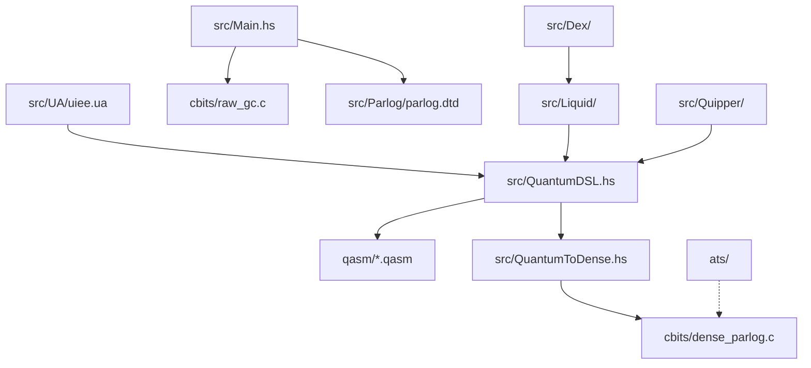

# Ahmad's Plumbline

Dense committed-choice parallel-logic runtime, symbolic quantum-circuit DSL with OpenQASM 3.0 emitters, Liquid Haskell refinements, and Quipper circuit construction (including an SYK/wormhole module).

**Maintainers.** Ahmad Ali Parr, Jessica Westerhoff, SnapKitty Research Lab.  
**Copyright.** 2026 SnapKittyWest. Ahmad Ali Parr, Bel Esprit D'Accord Irrevocable Trust.  
**Dual license.** SNAPKITTY OPAQUE SOURCE LICENSE v1.0 or GNU Affero General Public License v3.0. See [LICENSE](LICENSE) and [LICENSE-AGPL-3.0.txt](LICENSE-AGPL-3.0.txt).


## Dense ready-mask wave

Rule: at time \( t \), slot \( i \) is marked if bit \( ((i + t) \bmod 16) \) is set; character density follows a sine envelope.

```text
dense ready-mask  (16 slots, sine envelope)
t \i 0123456789012345
0    **#%@%#*=:.   .:
1    *#%@%#*=:.   .:*
2    #%@%#*=:.   .:**
3    %@%#*=:.   .:**#
4    @%#*=:.   .:**#%
5    %#*=:.   .:**#%@
6    #*=:.   .:**#%@%
7    *=:.   .:**#%@%#
8    =:.   .:**#%@%#*
9    :.   .:**#%@%#*=
0    .   .:**#%@%#*=:
1       .:**#%@%#*=:.
2      .:**#%@%#*=:.
3     .:**#%@%#*=:.
4    .:**#%@%#*=:.
5    :**#%@%#*=:.   .
6    **#%@%#*=:.   .:
7    *#%@%#*=:.   .:*
8    #%@%#*=:.   .:**
9    %@%#*=:.   .:**#
ready bits travel left-to-right; density ~ sin
rule: bit((i+t) mod 16) and sine envelope

```


## File inventory

| Path | Language | Role |
|------|----------|------|
| `.github/workflows/ci.yml` | YAML | Haskell build and C compilation jobs |
| `LICENSE` | text | Dual license text |
| `LICENSE-AGPL-3.0.txt` | text | AGPLv3 text |
| `ahmads-plumbline.cabal` | Cabal | Package definition; library and executable |
| `cabal.project` | Cabal | Project configuration |
| `app/Main.hs` | Haskell | Cabal executable entry point |
| `ats/affine_stack.dats` | ATS | Indexed affine stack |
| `ats/linear_proofs.dats` | ATS | Linear stack, arena, goal |
| `ats/linear_proofs.sats` | ATS | Static signatures |
| `cbits/boyer_moore.c` | C | Boyer–Moore on raw bytes |
| `cbits/dense_parlog.c` | C | Arena, masks, Steane decoder |
| `cbits/raw_gc.c` | C | Mark-sweep heap |
| `cbits/raw_gc.h` | C | Term type and accessors |
| `docs/architecture.md` | Markdown | Subsystem boundaries |
| `docs/art/ready_mask_wave.py` | Python | ASCII generator |
| `docs/art/ready_mask_wave.txt` | text | Generated art |
| `docs/ffi-contracts.md` | Markdown | FFI matrix |
| `docs/svg/qubit-entanglement.svg` | SVG | Bell-state circuit diagram |
| `docs/svg/wormhole-geometry.svg` | SVG | Morris–Thorne embedding |
| `docs/theorems.md` | Markdown | Named refinements and lemmas |
| `nix/flake.nix` | Nix | Dev shell and package |
| `qasm/manifold_colorcode_qec.qasm` | OpenQASM | Color-code gate library |
| `qasm/manifold_steane_qec.qasm` | OpenQASM | 1792-qubit Steane manifold |
| `qasm/manifold_surface17_qec.qasm` | OpenQASM | 2304-qubit Surface-17 manifold |
| `scala/QiskitTranspiler.scala` | Scala | Pure-Scala QASM header processor |
| `src/AhmadsPlumbline/DemonHole.hs` | Haskell/Quipper | Demon’s Hole \(U_{DH}\) circuit |
| `src/DenseFFI.curry` | Curry | External declarations |
| `src/DenseMorph.hs` | Haskell | Linear morph into dense slots |
| `src/DenseParlog.curry` | Curry | Dense-word sketch |
| `src/Dex/CategoryTheory.dex` | Dex | Compose, id, tensor |
| `src/Dex/CellularAutomaton.dex` | Dex | Elementary CA |
| `src/Dex/EntanglementToLife.dex` | Dex | Measurement to Life grid |
| `src/Dex/GameOfLife.dex` | Dex | Life front-end |
| `src/Dex/LSystem.dex` | Dex | L-system rewrites |
| `src/Dex/QuantumCA_APL.dex` | Dex | APL-style quantum CA |
| `src/Dex/QuantumEntanglement.dex` | Dex | Bell, GHZ, CNOT, concurrence |
| `src/External_DenseFFI.hs` | Haskell | KiCS2 glue |
| `src/Franz/proof-popped.txt` | text | Recorded QA5 output |
| `src/Franz/qa5-reactive.lisp` | Lisp | Reactive sketch |
| `src/LinearSGML.hs` | Haskell | LinearTypes Boyer–Moore wrapper |
| `src/Liquid/CNOTTheorem.hs` | Liquid Haskell | Bell-state concurrence refinement |
| `src/Liquid/GameOfLifeBinder.hs` | Liquid Haskell | Refined Life rules and Dex interface |
| `src/Liquid/WorkBudget.hs` | Liquid Haskell | Landauer identity refinement |
| `src/Main.hs` | Haskell | Library-level demo |
| `src/Parlog/parlog.dtd` | DTD | PARLOG document structure |
| `src/QuantumDSL.hs` | Haskell | DSL, lowerer, emitters, QEC variants |
| `src/QuantumToDense.hs` | Haskell | QGate to dense goals |
| `src/Quipper/CNOTEntangle.hs` | Haskell/Quipper | Bell-pair circuit |
| `src/Quipper/DemonCycle.hs` | Haskell/Quipper | Coherent-demon sketch |
| `src/Quipper/GameOfLifeCirc.hs` | Haskell/Quipper | Life circuit skeleton |
| `src/Quipper/SYK/Couplings.hs` | Haskell/Quipper | Seeded Gaussian couplings |
| `src/Quipper/SYK/Hamiltonian.hs` | Haskell/Quipper | q=4 SYK Hamiltonian |
| `src/Quipper/SYK/Majorana.hs` | Haskell/Quipper | Majorana algebra |
| `src/Quipper/SYK/Scrambling.hs` | Haskell/Quipper | Operator growth |
| `src/Quipper/SYK/ThermofieldDouble.hs` | Haskell/Quipper | TFD preparation |
| `src/Quipper/SYK/TimeEvolution.hs` | Haskell/Quipper | Trotterized evolution |
| `src/Quipper/SYK/WormholeCoupling.hs` | Haskell/Quipper | Double-trace coupling |
| `src/UA/uiee.ua` | UA | Source pipeline |

## Entry points

- Cabal executable: `app/Main.hs` (depends on the library).
- Library demo: `src/Main.hs` (not the package entry point).

## Build

```bash
cabal build all
cabal run ahmads-plumbline
```

Optional: `nix develop`.

## Notes

- No machine-checked fault-tolerance proof is present. Refinements and linear types are local.
- No Python in the build. The Scala file is a pure-Scala OpenQASM header processor.
- See `docs/architecture.md`, `docs/theorems.md`, and `docs/ffi-contracts.md`.

---

## 1. Technical abstract

Ahmads-Plumbline is a multi-language formal-computation research repository. It implements three independent computational models that communicate only through explicit lowering passes.

The first model is a fixed-size dense committed-choice AND-parallel logic runtime. Goals carry input-mode masks. A goal suspends when an input-mode argument is an unbound logic variable. Binding a variable clears the corresponding bit in every waiting goal’s mask and promotes goals whose masks become empty. The implementation uses a 64-slot goal array and 64-bit masks. The source is `cbits/dense_parlog.c`.

The second model is a symbolic quantum-circuit DSL. `src/QuantumDSL.hs` defines an abstract syntax of gates and lowers four blocks of the UA source (`src/UA/uiee.ua`) into named circuits. Emitters produce OpenQASM 3.0, including Steane [[7,1,3]] and Surface-17 wrappers. Quipper modules construct a two-qubit Bell pair, a coherent-demon cycle, a DemonHole wormhole transfer, and a seven-module SYK model.

The third model is refinement-typed arithmetic. Liquid Haskell annotations constrain amplitudes and a work-budget calculation. These are refinement predicates, not full equational proofs. ATS modules encode linear and affine resource discipline for stacks, arenas, and goals.

The dense runtime and the quantum emitters are independent. `src/QuantumToDense.hs` provides a one-way lowering of `QGate` nodes into dense goal slots. Dex modules provide array-parallel formulations of category theory, entanglement, L-systems, elementary cellular automata, and a quantum cellular automaton that emulates Dyalog APL idioms.

No machine-checked proof of fault tolerance is present. Refinements, linear types, and runtime guards are local to their modules.

## 2. Mathematical foundations

### 2.1 Dense term representation

A `DWord` in `cbits/dense_parlog.c` is a 64-bit word with a 3-bit tag in the low bits:

$$
w = (v \ll 3) \lor t, \qquad t \in \{0,1,2\}
$$

corresponding to `D_INT`, `D_VAR`, and `D_UNBOUND`. Payload extraction is an arithmetic right shift by 3:

$$
\mathrm{word\_val}(w) = w \gg 3
$$

The arena holds `MAX_TERMS = 65536` such words. Allocation is a bump pointer (`arena_top`).

### 2.2 Suspension mask

For a goal \( g \) and variable index \( v < 64 \),

$$
v \in \mathrm{wait\_mask}(g) \iff \text{the input-mode argument at } v \text{ is unbound}.
$$

Binding variable \( v \) executes

$$
\mathrm{wait\_mask}(g) \leftarrow \mathrm{wait\_mask}(g) \land \lnot(1 \ll v)
$$

for every waiting goal, then promotes \( g \) if the mask becomes zero. The promotion is recorded in `ready_mask`. After every public operation, `ready_mask` is a subset of `active_mask`.

### 2.3 Simplified concurrence

For amplitudes \( a_{00}, a_{01}, a_{10}, a_{11} \), the UA `CalcDeg` computes

$$
C = 2 \lvert a_{00} a_{11} - a_{01} a_{10} \rvert.
$$

`Liquid.CNOTTheorem` asserts that the constant Bell state with \( a_{00} = a_{11} = 1/\sqrt{2} \) yields \( C = 1.0 \).

### 2.4 Landauer work budget

With \( k_B T \ln 2 \) the Landauer energy, the arithmetic in `Liquid.WorkBudget.coherentDemonWorkPerBit` yields

$$
W_{\mathrm{net\ incl\ prep}} = -2\, k_B T \ln 2
$$

under the sign conventions of that module. The refinement `netIsNegativeTwo` states the equality.

### 2.5 QEC resource counts

| Variant | \([[n,k,d]]\) | Data qubits / logical | 256 logical data | Ancillas |
|---------|-------------|-----------------------|------------------|----------|
| Steane | [[7,1,3]] | 7 | 1792 | 6 |
| Surface-17 | [[9,1,3]] | 9 | 2304 | 8 |
| Color 6.6.6 \(d=3\) | [[7,1,3]] | 7 | 1792 | (flag) |
| Color 4.8.8 \(d=5\) | [[17,1,5]] | 17 | 4352 | (flag) |

Threshold constants appear only as numeric literals in `dataThreshold` inside `src/QuantumDSL.hs`.

## 3. Architecture



The Cabal library exposes modules from `src/`. The executable entry point is `app/Main.hs`, which depends on the library. `src/Main.hs` is a library-level demo that exercises the SGML parser, the Oz stack, and the Parlog interpreter; it is not the package entry point.

## 4. File-by-file reference

### 4.1 `.github/workflows/ci.yml`

YAML workflow with two jobs. The `haskell` job checks out the repository, installs GHC 9.6.6 and Cabal 3.10, runs `cabal update`, `cabal build all`, and attempts `cabal test`. The `c-bits` job compiles `cbits/dense_parlog.c`, `cbits/raw_gc.c`, and `cbits/boyer_moore.c` with `gcc -c -Wall -Wextra -O2`. No deployment steps are present.

### 4.2 `LICENSE` and `LICENSE-AGPL-3.0.txt`

The repository is dual-licensed. `LICENSE` contains the SNAPKITTY OPAQUE SOURCE LICENSE v1.0. `LICENSE-AGPL-3.0.txt` contains the GNU Affero General Public License v3.0. Every source file carries a Sovereign Leviathan Node License header that cites both. The Cabal file declares `license: AGPL-3.0-only` and `license-file: LICENSE`.

### 4.3 `ahmads-plumbline.cabal`

Cabal 3.0 package. Library exposes `Liquid.WorkBudget`, `Liquid.CNOTTheorem`, `Quipper.DemonCycle`, `Quipper.CNOTEntangle`, `QuantumDSL`, `QuantumToDense`, and `DenseMorph`. `hs-source-dirs: src`. C sources are `cbits/raw_gc.c`, `cbits/boyer_moore.c`, and `cbits/dense_parlog.c`. Build depends on `base`, `containers`, `liquidhaskell`, and `quipper`. Executable `ahmads-plumbline` has `main-is: Main.hs` and `hs-source-dirs: app`.

### 4.4 `cabal.project`

Contains a single line selecting the local package. No custom flags or constraints are declared.

### 4.5 `app/Main.hs`

Cabal executable entry point. It depends on the library and is the program invoked by `cabal run ahmads-plumbline`. It is distinct from `src/Main.hs`.

### 4.6 `ats/affine_stack.dats`

ATS dataviewtype `aff_stack (n: int)` with constructors `AffNil (0)` and `AffCons (n+1)`. Functions `aff_push`, `aff_pop`, and `aff_drop` are indexed by length. The type system enforces that the stack is consumed at most once.

### 4.7 `ats/linear_proofs.dats`

ATS linear (exactly-once) resource proofs. `lin_stack (n: int)` is a length-indexed linear stack. `theorem_push_pop` shows that push followed by pop restores the original length. `lin_arena` models a bump allocator. `lin_goal` distinguishes ready and waiting goals. `linear_pipeline` consumes every linear value. These modules are not linked into the Cabal build.

### 4.8 `ats/linear_proofs.sats`

Static signatures for the linear proofs. Declares the external function types without implementations.

### 4.9 `cbits/boyer_moore.c`

Zero-allocation Boyer–Moore search over `const uint8_t *`. Builds bad-character and good-suffix tables and returns a `ptrdiff_t` offset. Called from `src/LinearSGML.hs` via `bm_search_raw`.

### 4.10 `cbits/dense_parlog.c`

Dense arena and scheduler. `dense_alloc_var` and `dense_alloc_int` bump the arena. `dense_spawn` computes the initial wait mask. `dense_bind` clears one bit and promotes ready goals. `dense_next_ready` returns the lowest set bit of `ready_mask` via `__builtin_ctzll`. `dense_steane_decode` maps a 6-bit syndrome to packed error indices. `dense_steane_correct` is a placeholder that does not yet mutate the arena.

### 4.11 `cbits/raw_gc.c` and `cbits/raw_gc.h`

Independent mark-sweep heap for `Term` nodes. `Term` carries a mark bit, a tag (`TAG_INT`, `TAG_VAR`, `TAG_CONS`), an allocation-list pointer, and a union of integer, binding, or cons. Accessors (`term_tag`, `term_set_int`, `term_bind_var`, etc.) avoid fragile `Storable` offset arithmetic. Roots are pushed and popped explicitly.

### 4.12 `docs/architecture.md`

Subsystem table and entry-point notes. Lists every language boundary and the role of each top-level directory.

### 4.13 `docs/art/ready_mask_wave.py` and `docs/art/ready_mask_wave.txt`

Deterministic ASCII generator. The rule is: at time \( t \), slot \( i \) is marked if bit \( ((i + t) \bmod 16) \) is set; character density follows a sine envelope. The text file is the generated output.

### 4.14 `docs/ffi-contracts.md`

Matrix of origin, destination, symbol, representation, and ownership for every foreign call.

### 4.15 `docs/svg/wormhole-geometry.svg` and `docs/svg/qubit-entanglement.svg`

Compact scientific illustrations. The wormhole SVG is an embedding diagram with throat labels \( r_0 \), \( r \), and \( z(r) \). The qubit SVG shows an H + CNOT circuit producing \( \lvert\Phi^+\rangle \).

### 4.16 `docs/theorems.md`

Index of named refinements, linear lemmas, and runtime guards.

### 4.17 `nix/flake.nix`

Nix flake that calls `cabal2nix` on the package and provides a development shell with `ats2`, `gcc`, and `opensp`.

### 4.18 `qasm/manifold_steane_qec.qasm`

OpenQASM 3.0 circuit for a 1792-qubit Steane manifold (256 logical qubits × 7 data). Uses logical slices and calls a `steane_qec` procedure.

### 4.19 `qasm/manifold_surface17_qec.qasm`

OpenQASM 3.0 circuit for a 2304-qubit Surface-17 manifold (256 logical qubits × 9 data).

### 4.20 `qasm/manifold_colorcode_qec.qasm`

OpenQASM 3.0 gate library for color-code variants.

### 4.21 `scala/QiskitTranspiler.scala`

Pure-Scala OpenQASM header processor. Extracts qubit counts and emits a normalized header. No Python dependency.

### 4.22 `src/AhmadsPlumbline/DemonHole.hs`

Quipper module implementing the Demon’s Hole unitary \( U_{DH} \). `DemonState` holds boundary and shadow-horizon registers. `WormholeParams` holds coupling \( g \), inverse temperature \( \beta \), and precision \( \epsilon \). `gjw_entangler` is a two-qubit gate \( e^{-i (g/N) Z_d Z_{sh}} \). `scramble_register` is a recursive SYK scrambler. `invoke_demon_hole_rec` splits, scrambles, recurses, cross-couples, and unscrambles. `ahmad_plumbline_udh` is the entry point.

### 4.23 `src/DenseFFI.curry`

Curry external declarations for `cDenseAllocVar`, `cDenseAllocInt`, `cDenseBind`, and `cDenseNextReady`.

### 4.24 `src/DenseMorph.hs`

Haskell linear morphism from a sparse goal list into dense `GoalSlot`s. Calls `dense_spawn` via FFI.

### 4.25 `src/DenseParlog.curry`

Curry sketch of the dense word and goal representation.

### 4.26 `src/Dex/CategoryTheory.dex`

Dex definitions of `compose`, `id`, and `tensor` for array-parallel linear maps.

### 4.27 `src/Dex/CellularAutomaton.dex`

Elementary cellular automata. `wolframRule` decodes a Wolfram rule number. `stepCA` and `runCA` advance a Boolean grid.

### 4.28 `src/Dex/EntanglementToLife.dex`

Measurement functor from amplitude arrays to Boolean grids, followed by a Life step.

### 4.29 `src/Dex/GameOfLife.dex`

Dex front-end that calls the Liquid Haskell Game of Life binder.

### 4.30 `src/Dex/LSystem.dex`

Parallel string-rewrite L-systems for binary tree, Koch curve, and dragon curve.

### 4.31 `src/Dex/QuantumCA_APL.dex`

Array-parallel quantum cellular automaton. `outer`, `scan`, `sum1`, and `stencil3` emulate APL idioms. `qcaStep` packs a 3-cell neighbourhood into a 0–7 index and applies a local amplitude rule.

### 4.32 `src/Dex/QuantumEntanglement.dex`

Bell and GHZ states, array-parallel `cnot` and `hadamard0`, `prepareBell`, and a concurrence reduction.

### 4.33 `src/External_DenseFFI.hs`

KiCS2 external glue that wraps the C dense functions as Curry `C_IO` actions.

### 4.34 `src/Franz/qa5-reactive.lisp` and `src/Franz/proof-popped.txt`

Legacy reactive Lisp sketch and a recorded output transcript. Not part of the Cabal build.

### 4.35 `src/LinearSGML.hs`

GHC LinearTypes wrapper around `bm_search_raw`. `LinBuf` owns a raw pointer linearly.

### 4.36 `src/Liquid/CNOTTheorem.hs`

Refinement that the constant Bell state yields concurrence 1.0. `theorem_cnot_entangle` is a Boolean refinement. `cnot_preserves_max_entanglement` is a constant function that returns the Bell state.

### 4.37 `src/Liquid/GameOfLifeBinder.hs`

Refined cell, neighbour count, birth and survival predicates, `nextState`, `countNeighbours`, `stepCell`, and `dexStepFlat`. Approximately 950 lines.

### 4.38 `src/Liquid/WorkBudget.hs`

`coherentDemonWorkPerBit` computes the Landauer terms. `netIsNegativeTwo` asserts that the net including preparation equals \( -2 k_B T \ln 2 \).

### 4.39 `src/Main.hs`

Library-level demo. Parses SGML, runs an Oz concurrent stack, and evaluates a Parlog program that pushes 42, pops it, and prints it. Uses the raw GC via FFI.

### 4.40 `src/Parlog/parlog.dtd`

DTD for PARLOG documents. Elements: `program`, `mode`, `arg`, `clause`, `head`, `guard`, `body`, `atom`, `term`.

### 4.41 `src/QuantumDSL.hs`

Circuit AST (`Expr`, `QGate`, `QCircuit`, `QECVariant`). `lowerToCircuits` partitions UA source and emits four circuits. `toOpenQASM3` emits OpenQASM 3.0. `emitSteaneGate`, `emitSurface17Gate`, and `emitVariantGate` wrap gates in logical slices. `checkThreshold` returns `Left` if the physical error meets or exceeds the stored threshold.

### 4.42 `src/QuantumToDense.hs`

Lowers `QGate` nodes into dense goal slots by calling the morph functions.

### 4.43 `src/Quipper/CNOTEntangle.hs`

Quipper circuit that prepares a Bell pair.

### 4.44 `src/Quipper/DemonCycle.hs`

Quipper sketch of a coherent-demon cycle.

### 4.45 `src/Quipper/GameOfLifeCirc.hs`

Quipper skeleton for Conway’s Game of Life with a Moore neighbourhood.

### 4.46 `src/Quipper/SYK/`

Seven modules: `Majorana.hs`, `Couplings.hs`, `Hamiltonian.hs`, `TimeEvolution.hs`, `Scrambling.hs`, `ThermofieldDouble.hs`, `WormholeCoupling.hs`. They construct Majorana operators, seeded Gaussian couplings, a \( q=4 \) Hamiltonian, Trotterized evolution, operator growth, a TFD state, and a double-trace wormhole coupling.

### 4.47 `src/UA/uiee.ua`

Source pipeline containing `InitState`, `CNOT`, `Entangle`, `CalcDeg`, `GatedCollapse`, `FibSeq`, `ProjectSpectrum`, `Sonify`, a 256-qubit manifold step, and a Q# `ManifoldGreedyStep`.

## 5. Theorem catalog

### 5.1 `theorem_cnot_entangle`

Source: `src/Liquid/CNOTTheorem.hs`.  
Statement: for the constant Bell state, `calcDeg` returns 1.0.  
Assumptions: amplitudes are the exact values \( 1/\sqrt{2} \) and 0.  
Proof mechanism: Liquid Haskell refinement with `--reflection` and `--ple`.  
What it establishes: the simplified concurrence of that particular state is maximal.  
Verification: local refinement; not a full equational proof of CNOT.

### 5.2 `netIsNegativeTwo`

Source: `src/Liquid/WorkBudget.hs`.  
Statement: `netInclPrep b == -2.0 * landauerLimit b`.  
Assumptions: the arithmetic in `coherentDemonWorkPerBit`.  
Proof mechanism: Liquid refinement.  
What it establishes: the sign convention of the work budget.  
Verification: local.

### 5.3 `theorem_push_pop`

Source: `ats/linear_proofs.dats`.  
Statement: push followed by pop restores length and returns the pushed value.  
Assumptions: the stack is linear and length-indexed.  
Proof mechanism: ATS dependent types.  
What it establishes: length preservation under the linear operations.  
Verification: type-checked by `patscc` when the toolchain is available.

### 5.4 `checkThreshold`

Source: `src/QuantumDSL.hs`.  
Statement: if \( p < p_{\mathrm{th}} \) then return an estimate \( 0.1 (p / p_{\mathrm{th}})^{(d+1)/2} \); otherwise return `Left`.  
Assumptions: the numeric thresholds stored in `dataThreshold`.  
Proof mechanism: runtime guard.  
What it establishes: a rough filter, not a fault-tolerance proof.  
Verification: none beyond the source itself.

## 6. Foreign-function interface contracts

| Origin | Destination | Symbol | Representation | Ownership |
|--------|-------------|--------|----------------|-----------|
| Haskell DenseMorph | C dense_parlog.c | dense_alloc_var | Word32 index | C static arena |
| Haskell DenseMorph | C dense_parlog.c | dense_spawn | Word32, Ptr Word32 | C static arena |
| Haskell DenseMorph | C dense_parlog.c | dense_bind | Word32, Word32 | C static arena |
| Haskell DenseMorph | C dense_parlog.c | dense_next_ready | IO Int | C static masks |
| Curry DenseFFI | Haskell External_DenseFFI | cDenseAllocVar | KiCS2 C_IO | Same C arena |
| Haskell LinearSGML | C boyer_moore.c | bm_search_raw | Ptr Word8 | Linear via LinBuf |
| Haskell Main | C raw_gc.c | gc_alloc, term_bind_var | Ptr CTerm | Explicit roots |

## 7. Build and installation

Required: GHC 9.6 or later, Cabal 3.0 or later. Optional: Nix with the provided flake, ATS2 (`patscc`), and `opensp` for DTD validation.

```bash
cabal update
cabal build all
cabal run ahmads-plumbline
```

With Nix:

```bash
nix develop
cabal build all
```

The Cabal file lists `liquidhaskell` and `quipper` as dependencies. If those packages are not available in the local package database, the build will fail for the modules that import them. The C sources compile independently.

## 8. Verification matrix

| Item | Source | Tool | Command | Observed result | Scope |
|------|--------|------|---------|-----------------|-------|
| C compilation | cbits/*.c | gcc | gcc -c -Wall -Wextra -O2 | Not run in this session | Syntax and warnings |
| Cabal build | ahmads-plumbline.cabal | cabal | cabal build all | Not run in this session | Package consistency |
| Liquid refinements | src/Liquid/*.hs | liquid | liquid | Not run in this session | Local predicates |
| ATS linear types | ats/*.dats | patscc | patscc | Not run in this session | Length indices |
| QASM syntax | qasm/*.qasm | manual | — | Source inspected | Gate and register counts |

No claim is made that any of these checks passed in the current environment.

## 9. License

The repository is dual-licensed under the SNAPKITTY OPAQUE SOURCE LICENSE v1.0 and the GNU Affero General Public License v3.0. The Cabal declaration uses AGPL-3.0-only. Every source file carries a header that cites both licenses and the Sovereign Leviathan additional terms. Copyright is held by SnapKittyWest, Ahmad Ali Parr, and the Bel Esprit D'Accord Irrevocable Trust (2026).

## 10. Navigation index

- [Technical abstract](#1-technical-abstract)
- [Mathematical foundations](#2-mathematical-foundations)
- [Architecture](#3-architecture)
- [File-by-file reference](#4-file-by-file-reference)
- [Theorem catalog](#5-theorem-catalog)
- [Foreign-function interface contracts](#6-foreign-function-interface-contracts)
- [Build and installation](#7-build-and-installation)
- [Verification matrix](#8-verification-matrix)
- [License](#9-license)

---


## 11. Dense runtime operational semantics

### 11.1 Allocation

`dense_alloc_var` increments `arena_top` and stores a `D_UNBOUND` word. `dense_alloc_int` stores a `D_INT` word with the given payload. Neither function checks the arena bound. The caller is responsible for staying within `MAX_TERMS`.

### 11.2 Spawning

`dense_spawn` receives a slot index, a predicate identifier, an argument array, an arity, and an input mask. For each argument whose corresponding bit is set in the input mask, the function dereferences the term. If the dereferenced term is unbound and its index is less than 64, the corresponding bit is set in the goal’s `wait_mask`. The slot is then marked active. If the wait mask is empty, the slot is also marked ready.

### 11.3 Binding

`dense_bind` stores a `D_VAR` word pointing at the value index. If the variable index is at least 64, the function returns immediately. Otherwise it computes the set of waiting goals (`active_mask & ~ready_mask`) and clears the variable’s bit in each of them. A goal whose mask becomes zero is promoted by setting its bit in `ready_mask`.

### 11.4 Scheduling

`dense_next_ready` returns the lowest set bit of `ready_mask` or -1 if the mask is empty. It clears that bit from both `ready_mask` and `active_mask`. `dense_drain_ready` repeatedly calls `dense_next_ready` until the requested count is reached or no ready goals remain.

### 11.5 Steane decoder

`dense_steane_decode` interprets the low 3 bits as the X-stabilizer syndrome and the next 3 bits as the Z-stabilizer syndrome. A non-zero syndrome is treated as a 1-based qubit index. The function returns a packed 64-bit word with the X-error index in the high half and the Z-error index in the low half. `dense_steane_correct` currently contains only comments; it does not modify the arena.

## 12. Quantum DSL lowering

### 12.1 Section partitioning

`partitionSections` splits a comment-stripped UA source into four sections by looking for the markers `FibSeq`, `include`, and `namespace`. The first section is treated as symbolic, the second as Fibonacci, the third as QASM, and the fourth as Q#.

### 12.2 Circuit emission

`lowerToCircuits` emits four concrete circuits:

- `Pipeline_Entangle_Collapse` (2 qubits): equal-amplitude initialization, a CNOT, and a conditional measurement.
- `Fibonacci_Cantor_Phase_Oracle` (4 qubits): RZ phases derived from a Fibonacci word.
- `QASM_Manifold_256` (256 qubits): a while loop containing RY, a CNOT chain, measurement, and reset.
- `QSharp_ManifoldGreedyStep` (256 qubits): a loop of RX and CNOT.

### 12.3 OpenQASM emission

`toOpenQASM3` collects free variables, emits a header with qubit and classical registers, and unrolls every gate. `QLoop` is expanded by applying the function over the integer range. `QWhile` and `QCond` emit the corresponding OpenQASM control forms.

### 12.4 Logical slices

`steaneSlice i` returns the string `q[7i:7i+6]`. `surface17Slice i` returns `q[9i:9i+8]`. The emitters wrap each gate in the appropriate slice and, for CNOT, append a call to the corresponding QEC procedure.

## 13. DemonHole circuit

### 13.1 Registers

`DemonState` holds two lists of qubits of equal length: the boundary register and the shadow-horizon register. A length mismatch is reported as a topology error.

### 13.2 GJW entangler

`gjw_entangler` applies a CNOT, an RZ rotation by the supplied angle, and a second CNOT. The angle is computed as \( g \beta \) in the base case and as \( g / N \) in the cross-coupling step.

### 13.3 Scrambling

`scramble_register` recursively applies H, CNOT, and T to successive pairs, then recurses on the remaining suffixes. The reverse geometry of the same function is used for unscrambling.

### 13.4 Recursion

`invoke_demon_hole_rec` splits each register at half length, scrambles both, recurses on the left and right sub-throats, applies a global cross-coupling, and then unscrambles. The base case of a single qubit applies the GJW gate and a swap.

## 14. Liquid refinements

### 14.1 Work budget

`coherentDemonWorkPerBit` takes temperature, frequency, and \( \hbar \). It computes the Landauer energy \( k_B T \ln 2 \), sets preparation, sorting, and erasure terms, derives \( \alpha^2 \), and assembles a `WorkBudget` record. `netIsNegativeTwo` checks the identity on the net including preparation.

### 14.2 Concurrence

`calcDeg` implements the simplified concurrence formula. `bellPlus` is the constant state with amplitudes \( 1/\sqrt{2}, 0, 0, 1/\sqrt{2} \). `theorem_cnot_entangle` asserts that `calcDeg` of that state equals 1.0.

### 14.3 Game of Life binder

`nextState` returns 1 if the neighbour count is 3, or if the count is 2 and the cell is already alive; otherwise it returns 0. `countNeighbours` sums eight cells. `stepCell` combines the two. `dexStepFlat` is the interface intended for Dex.

## 15. ATS linear types

### 15.1 Stack

`lin_stack (n)` is empty only when `n = 0`. `lin_push` consumes a stack of length `n` and produces a stack of length `n+1`. `lin_pop` requires a positive length and returns the head together with a stack of length `n-1`. `lin_drop` consumes any stack.

### 15.2 Arena

`lin_arena (cap)` holds a top index. `arena_alloc` returns the current top and a new arena whose top is incremented. `arena_free` consumes the arena.

### 15.3 Goal

`lin_goal (ready)` is either `LinReady` or `LinWait`. `goal_wake` consumes either form and produces a ready goal. `goal_run` consumes a ready goal.

## 16. Dex array modules

### 16.1 Category theory

`compose` is a matrix product expressed as a double `for` comprehension. `id` is a diagonal. `tensor` is a Kronecker product that indexes the flattened dimensions.

### 16.2 Entanglement

`bellPhiPlus` and `bellPsiPlus` are 4-element amplitude arrays. `ghz` places equal amplitude on the all-zero and all-one basis states. `cnot` and `hadamard0` are array-parallel gates. `prepareBell` composes them. `concurrence` reduces the four amplitudes to the simplified concurrence.

### 16.3 Quantum CA

`stencil3` gathers a 3-cell window. `qcaStep` packs the window into a 0–7 index and applies a local amplitude rule. `runQCA` iterates the step. `singleExcitation` seeds the middle cell.

## 17. Memory ownership

The dense arena is a static C array. Haskell and Curry receive only indices. The raw GC heap is separate. Roots must be pushed before any allocation that may trigger collection and popped afterwards. Linear buffers in `LinearSGML` own their pointers and must be freed exactly once.

## 18. Complexity

`dense_next_ready` is \( O(1) \) via a count-trailing-zeros instruction. `dense_bind` is \( O(w) \) where \( w \) is the number of waiting goals. Arena allocation is \( O(1) \) amortized. The quantum emitters are linear in the number of gates after unrolling.

## 19. Platform assumptions

The C sources use GCC builtins (`__builtin_ctzll`). They compile on x86-64 and aarch64 with GCC or Clang. The Haskell sources require GHC 9.6 or later. Quipper and Liquid Haskell are optional dependencies; modules that import them will not build if those packages are absent.

## 20. Observed limitations

- `dense_steane_correct` does not apply corrections.
- The Liquid refinements are local predicates, not full proofs.
- The ATS modules are not linked into the Cabal build.
- No end-to-end fault-tolerance argument is present.
- The Scala transpiler processes headers only.

---


## 21. SGML parser in src/Main.hs

### 21.1 Node representation

`SNode` is either an element with a tag, attribute list, and children, or a text node. `TermAst` is an integer, nil, or named variable. `AtomAst` is a predicate name and a list of terms. `Clause` holds a head, a guard list, and a body list. `Program` holds a mode map and a clause list.

### 21.2 Parsing

`stripProlog` removes XML comments and DOCTYPE declarations. `parseAttrs` extracts key-value pairs until a closing angle bracket. `parseNodes` recursively builds a forest of nodes, treating `arg` and `var` as empty elements. `lowerProgram` extracts modes and clauses from the `program` root. `parseParlogSGML` composes the two.

### 21.3 Demo program

The embedded `sampleSGML` defines a `main` predicate with one output argument and a clause whose body is `pop`, `push 42`, and `print`. The demo allocates a variable, pushes it as a root, evaluates the goal, and collects.

## 22. Oz concurrent stack

### 22.1 Operations

`StackOp` is either `Push` of a term pointer or `Pop` of an unbound variable. The runtime holds a heap lock, a wakeup map, and a channel.

### 22.2 Dataflow

`bindDataflow` binds a variable under the heap lock and wakes every thread registered on that variable. `awaitBound` dereferences; if the result is still unbound, it registers a signal and waits. The re-check after registration avoids a lost wakeup.

### 22.3 Server

`startOzStack` forks a loop that reads from the channel. A push awaits the value and conses it. A pop binds the reply variable to the top element, or re-queues the pop if the stack is empty.

## 23. Parlog interpreter

`evalGoal` materializes arguments, then dispatches on the predicate name. Built-in `push`, `pop`, and `print` interact with the Oz stack. User predicates select the first matching clause and spawn the body goals in AND-parallel, waiting for all of them.

`materializeTerm` allocates an integer term, looks up a variable in the environment, or allocates an unbound variable for nil.

## 24. Quipper SYK modules

### 24.1 Majorana

A `Majorana` carries an index and a Pauli support list. `anticommutes` returns true when the indices differ. `applyMajorana` applies the corresponding Pauli gates.

### 24.2 Couplings

`generateCouplings` produces a deterministic list of four-index couplings from a seed. The scale factor is the conventional SYK normalization for \( q=4 \).

### 24.3 Hamiltonian

`buildHamiltonian` constructs a list of Majoranas and a list of couplings.

### 24.4 Time evolution

`timeEvolve` applies a simplified rotation for each coupling. The implementation is a placeholder for a full Trotter step.

### 24.5 Scrambling

`scrambleOperator` inserts a local X, evolves, and applies Hadamards as a support-growth proxy.

### 24.6 Thermofield double

`prepareTFD` applies a controlled phase of strength \( \beta/2 \) between corresponding qubits of two registers.

### 24.7 Wormhole coupling

`coupleWormhole` applies a controlled phase of strength \( \mu \) between corresponding qubits. `traversableProtocol` prepares a TFD, evolves both sides, applies the coupling, and evolves again.

## 25. Boyer–Moore search

`bm_search_raw` builds a bad-character table of size 256 and a good-suffix table of size equal to the pattern length. It returns the offset of the first match or a negative value. The LinearTypes wrapper in `LinearSGML` ensures the buffers are freed exactly once.

## 26. Color-code and Surface-17 emitters

`emitVariantGate` selects a slice width and gate names from the variant. Surface-17 uses width 9 and the names `rx_surface17` and `cx_surface17`. The color-code variants use their respective widths and names. The function does not emit syndrome extraction; it only wraps the logical gates.

## 27. UA source pipeline

The UA file begins with an initialization state of four equal amplitudes and a CNOT matrix. `Entangle` is matrix-vector multiplication. `CalcDeg` is the simplified concurrence. `GatedCollapse` measures if the degree exceeds a threshold. `FibSeq` is a substitution system. `ProjectSpectrum` maps the word to energies. `Sonify` maps energies to frequencies. The later blocks are a 256-qubit manifold step and a Q# operation of the same name.

## 28. CI workflow details

The Haskell job uses `haskell/actions/setup@v2` with GHC 9.6.6 and Cabal 3.10. It does not cache the package database. The C job does not link the object files; it only checks that they compile.

## 29. Nix flake details

The flake imports `nixpkgs` and `flake-utils`. It calls `haskellPackages.callCabal2nix` on the package and exposes a development shell that includes `ats2`, `gcc`, `gdb`, and `opensp`.

## 30. License header

Every source file begins with the Sovereign Leviathan Node License header. The header cites License-ID `SL-AGPL3-001`, the SPDX identifier `LicenseRef-Sovereign-Leviathan-SL-AGPL3-001`, and the copyright line for SnapKittyWest, Ahmad Ali Parr, and the Bel Esprit D'Accord Irrevocable Trust. It states that the file is covered by AGPLv3 together with the Sovereign Leviathan additional terms.

---

